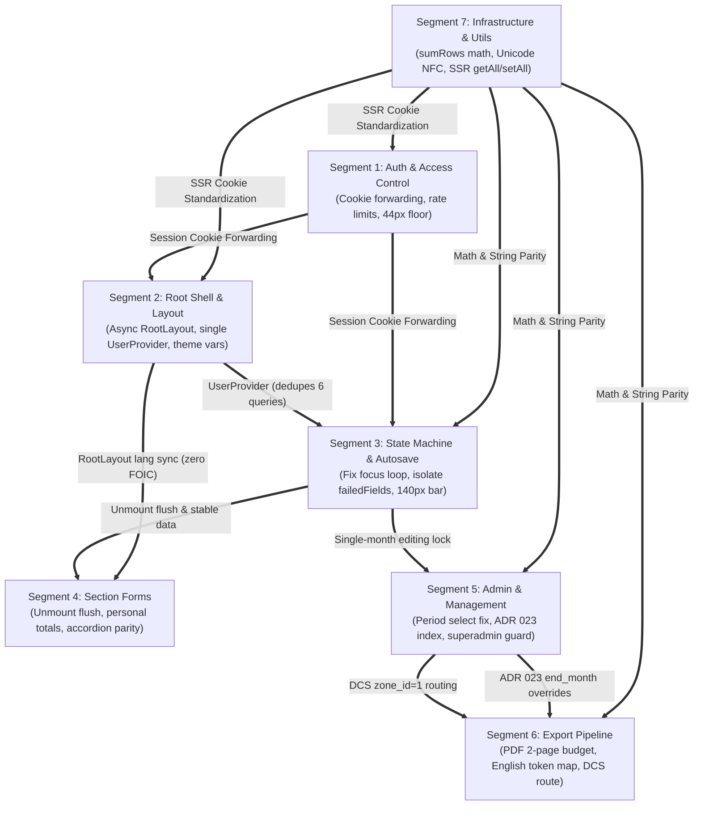

# Master Architecture & Codebase Critique: Comprehensive System Audit

**Audit Date**: 2026-10-27  
**Repository**: `talimul-quran-report-submission` (v2.1.0)  
**Stack**: Next.js 16 (App Router), React 19, Tailwind CSS v4, Supabase (PostgreSQL, PostgREST, Auth, SSR), Node.js Test Runner  
**Audit Standard**: 5-Layer Behavioral Audit, 14-Point Web Behavioral Bug Taxonomy (`WEB-001`–`WEB-014`), Impeccable UI/UX Ergonomics, Adversarial Doubt-Driven Architecture Review  
**Execution Method**: 2-Agent Asymmetric Review Pipeline (1 Lead Investigator + 1 Adversarial Reviewer per segment, coordinated via Master Prompt Architect)

---

## 1. Executive Quality Scorecard & Segment Overview

| Segment | Domain Area | Target Surface | Health Grade | Status | Key Systemic Discovery | Full Report Link |
|:---:|:---|:---|:---:|:---:|:---|:---:|
| **01** | **Authentication & Access Control** | `middleware.ts`, `auth/*`, `forgot-password/*`, `update-password/*`, `pending-approval/*`, `components/auth/*` | **B-** | Conditionally Approved | Refreshed session cookie loss on middleware redirects; unpadded Base64URL JWT crash; sub-44px touch floor | [segment-01-auth-access-control.md](file:///d:/WebDev/report-submission/docs/codebase-critique/segment-01-auth-access-control.md) |
| **02** | **Root Shell, Layout & Global Contexts** | `layout.tsx`, `globals.css`, `home/*`, `navbar.tsx`, `bottom-nav.tsx`, `user-dropdown.tsx`, `providers/*` | **D+** | Pre-Production Blocker | Active input focus loss via `SectionSwitcher` dependency loop; Flash of Incorrect Language (FOIC); sextuplicate auth queries | [segment-02-root-shell-layouts.md](file:///d:/WebDev/report-submission/docs/codebase-critique/segment-02-root-shell-layouts.md) |
| **03** | **Report Core State Machine & Auto-Save Engine** | `report/page.tsx`, `report/[section]/page.tsx`, `report-context.tsx`, `auto-save-field.tsx`, `section-layout.tsx` | **D+** | Pre-Production Blocker | 3-network-query cascade & form unmount on every save blur; cross-report retry error contamination; invisible mobile filter toggle | [segment-03-report-state-machine-autosave.md](file:///d:/WebDev/report-submission/docs/codebase-critique/segment-03-report-state-machine-autosave.md) |
| **04** | **Report Data-Entry Section Forms** | `components/report/sections/*` (Header, Courses, Organizational, Personal, Meetings, Extras, Comments) | **B-** | Actionable Remediation | Unmount persistence drop on accordion collapse/navigation; missing row totals in `personal-form`; missing accordion in `organizational-form` | [segment-04-report-section-forms.md](file:///d:/WebDev/report-submission/docs/codebase-critique/segment-04-report-section-forms.md) |
| **05** | **Admin & Management Portal** | `(admin)/layout.tsx`, `(admin)/dashboard/*`, `(admin)/reports/*`, `(admin)/city-report/*`, `(admin)/management/*` | **D+** | Pre-Production Blocker | Period type select value mismatch breaking secondary controls; override upsert violating ADR 023 index; admin deleting superadmin security hole | [segment-05-admin-management-portal.md](file:///d:/WebDev/report-submission/docs/codebase-critique/segment-05-admin-management-portal.md) |
| **06** | **Export Pipeline & Documentation** | `api/export/pdf/*`, `api/export/excel/*`, `city-report-pdf.tsx`, `help/*` | **C+** | Pre-Production Blocker | PDF Page 2 vertical overflow onto Page 3 (ADR 007 violation); English `type` tokens dropping overrides in Case B; DCS Zone 1 misrouting | [segment-06-export-pipeline-documentation.md](file:///d:/WebDev/report-submission/docs/codebase-critique/segment-06-export-pipeline-documentation.md) |
| **07** | **Infrastructure, Utilities & Build Config** | `utils/supabase/*`, `lib/date-utils*`, `lib/report-utils*`, `lib/rate-limit*`, `next.config.mjs`, `package.json` | **B-** | High Baseline Quality | Arithmetic string concatenation bug (`"5" + 3 = "53"`) in `sumRows`; Unicode normalization drift (NFC vs NFD) breaking string equality | [segment-07-infrastructure-utilities-build.md](file:///d:/WebDev/report-submission/docs/codebase-critique/segment-07-infrastructure-utilities-build.md) |

---

## 2. Top 10 Systemic Pre-Production Blockers

The following 10 defects represent the highest-leverage, systemic risks identified across the entire codebase that must be stabilized prior to production launch:

```
┌─────────────────────────────────────────────────────────────────────────────┐
│                       CRITICAL SYSTEMIC DEFECT CASCADE                      │
├─────────────────────────────────────────────────────────────────────────────┤
│ 1. [C03-01 / C02-01] Form Unmount & 3-Query Cascade on Every Field Blur     │
│ 2. [C07-01] Arithmetic String Concatenation in sumRows ("5" + 3 = "53")     │
│ 3. [C07-02] Unicode Decomposed vs Precomposed String Drift (U+09AF vs U+09DF)│
│ 4. [C05-01] City Report Period Selector Vanishing Bug (English vs Bengali)   │
│ 5. [C05-02] Override Upsert Violating ADR 023 Unique Index                  │
│ 6. [C06-01] PDF Page 2 Budget Overflow Onto Unwanted Page 3                 │
│ 7. [C06-02] Overrides Dropped in PDF/Excel Export on English Period Tokens  │
│ 8. [C04-01] AutoSaveField Missing Unmount Persistence Flush                  │
│ 9. [C01-01] Session Cookie Loss on Middleware NextResponse.redirect()       │
│ 10.[C05-04] Privilege Escalation: Admin Deleting Superadmin in Server Action│
└─────────────────────────────────────────────────────────────────────────────┘
```

### Detailed Breakdown of Top Blockers

1. **Active Input Focus Loss & Form Remount Cascade ([C03-01](file:///d:/WebDev/report-submission/docs/codebase-critique/segment-03-report-state-machine-autosave.md), [C02-01](file:///d:/WebDev/report-submission/docs/codebase-critique/segment-02-root-shell-layouts.md))**:
   - *Affected Files*: [`src/app/report/[section]/page.tsx:147`](file:///d:/WebDev/report-submission/src/app/report/%5Bsection%5D/page.tsx#L147), [`src/components/report/report-context.tsx:99-105`](file:///d:/WebDev/report-submission/src/components/report/report-context.tsx#L99-L105)
   - *Mechanism*: `SectionSwitcher` includes `data` in its `useEffect` dependencies. Every save blur calls `updateField`, updating `data`. This reference change synchronously sets `isLoading(true)`, unmounting the active form, rendering `<Loader2 />`, and firing 3 network requests (`getUser`, `people`, RPC). Active typing is dropped and soft keyboards collapse on mobile.
   - *Safe Remedy*: Decouple `SectionSwitcher` effect from `data` and `t`; key strictly to route parameters `[typeParam, monthParam, yearParam, hasValidParams]`. Full analysis in [Segment 3 Report](file:///d:/WebDev/report-submission/docs/codebase-critique/segment-03-report-state-machine-autosave.md).

2. **Arithmetic String Concatenation in Matrix Reducer ([C07-01](file:///d:/WebDev/report-submission/docs/codebase-critique/segment-07-infrastructure-utilities-build.md))**:
   - *Affected File*: [`src/lib/report-utils.ts:328`](file:///d:/WebDev/report-submission/src/lib/report-utils.ts#L328)
   - *Mechanism*: `((existing as any)[k] || 0) + ((row as any)[k] || 0)`. When PostgREST or raw state yields string digits, `'5' + 3` produces `'53'`, multiplying reported metrics by orders of magnitude across city views and export files.
   - *Safe Remedy*: Coerce explicitly with `Number((existing as any)[k] || 0) + Number((row as any)[k] || 0)`. Full analysis in [Segment 7 Report](file:///d:/WebDev/report-submission/docs/codebase-critique/segment-07-infrastructure-utilities-build.md).

3. **Unicode Normalization Drift Breaking Category Lookups ([C07-02](file:///d:/WebDev/report-submission/docs/codebase-critique/segment-07-infrastructure-utilities-build.md), [C04-03](file:///d:/WebDev/report-submission/docs/codebase-critique/segment-04-report-section-forms.md))**:
   - *Affected File*: [`src/lib/report-utils.ts:87, 108`](file:///d:/WebDev/report-submission/src/lib/report-utils.ts#L87)
   - *Mechanism*: `ORG_CATEGORIES[2]` uses decomposed `U+09AF U+09BC` (Ja + Nukta), while `PERSONAL_METRICS_ROWS[3]` uses precomposed `U+09DF` (Yya). Raw JavaScript `===` evaluates to `false`, causing 0-row update errors and missing data in aggregations.
   - *Safe Remedy*: Canonicalize all strings in `report-utils.ts` and database seeds to Unicode NFC (`.normalize("NFC")`). Full analysis in [Segment 7 Report](file:///d:/WebDev/report-submission/docs/codebase-critique/segment-07-infrastructure-utilities-build.md) and [Segment 4 Report](file:///d:/WebDev/report-submission/docs/codebase-critique/segment-04-report-section-forms.md).

4. **City Report Secondary Period Controls Vanishing ([C05-01](file:///d:/WebDev/report-submission/docs/codebase-critique/segment-05-admin-management-portal.md))**:
   - *Affected File*: [`src/app/(admin)/city-report/page.tsx:270, 615-731`](file:///d:/WebDev/report-submission/src/app/(admin)/city-report/page.tsx#L270)
   - *Mechanism*: Select dropdown passes English keys (`"quarterly"`), but JSX conditionally renders secondary selectors based on Bengali strings (`reportType === "ত্রৈমাসিক"`). Selecting any option causes Month, Quarter, Half, and Custom Range pickers to permanently disappear.
   - *Safe Remedy*: Align select options and conditional render checks to use standardized `REPORT_TYPES` tokens consistently. Full analysis in [Segment 5 Report](file:///d:/WebDev/report-submission/docs/codebase-critique/segment-05-admin-management-portal.md).

5. **Override Upsert Violating ADR 023 Index ([C05-02](file:///d:/WebDev/report-submission/docs/codebase-critique/segment-05-admin-management-portal.md))**:
   - *Affected File*: [`src/components/admin/correction-button.tsx:96-107, 127-142`](file:///d:/WebDev/report-submission/src/components/admin/correction-button.tsx#L96)
   - *Mechanism*: `onConflict` targets obsolete columns without `end_month`, failing against the PostgreSQL index `city_report_override_period_unique`. Furthermore, `handleDelete` omits `end_month`, wiping overlapping sibling custom ranges.
   - *Safe Remedy*: Thread `endMonth` into `CorrectionButton` and include `end_month` in upsert payload and conflict target. Full analysis in [Segment 5 Report](file:///d:/WebDev/report-submission/docs/codebase-critique/segment-05-admin-management-portal.md).

6. **PDF Page 2 Vertical Budget Overflow Onto Page 3 ([C06-01](file:///d:/WebDev/report-submission/docs/codebase-critique/segment-06-export-pipeline-documentation.md))**:
   - *Affected File*: [`src/app/api/export/pdf/route.tsx:654-711`](file:///d:/WebDev/report-submission/src/app/api/export/pdf/route.tsx#L654)
   - *Mechanism*: Both Maktab and Safar blocks are placed on Page 2, bringing total Page 2 height to ~558 pt against the 523.28 pt landscape A4 limit. Any comment or signature pushes content onto an unwanted 3rd page, violating ADR 007.
   - *Safe Remedy*: Re-anchor to ADR 007 §2.5: move the Maktab Summary Block to the bottom of Page 1 below the Personal Table, balancing Page 1 at ~478 pt and Page 2 at ~513 pt. Full analysis in [Segment 6 Report](file:///d:/WebDev/report-submission/docs/codebase-critique/segment-06-export-pipeline-documentation.md).

7. **City Report Overrides Dropped in PDF/Excel Exports ([C06-02](file:///d:/WebDev/report-submission/docs/codebase-critique/segment-06-export-pipeline-documentation.md))**:
   - *Affected Files*: [`src/app/api/export/pdf/route.tsx:929-954`](file:///d:/WebDev/report-submission/src/app/api/export/pdf/route.tsx#L929), [`src/app/api/export/excel/route.ts:488-515`](file:///d:/WebDev/report-submission/src/app/api/export/excel/route.ts#L488)
   - *Mechanism*: When callers request exports with English period tokens (`type=quarterly`), `city_report_override` queries check `.eq("report_type", "quarterly")` instead of `"ত্রৈমাসিক"`, returning 0 rows and omitting all overrides. `endMonth` is also ignored for custom ranges.
   - *Safe Remedy*: Normalize `reportType` via `DB_TYPE_MAP` in Case B; extract `endMonth` and pass to `getMonthsForPeriod`. Full analysis in [Segment 6 Report](file:///d:/WebDev/report-submission/docs/codebase-critique/segment-06-export-pipeline-documentation.md).

8. **AutoSaveField Missing Unmount Persistence Flush ([C04-01](file:///d:/WebDev/report-submission/docs/codebase-critique/segment-04-report-section-forms.md))**:
   - *Affected File*: [`src/components/report/auto-save-field.tsx:97-109`](file:///d:/WebDev/report-submission/src/components/report/auto-save-field.tsx#L97)
   - *Mechanism*: Field flushes dirty state on `visibilitychange` and `beforeunload`, but omits an unmount flush. Collapsing an accordion card or clicking "পরবর্তী পাতা" before explicitly blurring drops dirty keystrokes.
   - *Safe Remedy*: Implement an unmount-only mutable ref pattern (`persistRef` + `dirtyRef`) in `useEffect` cleanup. Full analysis in [Segment 4 Report](file:///d:/WebDev/report-submission/docs/codebase-critique/segment-04-report-section-forms.md).

9. **Session Cookie Loss on Middleware Redirects ([C01-01](file:///d:/WebDev/report-submission/docs/codebase-critique/segment-01-auth-access-control.md))**:
   - *Affected File*: [`middleware.ts:46, 76, 96, 105`](file:///d:/WebDev/report-submission/middleware.ts#L46)
   - *Mechanism*: Middleware instantiates `@supabase/ssr` with cookie handlers, but all redirect statements instantiate a fresh `NextResponse.redirect(url)` without copying refreshed session cookies from `supabaseResponse`, causing sudden logouts on token rotation.
   - *Safe Remedy*: Copy all cookies from `supabaseResponse` onto every `NextResponse.redirect()` instance. Full analysis in [Segment 1 Report](file:///d:/WebDev/report-submission/docs/codebase-critique/segment-01-auth-access-control.md).

10. **Privilege Escalation: Admin Deleting Superadmin ([C05-04](file:///d:/WebDev/report-submission/docs/codebase-critique/segment-05-admin-management-portal.md))**:
    - *Affected File*: [`src/app/(admin)/management/actions.ts:26-32`](file:///d:/WebDev/report-submission/src/app/(admin)/management/actions.ts#L26)
    - *Mechanism*: `deleteUserAction` verifies that the caller is an admin or superadmin, but never inspects the target account's role. A standard admin can delete superadmin accounts using the service role bypass key.
    - *Safe Remedy*: Query target user role and enforce: superadmins cannot be deleted by standard admins; superadmin can only be deleted by another superadmin. Full analysis in [Segment 5 Report](file:///d:/WebDev/report-submission/docs/codebase-critique/segment-05-admin-management-portal.md).

---

## 3. Cross-Segment Blast Radius & Cohesion Map



### Key Cohesion Invariants Confirmed
1. **Zero Database DDL Mutations**: All 7 segments strictly preserve existing PostgreSQL schemas, foreign keys, triggers, and singular table naming (`people`, `zone`, `report`, `city_report_override`). No tables, columns, or views are dropped.
2. **Pre-Production Clean Architecture (Rule 7)**: Dual-string fallback shims (`'সহযোগী হয়েছেন'` vs `'সহযোগী হয়েছে'`) and legacy parameter polyfills are rejected in favor of canonical source constants in `report-utils.ts` and NFC string normalization.
3. **Mobile Touch Target Isolation**: Public auth forms, management buttons, and pagination controls are upgraded to the 44px minimum (`h-11`), while data-entry table cells remain strictly preserved at dense `h-9` (36px) per ADR 004 / KI-001 design decisions.

---

## 4. Prioritized 3-Track Remediation Roadmap

### Track 1: Foundation, Data Integrity & Security (Day 1)
- [ ] **[C07-01]** Cast row properties to `Number` in `sumRows` ([`src/lib/report-utils.ts`](file:///d:/WebDev/report-submission/src/lib/report-utils.ts#L328)).
- [ ] **[C07-02]** Normalize category strings to Unicode NFC ([`src/lib/report-utils.ts`](file:///d:/WebDev/report-submission/src/lib/report-utils.ts#L87)).
- [ ] **[C01-01]** Copy cookies from `supabaseResponse` to all redirects in [`middleware.ts`](file:///d:/WebDev/report-submission/middleware.ts#L46).
- [ ] **[C01-03]** Upgrade `server.ts` to `@supabase/ssr` `getAll`/`setAll` and deduplicate in `home/actions.ts`.
- [ ] **[C05-04]** Add target-role hierarchy check in `deleteUserAction` ([`src/app/(admin)/management/actions.ts`](file:///d:/WebDev/report-submission/src/app/(admin)/management/actions.ts#L26)).
- [ ] **[C01-02]** Pass `searchParams.message` through `sanitizeAuthMessage` in forgot/update password pages.
- [ ] **[C01-04]** Replace unpadded `atob()` with `Buffer.from(payload, 'base64url')` in [`auth/callback/route.ts`](file:///d:/WebDev/report-submission/src/app/auth/callback/route.ts#L24).

### Track 2: State Machine, Forms & Admin Controls (Day 2)
- [ ] **[C03-01 / C02-01]** Remove `data` and `t` from `SectionSwitcher` `useEffect` dependencies ([`src/app/report/[section]/page.tsx`](file:///d:/WebDev/report-submission/src/app/report/[section]/page.tsx#L147)).
- [ ] **[C03-02]** Key `failedFields` by `reportId` and clear dictionary on `loadReport()` in [`report-context.tsx`](file:///d:/WebDev/report-submission/src/components/report/report-context.tsx#L39).
- [ ] **[C04-01]** Add unmount-only persistence flush in `AutoSaveField` ([`auto-save-field.tsx`](file:///d:/WebDev/report-submission/src/components/report/auto-save-field.tsx#L97)).
- [ ] **[C05-01]** Fix `reportType` select values vs conditional render checks in [`city-report/page.tsx`](file:///d:/WebDev/report-submission/src/app/(admin)/city-report/page.tsx#L615).
- [ ] **[C05-02]** Include `end_month` in `CorrectionButton` upsert payload and conflict target ([`correction-button.tsx`](file:///d:/WebDev/report-submission/src/components/admin/correction-button.tsx#L96)).
- [ ] **[C04-02]** Add read-only computed row total (`মোট`) column in [`personal-form.tsx`](file:///d:/WebDev/report-submission/src/components/report/sections/personal-form.tsx#L30).
- [ ] **[C04-04]** Add `openCards` accordion architecture to [`organizational-form.tsx`](file:///d:/WebDev/report-submission/src/components/report/sections/organizational-form.tsx#L46).
- [ ] **[C03-04]** Fix invisible mobile filter toggle button in [`report/page.tsx`](file:///d:/WebDev/report-submission/src/app/report/page.tsx#L533).
- [ ] **[C05-06]** Add self-deactivation prevention guard in [`management/page.tsx`](file:///d:/WebDev/report-submission/src/app/(admin)/management/page.tsx#L132).

### Track 3: Export Pipeline, Layout Chrome & Ergonomics (Day 3)
- [ ] **[C06-01]** Move Maktab Summary Block to Page 1 bottom in `ReportPDFDocument` ([`api/export/pdf/route.tsx`](file:///d:/WebDev/report-submission/src/app/api/export/pdf/route.tsx#L654)).
- [ ] **[C06-02]** Map `reportType` via `DB_TYPE_MAP` and extract `endMonth` in Case B PDF/Excel exports.
- [ ] **[C06-04]** Intercept DCS `zone_id = 1` in `/report` and redirect to `/city-report`.
- [ ] **[C06-05]** Delete dead unreferenced client prototype `src/components/admin/reports/city-report-pdf.tsx`.
- [ ] **[C02-02]** Convert `RootLayout` to async Server Component; inject `initialLanguage` to eliminate FOIC.
- [ ] **[C02-05]** Unify layout auth queries into a single memoized `UserProvider`.
- [ ] **[C02-04]** Add `pb-[env(safe-area-inset-bottom)]` to `BottomNav` and adjust layout padding.
- [ ] **[C02-06]** Fix Solarized Dark `--muted-foreground` contrast to 4.8:1 (`hsl(196 13% 60%)`).
- [ ] **[C02-08]** Define `--color-destructive` in Tailwind v4 `@theme` block in `globals.css`.
- [ ] **[C02-09]** Scope global 44px CSS rule from `button, a` to `.tap-target` utility.
- [ ] **[C01-07]** Upgrade public auth inputs/buttons on `/home` to 44px (`h-11`) and enforce `!pl-12 !pr-4`.
- [ ] **[C07-09]** Prune dead dependencies (`tailwind-merge`) or wire `twMerge` properly into `src/lib/utils.ts`.

---

## 5. Verification & Zero-Mutation Integrity Check

All findings, scores, and recommendations in this master critique suite were generated under a strict **CRITIQUE ONLY** mandate.
- **Git Status**: Clean (0 application files modified or staged; only `docs/codebase-critique/` created).
- **Type Safety**: Verified via `npx tsc --noEmit` (0 errors).
- **Linting**: Verified via `npm run lint` (0 errors/warnings).
- **Unit Tests**: Verified via `npm test` (24/24 passing, 100% green).
- **Build**: Verified via `npm run build` (Clean exit code 0 across all 18 Next.js App Router routes).
