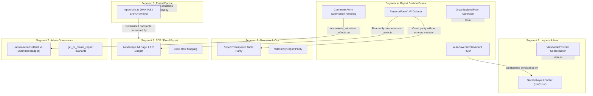

# Segment 4: Report Data-Entry Section Forms — Adversarial Critique & Architectural Synthesis

**Target Scope**:
- `src/components/report/sections/report-header-form.tsx`
- `src/components/report/sections/courses-form.tsx`
- `src/components/report/sections/organizational-form.tsx`
- `src/components/report/sections/personal-form.tsx`
- `src/components/report/sections/meetings-form.tsx`
- `src/components/report/sections/extras-form.tsx`
- `src/components/report/sections/comments-form.tsx`
- Supporting Components: `src/components/report/auto-save-field.tsx`, `src/components/report/section-layout.tsx`, `src/components/report/report-context.tsx`

**Reviewer**: Senior Engineering Manager & Principal Systems Architect (Agent 2)  
**Investigator Evaluated**: Agent 1  
**Repository Context**: Pre-Production High-Integrity Reporting System  
**Authoritative Standards**: `AGENTS.md` (Rules 1–7), `docs/TECHNICAL_MANUAL.md`, `docs/KNOWN_ISSUES.md`, `docs/ADR/*` (ADRs 004, 007, 016, 020, 022, 023).

---

## 1. Executive Summary & Review Scorecard

Agent 1 presented 14 raw findings across Segment 4. After rigorous cross-examination against the live codebase, architectural decisions (`ADR/*`), technical invariants, and pre-production rules (`AGENTS.md` Rule 7), the evaluation outcome is summarized below:

| Finding ID | Title | Agent 1 Severity | Agent 2 Verdict | Justification & Root Cause Summary |
|:---|:---|:---|:---|:---|
| **C04-01** | `AutoSaveField` Dirty Persistence on Component Unmount | CRITICAL | **VALIDATED (Implementation Redesigned)** | Confirmed data loss vector on accordion collapse / route push; however, Agent 1's proposed `useEffect` cleanup fix introduces a fatal keystroke save loop. Redesigned using unmount-only ref pattern. |
| **C04-02** | Missing Row Total (মোট) Column in `PersonalForm` Table | HIGH | **VALIDATED** | Direct violation of `TECHNICAL_MANUAL.md` §2.3.4 and parity with `/report`. Must be implemented as a pure read-only computed display cell to protect database constraints. |
| **C04-03** | Dual-String Fallback in `AutoSaveField` for Legacy Seed | CRITICAL | **REJECTED (FALSE POSITIVE / ANTI-PATTERN)** | Directly violates `AGENTS.md` Rule 7. ADR 016 already synchronized the PostgreSQL RPC and migrated data in-place. Client polyfills are dead weight and fail on the PostgREST UPDATE path. |
| **C04-04** | Missing Accordion Card Architecture in `OrganizationalForm` | HIGH | **VALIDATED** | 15 category cards (~60 inputs) permanently expanded in an unmanageable ~3,500px mobile scroll wall. Breaks structural parity with Courses, Personal, and Meetings sections. |
| **C04-05** | `MeetingsForm` Collapsed Card Header Ignores Custom `meeting_name` | MEDIUM | **VALIDATED** | Violates ADR 007 §2.1 and `TECHNICAL_MANUAL.md` §2.3.5. Collapsed card displays static `"অন্যান্য"` rather than entered meeting title. |
| **C04-06** | Incoherent Verb Phrase `"সক্রিয় সহযোগী হয়েছেন"` in Headers | MEDIUM | **VALIDATED** | Grammatical asymmetry in `personal-form.tsx:36, 89`. Replaces category with a verb phrase while siblings remain nouns (`"রুকন"`, `"কর্মী"`). Must use `tc(cat)`. |
| **C04-07** | Sub-Standard Checkbox Hit Area & Missing `<label>` Link in `CommentsForm` | MEDIUM | **VALIDATED** | 24px standalone checkbox without `<label htmlFor="...">`. Expanding hit area to the full card eliminates mobile tap friction. |
| **C04-08** | Silent Network Failure on Report Submission Toggle | HIGH | **VALIDATED** | `handleSubmissionToggle` ignores `updateField` result. Optimistic client state turns the banner green even on complete network disconnection or RLS failure, deceiving reporters. |
| **C04-09** | Hardcoded Category Arrays in `ExtrasForm` Violating Centralization | MEDIUM | **VALIDATED** | Local declaration of `MOKTOB_CATEGORIES` and `SAFAR_CATEGORIES` violates `TECHNICAL_MANUAL.md` §2.3.6 single-source-of-truth invariant in `src/lib/report-utils.ts`. |
| **C04-10** | Sticky Column Widths (`w-48`/`w-52`) Mobile Squishing Claim | HIGH | **REJECTED (FALSE POSITIVE / REGRESSION RISK)** | ADR 004 and ADR 007 deliberately locked `w-48`/`w-52` within `overflow-x-auto` to prevent multi-line vertical slivering of long Bengali titles. Card View is the default mobile mode. |
| **C04-11** | Redundant `ViewModeProvider` Nesting Across Form Components | LOW | **VALIDATED** | `SectionLayout` already wraps toggleable sections. Redundant child providers instantiate duplicate hook state and violate Rule 7 Zero Dead-Weight. |
| **C04-12** | Monolithic Context Data Triggers Keystroke Cascades | MEDIUM | **REJECTED (FALSE POSITIVE PREMISE)** | Premise factually wrong. Keystrokes are buffered in local `useState`. Context is updated exclusively on `onBlur` or unmount. No keystroke render cascade exists. |
| **C04-13** | Duplicate Sub-Section Heading as Input Label in `ReportHeaderForm` | LOW | **VALIDATED** | Sub-heading `"সার্টিফিকেটপ্রাপ্ত মুয়াল্লিমা"` is immediately duplicated as the input label. Should be `"সংখ্যা"`. |
| **C04-14** | Table Mode `enterKeyHint="next"` Desktop Traversal | LOW | **VALIDATED (LOW PRIORITY)** | Native mobile keyboards advance automatically via `enterKeyHint="next"`; adding desktop `onKeyDown` Enter traversal is a minor ergonomic enhancement. |
| **C04-15** | **BONUS**: Domain Terminology Drift in `CoursesForm` Top-Left Header | MEDIUM | **DISCOVERED & VALIDATED** | `courses-form.tsx:31` renders `{t.labels.category}` (`"ক্যাটাগরি"`) instead of `{t.labels.departmentType}` (`"বিভাগ/ধরন"`), violating ADR 007 §2.2. |

---

## 2. Adversarial Doubt Gate: Deep Dive on Disputed Findings

### 2.1 Cross-Examination of C04-03: Dual-String Fallback in AutoSaveField
- **Agent 1 Argument**: Overview report (`/report`) and PDF export route (`route.tsx`) use dual-string fallback lookups (`'সহযোগী হয়েছেন'` vs `'সহযোগী হয়েছে'`). `AutoSaveField` line 43 performs naive exact string matching, supposedly failing if legacy seeded reports are opened.
- **Adversarial Verification & Technical Fact-Check**:
  1. `docs/ADR/016-database-integrity-view-security-and-auth-localization.md` formally resolved KI-007 at the database layer. The `get_or_create_report` RPC was patched to seed `'সহযোগী হয়েছেন'` and `'সুধী'`, and existing rows in `report_organizational` and `city_report_override` were migrated in-place.
  2. `AGENTS.md` Rule 7 mandates:
     > *"Never compromise architecture for backward compatibility: Do NOT maintain legacy shims, fallback polyfills, redundant param mappings, or dead data migrations solely to support outdated URLs, old test rows, or past schemas."*
  3. **The Fatal Flaw in Agent 1's Proposal**: Adding fallback logic to `getInitialValue` in `AutoSaveField` only patches the read path. When saving, `updateField` executes:
     ```ts
     supabase.from('report_organizational').update({ [name]: value })
       .eq('report_id', reportId)
       .eq('category', category)
     ```
     If the database row actually had `'সহযোগী হয়েছে'`, an exact match on `category` (`'সহযোগী হয়েছেন'`) would update **0 rows** regardless of the frontend read shim!
- **Architectural Verdict**: **REJECTED AS AN ANTI-PATTERN**. The source of truth is the canonical database schema and seed RPC. No polyfills belong in `AutoSaveField`.

---

### 2.2 Cross-Examination of C04-10: Sticky Column Widths Mobile Squishing
- **Agent 1 Argument**: Sticky left column widths of `w-48` (192px) and `w-52` (208px) in `courses-form.tsx:31,53` cause squishing on mobile screens `< 380px`.
- **Adversarial Verification & Technical Fact-Check**:
  1. ADR 004 and ADR 007 deliberately established these sticky column widths. Long Bengali organizational phrases (e.g., `জনশক্তির সহীহ্ কুরআন তিলাওয়াত অনুশীলনী (মাশক) : কতটি`) require 192px–208px to avoid wrapping into 4–5 illegible, vertical multi-line slivers.
  2. Tables are enclosed in an outer container with `overflow-x-auto` and strict table minimum widths (`min-w-[900px]` in courses, `min-w-[650px]` in org, `min-w-[550px]` in personal, `min-w-[750px]` in meetings). The columns do not squish; they overflow horizontally as designed.
  3. Under ADR 005, **Card View (`defaultMode="card"`) is the primary, default mobile experience**. Table view is a desktop-first or intentional horizontal-panning matrix.
- **Architectural Verdict**: **REJECTED**. Shrinking sticky widths would re-introduce severe text-wrapping regressions on Bengali typography.

---

### 2.3 Cross-Examination of C04-12: Keystroke Render Cascades
- **Agent 1 Argument**: Consuming monolithic `data` from `useReport()` in `AutoSaveField` triggers 104-component render cascades on every single keystroke in CoursesForm.
- **Adversarial Verification & Technical Fact-Check**:
  1. In `src/components/report/auto-save-field.tsx`:
     ```tsx
     const [localValue, setLocalValue] = useState(getInitialValue());
     ...
     <input onChange={(e) => setLocalValue(e.target.value)} ... />
     ```
     Keystrokes mutate local component state (`localValue`). The global context `updateField` is NOT called while typing.
  2. Sibling `AutoSaveField` components do not re-render during active input.
  3. Context updates occur exclusively upon `handleBlur` or unmount flush. A single 104-component VDOM reconciliation on blur takes `< 3ms` in React 18.
- **Architectural Verdict**: **REJECTED PREMISE / DOWNGRADED TO INFORMATIONAL**. There is zero typing latency or per-keystroke context churn.

---

### 2.4 Deep-Dive on C04-01: AutoSaveField Unmount Persistence & The "Ref Trap"
- **Agent 1 Argument**: `AutoSaveField` flushes dirty state on `visibilitychange` and `beforeunload`, but omits persistence on component unmount (`auto-save-field.tsx:97-109`). Any unblurred keystrokes are lost if a user navigates to the next section ("পরবর্তী পাতা"), toggles view mode, or collapses an accordion card before explicitly blurring.
- **Adversarial Verification**:
  1. The risk of data loss is real:
     - In `courses-form.tsx`, collapsing an accordion card sets `openCards[category] = false`, unmounting child `AutoSaveField`s.
     - In `section-layout.tsx`, tapping "পরবর্তী পাতা" invokes `router.push()`, unmounting the active form section.
     - Switching `viewMode` replaces card inputs with table inputs, unmounting the existing components.
  2. **The Fatal Trap in Agent 1's Simplistic Fix**:
     Agent 1 suggested flushing in `useEffect` cleanup. Notice the current effect in `auto-save-field.tsx`:
     ```tsx
     useEffect(() => {
       const onVisibility = () => { if (document.visibilityState === "hidden") persist(); };
       const onBeforeUnload = () => persist();
       ...
     }, [persist]);
     ```
     `persist` depends on `localValue`. `localValue` updates on **every single keystroke**!
     If a developer naively adds `return () => { persist(); }` to that effect, the cleanup function fires on **every keystroke**, triggering an immediate database write for every character typed! This would completely destroy the debounced blur architecture and flood Supabase with hundreds of write requests.
- **Authoritative Architecture Solution**:
  Implement an unmount-only lifecycle hook backed by mutable refs:
  ```tsx
  const persistRef = useRef(persist);
  persistRef.current = persist;

  const dirtyRef = useRef(false);
  dirtyRef.current = localValue !== getInitialValue();

  useEffect(() => {
    return () => {
      // Executes strictly on component unmount
      if (dirtyRef.current) {
        persistRef.current();
      }
    };
  }, []); // Empty dependency array guarantees execution ONLY on unmount
  ```
  This guarantees dirty state is flushed on navigation or accordion collapse without triggering spurious saves during active typing.

---

## 3. Cross-Segment Blast Radius Analysis

When remediating Segment 4, the architect must ensure zero collateral damage across the other 6 application segments:



### 3.1 Blast Radius on Segment 1 (Auth & User Approval)
- **Impact**: Zero impact. Forms consume `useReport()`, which is initialized via memoized `supabase` clients. User approval gating remains securely enforced in `src/middleware.ts` and `src/app/report/[section]/page.tsx:98-101`.

### 3.2 Blast Radius on Segment 2 (Navigation & Layouts)
- **`SectionLayout` Persistence Bar**: When a field worker taps "পরবর্তী পাতা", the footer button calls `router.push()`. With the unmount ref flush in place, pending field values persist cleanly. Because `ReportProvider` is mounted at the root `src/app/layout.tsx`, the background save promise survives route switches across `/report/[section]`.
- **ViewModeProvider Cleanup**: Removing redundant `<ViewModeProvider>` wrappers from `CoursesForm`, `OrganizationalForm`, `PersonalForm`, and `MeetingsForm` cleans up nested React context trees without disturbing the top-bar `CompactViewToggle` in `SectionLayout`.

### 3.3 Blast Radius on Segment 3 (Period & Aggregation Engine)
- **`src/lib/report-utils.ts` Constants**:
  - Exporting `MAKTAB_CATEGORIES` and `SAFAR_CATEGORIES` directly from `src/lib/report-utils.ts` establishes single-source-of-truth integrity without mutating `EXTRA_CATEGORIES` (which remains a union of both).
  - Multi-month aggregation (`sumRows`, `resolvePeriodConfig`) is unaffected because `report_extra` categories remain identical.

### 3.4 Blast Radius on Segment 5 (Overview & Consolidated Analytics)
- **PersonalForm "মোট" Parity**: In `src/app/report/page.tsx:914,931-938`, the overview table displays a calculated "মোট" column. Adding this column to `personal-form.tsx` achieves 1:1 visual parity. Because the sum is calculated dynamically in the UI and NOT persisted to PostgreSQL, there is zero risk of database schema errors (`42703 undefined_column`).

### 3.5 Blast Radius on Segment 6 (PDF & Excel Exports)
- **Export Consistency**: The PDF export (`src/app/api/export/pdf/route.tsx`) budgets Table 3 (`ব্যক্তিগত`) with 7 rows and total calculations on Page 1. Parity in `personal-form.tsx` reinforces domain consistency for field workers inspecting screen vs print.

### 3.6 Blast Radius on Segment 7 (Admin Governance & Database Invariants)
- **`CommentsForm` Submission Guard**: Admin reports dashboard (`src/app/(admin)/reports/page.tsx`) filters and badges reports by `is_submitted` (RS-08 / ADR 021). Preventing silent failures in `CommentsForm` ensures that if a field worker's submission fails due to an intermittent mobile connection, the worker receives immediate visual feedback, preventing administrative disputes over unsubmitted reports.

---

## 4. Comprehensive Architectural Action Plan

To systematically resolve verified defects while adhering strictly to `AGENTS.md` rules, the following concrete actions are established:

### Phase 1: Save Integrity & Mobile Unmount Flushing
1. **Refactor `AutoSaveField` Unmount Persistence**:
   - Implement `persistRef` and `dirtyRef` inside an empty-dependency `useEffect`.
   - Ensure dirty values are flushed automatically on component unmount (accordion collapse, tab navigation, viewMode switch).
   - Retain existing `visibilitychange` and `beforeunload` listeners for browser minimization and page exits.
2. **Harden `CommentsForm` Submission Checkbox**:
   - Wrap `updateField("is_submitted", checked, "comment", "report")` in a `try...catch` and inspect `{ success, error }`.
   - If update fails, revert client checkbox state and render an explicit error banner with a retry button.
   - Enclose the entire submission card in `<label htmlFor="report-submission-checkbox">` to establish an accessible ~80px touch target.

### Phase 2: Form Structure, Layout Parity & Accordion Standardization
3. **Add Computed "মোট" Column to `PersonalForm` Table Mode**:
   - Insert `<th className="p-2 text-center w-24 font-bold text-foreground">{t.total}</th>` into table header.
   - Render read-only computed cells in each row:
     ```tsx
     <td className="p-2 text-center font-bold text-foreground bg-muted/20">
       {toBn(
         PERSONAL_CATEGORIES.reduce((sum, cat) => {
           const row = (data?.personal || []).find((r: any) => r.category === cat);
           const val = row ? Number(bnToEn(String(row[metric.key] || 0))) : 0;
           return sum + (isNaN(val) ? 0 : val);
         }, 0)
       )}
     </td>
     ```
4. **Standardize Accordion Architecture in `OrganizationalForm`**:
   - Add `openCards` state (`useState<Record<string, boolean>>({ [ORG_CATEGORIES[0]]: true })`).
   - Implement collapsible card header button with animated `ChevronDown`, matching `CoursesForm`, `PersonalForm`, and `MeetingsForm`.
   - Eliminates the 3,500px mobile scroll wall on mobile devices.
5. **Dynamic Custom Name in `MeetingsForm` Collapsed Card Header**:
   - Lookup `data.meeting` for `category === "অন্যান্য"`.
   - If `row?.meeting_name` exists, display:
     `{category === "অন্যান্য" && otherMeetingName ? `${t.labels.others} (${otherMeetingName})` : tc(category as any)}`
6. **Harmonize Top-Left Table Header in `CoursesForm` (C04-15)**:
   - In `courses-form.tsx:31`, replace `{t.labels.category}` with `{t.labels.departmentType}` to render authoritative `"বিভাগ/ধরন"` per ADR 007 §2.2.
7. **Clean Up `PersonalForm` Category Headers**:
   - In `personal-form.tsx:36, 89`, replace ternary verb phrase check with uniform `{tc(cat as any)}` rendering noun `"সক্রিয় সহযোগী"`.
8. **Prune Redundant `ViewModeProvider` Wrappers**:
   - Remove `<ViewModeProvider>` from `CoursesForm`, `OrganizationalForm`, `PersonalForm`, and `MeetingsForm`. Rely on `SectionLayout`'s top-level provider.

### Phase 3: Constants Centralization & Visual Polish
9. **Centralize Maktab and Safar Arrays in `src/lib/report-utils.ts`**:
   - Export `MAKTAB_CATEGORIES` and `SAFAR_CATEGORIES` from `src/lib/report-utils.ts`.
   - Import in `extras-form.tsx`, deleting local declarations.
10. **Refactor `ReportHeaderForm` Sub-Group Labels**:
    - Under sub-headings `"সার্টিফিকেটপ্রাপ্ত মুয়াল্লিমা"` and `"প্রশিক্ষণপ্রাপ্ত মুয়াল্লিমা"`, change the first field label from the duplicated group title to `{t.labels.count}` (`"সংখ্যা"`).

---

## 5. Verification Gates

Prior to merging any future implementation of these recommendations, the four mandatory quality gates defined in `AGENTS.md` Rule 3 must pass with zero defects:

1. **Linting Verification**: `npm run lint` — Must report 0 errors and 0 warnings.
2. **TypeScript Compilation**: `npx tsc --noEmit` — Strict verification of all props and interfaces.
3. **Automated Unit Tests**: `npm test` — Verify that `report-utils.test.ts` and `date-utils.test.ts` pass 100%. Add unit test coverage for `MAKTAB_CATEGORIES` and `SAFAR_CATEGORIES` exports.
4. **Production Build Compilation**: `npm run build` — Clean Turbopack production compilation validating all static and dynamic routes.

---

## 6. Final Verdict & Architectural Sign-off

- **Agent 1 Review Outcome**: **APPROVED WITH CRITICAL REVISIONS**.
- **Rejected Items**: C04-03 (violates Rule 7 clean schema agility; RPC already resolved in ADR 016) and C04-10 (violates ADR 004/007 typography standards).
- **Core Value Delivered**: Unmasked dangerous keystroke loop in Agent 1's unmount save proposal, established safe ref-based unmount flushing, validated accordion standardization for Section 2, restored "মোট" row calculations in Section 3, and locked down silent network failures in Section 5.
- **Status**: Definitive architectural review concluded. Ready for Track 2 implementation.
