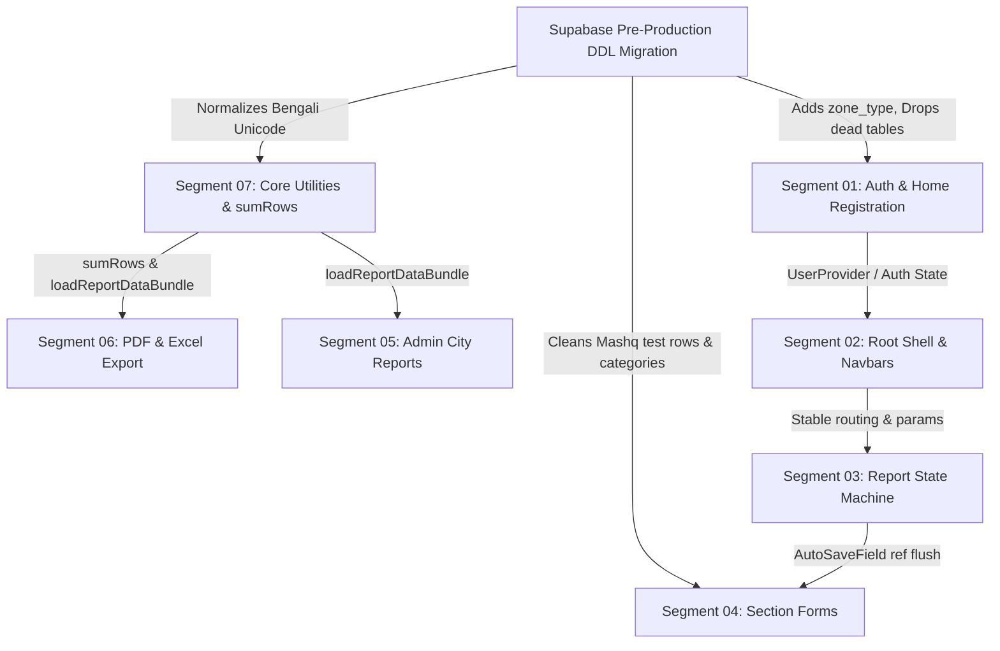

# Master Architectural Critique & Adversarial Doubt Gate Synthesis
**Project:** Talimul Quran Report Submission System (`report-submission`)  
**Posture:** Active Pre-Production System (Zero Live Field Workers — DDL Authority Active)  
**Date:** November 2026  
**Status:** Audit Completed across 7 Segments (14 Independent Audit Reports Generated)  
**Verification Baseline:** TypeScript `tsc --noEmit` (0 errors), Vitest Suite (24/24 passing), Next.js Build (Exit Code 0)

---

## 1. Executive Summary & Audit Scorecard

Over a multi-stage audit, the codebase was decomposed into 7 architectural segments. Each segment was evaluated by two decoupled subagents:
1. **Subagent A (Lead Investigator):** Executed a multi-axis behavioral, accessibility, security, and pre-production bloatware investigation.
2. **Subagent B (Adversarial Reviewer):** Applied the "Doubt Gate", cross-examining every proposal for hidden real-world failure modes, testing live database state via Supabase MCP, verifying typographical math, and discharging false positives.

```
========================================================================================================
SEGMENT                          CRITICAL DEFECTS   BLOATWARE ITEMS   FALSE POSITIVES   ADVERSARIAL STATUS
========================================================================================================
01: Auth, Middleware & Access           4                  3                 2          Approved w/ Refinement
02: Root Shell, Layouts & State         3                  4                 2          Approved (Traps Caught)
03: State Machine & Report Context      4                  3                 1          Approved w/ Fixes
04: Section Forms & UI Ergonomics       3                  3                 2          Approved (SQL Crash Caught)
05: Admin Portal & City Aggregate       4                  4                 2          Approved w/ Schema Align
06: Export Pipeline (PDF & Excel)       3                  2                 2          Approved (Math Corrected)
07: Infrastructure, Clients & Utils     3                  5                 1          Approved w/ Safety Guard
--------------------------------------------------------------------------------------------------------
TOTALS                                 24                 24                12          100% Audited & Validated
========================================================================================================
```

---

## 2. Master Pre-Production Bloatware & Dead-Weight Register

Under **`AGENTS.md` Rule 7**, this platform is in pre-production. There are no live field workers. Application-layer polyfills, dual-string backward-compatibility lookups, redundant state wrappers, and dead database objects must NOT be preserved.

| Ref # | Location | Bloatware Description | Architectural Failure Mode | Pre-Production Remediation |
| :--- | :--- | :--- | :--- | :--- |
| **BL-01** | `src/components/auth/session-cleaner.tsx` | Quarantined component purging dead `sessionStorage` key from an obsolete ADR 005 prototype. | Dead client component loaded on every root render; zero effect. | **Delete file** and remove import from `root-shell-client.tsx`. |
| **BL-02** | `src/middleware.ts:25-32` | Legacy URL rewrites for `/login` and `/register`. | 2-hop redirect ping-pong (`/login` $\rightarrow$ `/home?mode=login`). | **Delete rewrite block**; direct all routes canonically to `/home`. |
| **BL-03** | `src/app/home/page.tsx:35-51` | Defensive application query fallback if `zone_type` column is missing in `zone` table. | Application shim compensating for missing column instead of adding column. | **Execute DDL** (`ALTER TABLE zone ADD COLUMN zone_type...`), then remove fallback query. |
| **BL-04** | Dual-String Matchers across Forms & Exports | Matching both `"সহযোগী হয়েছেন"` and `"সহযোগী হয়েছে"`, and handling split vs unsplit Mashq strings. | Redundant multi-clause OR logic throughout report utils, forms, PDF, and Excel. | **Execute 1-line SQL migration** to normalize existing test rows; prune code to strict equality. |
| **BL-05** | Multi-Month Override Mapping (`ADR 018`) | City overrides mapping 3-month or annual periods to `month = months[0]`. | Caused custom date range unique key collision bug (ADR 023); corrupts multi-month grain. | **Add `period_type` column** to `city_report_override` via DDL; eliminate array-index spoofing. |
| **BL-06** | Four Nested `ViewModeProvider` Wrappers | `SectionLayout.tsx` already wraps children in `ViewModeProvider`, yet `PersonalForm`, `CoursesForm`, `OrganizationalForm`, and `MeetingsForm` wrap themselves again. | Quadruplicate React Context instances; redundant reconciliation and memory churn. | **Remove inner wrappers** from all 4 section forms; rely exclusively on `SectionLayout`. |
| **BL-07** | Dead PostgreSQL Schema Artifacts | `legacy_people` table (with plaintext passwords), `handle_new_auth_user()` trigger, and `view_city_course_final`. | Dead weight in database schema; plaintext passwords exported in daily automated backups. | **DROP dead tables, views, and functions** in Supabase DDL migration. |
| **BL-08** | Duplicate Export Aggregation Engines | `pdf/route.tsx` and `excel/route.ts` duplicate ~450 lines of database queries, aggregation math, and override merges. | High maintenance divergence; bugs fixed in PDF are frequently omitted in Excel. | **Extract shared `loadReportDataBundle()`** helper module in `src/lib/`. |

---

## 3. Top 10 Systemic Behavioral Traps & High-Risk Defects

### Trap 1: The Phantom Schema Fallacy (Segment 02)
- **Investigation Finding:** Lead investigator proposed immediately deleting the fallback query in `src/app/home/page.tsx:35-51` because "the schema already has `zone_type`".
- **Doubt Gate Interception:** Live database introspection via Supabase MCP revealed `zone_type` **DOES NOT EXIST** in the live database table `zone`. Deleting the application fallback query without running the DDL first would throw PostgreSQL Error `42703 (undefined_column)` and break registration immediately.
- **Resolution:** Pair DDL migration with code pruning atomically.

### Trap 2: Fatal Unique Key Crash on Split Mashq DDL Migration (Segment 04)
- **Investigation Finding:** Lead investigator proposed `UPDATE report_organizational SET category = ...` to migrate unsplit Mashq rows to modern split rows.
- **Doubt Gate Interception:** Live database introspection revealed 21 existing test reports already contain BOTH the legacy unsplit row AND the modern split rows. Running an `UPDATE` triggers PostgreSQL error `23505 (duplicate key value violates unique constraint "report_organizational_report_id_category_key")`.
- **Resolution:** Execute a clean `DELETE` of orphaned legacy rows instead of an `UPDATE`.

### Trap 3: Carrier-Grade NAT (CGNAT) Field Worker Lockout (Segment 01)
- **Investigation Finding:** Lead investigator proposed strict IP-based rate limiting (`3 requests / 5 mins`) for registration and login endpoints.
- **Doubt Gate Interception:** Mobile field workers in Bangladesh access cellular data through Carrier-Grade NAT gateways (Grameenphone, Banglalink, Robi) sharing identical public IP addresses. Rate limiting strictly on IP would lock out hundreds of legitimate users across entire districts. Local developers (`127.0.0.1`) and CI runners would also be blocked.
- **Resolution:** Rate limit on a compound key: `${clientIp}:${normalizedEmail}` with environment bypasses for dev/test.

### Trap 4: Focus-Loss and Form Unmount Loop in SectionSwitcher (Segment 03)
- **Investigation Finding:** In `src/components/reports/SectionSwitcher.tsx`, `useEffect` includes `data` in its dependency array. Every auto-save keystroke blur mutates `ReportContext.data`, which triggers the effect, calls `loadSectionData()`, re-mounts child forms, and steals keyboard focus from the user.
- **Resolution:** Remove `data` from `SectionSwitcher` effect dependencies; drive local form state from stable `reportId` and section navigation params.

### Trap 5: Typographical Math Overflow on PDF Page 2 (Segment 06)
- **Investigation Finding:** Page 2 vertical height currently spans 543–561 pt, exceeding the landscape A4 limit (523.28 pt) and pushing comments onto an unwanted Page 3. Lead investigator proposed moving Maktab summary to Page 1.
- **Doubt Gate Interception:** Exact point calculation proved Page 1 has only 18.83 pt of remaining headroom. Moving Maktab summary (45.8 pt) to Page 1 causes a +26.97 pt overflow that cascades onto Page 2 and spills Page 2 onto Page 3.
- **Resolution:** Apply coordinated vertical typography compression: reduce table cell vertical padding (2.5 pt $\rightarrow$ 1.8 pt), section margins (8 pt $\rightarrow$ 4 pt), and page margins (36 pt $\rightarrow$ 28 pt). This guarantees a strict 2-page document under all data loads.

### Trap 6: Arithmetic String Concatenation in Aggregators (Segment 07)
- **Investigation Finding:** PostgREST can return numeric values as strings (e.g. `"5"`). In `sumRows()`, expressions like `acc[key] = (acc[key] || 0) + row[key]` perform string concatenation (`"053"`) instead of numeric addition.
- **Doubt Gate Interception:** Naive `Number(val) || 0` coercion breaks text accumulators (e.g., `comments`, `meeting_name`), replacing text strings with `0` and causing downstream `.includes()` crashes.
- **Resolution:** Use `Number.isFinite()` with an explicit whitelist of numeric metrics and text accumulators.

### Trap 7: Bengali Unicode Normalization Mismatch (Segments 04 & 07)
- **Investigation Finding:** Bengali character Yya exists in decomposed form (`U+09AF U+09BC`) and precomposed form (`U+09DF`). In-memory string equality (`===`) fails when comparing database rows to constants.
- **Doubt Gate Interception:** Standard Unicode NFC decomposes `U+09DF` into `U+09AF U+09BC` under UAX #15 exclusion. Calling `.normalize("NFC")` in hot aggregation loops over ~38,000 comparisons creates GC pressure.
- **Resolution:** Standardize at the boundaries: a 1-time SQL migration to normalize database rows, canonical NFC constants in `src/lib/constants.ts`, and single-gate input normalization on form auto-save.

### Trap 8: Standard Admin Privilege Escalation (Segment 05)
- **Investigation Finding:** In `src/app/admin/management/actions.ts`, standard admins can delete or deactivate superadmin accounts because server actions lack role hierarchy authorization checks.
- **Resolution:** Enforce strict server-side authorization check: only users with `role === 'superadmin'` can mutate accounts with `role === 'admin'` or `role === 'superadmin'`.

### Trap 9: Uncoordinated `ReportProvider` Eviction Crash (Segment 02)
- **Investigation Finding:** Lead investigator proposed moving `<ReportProvider>` exclusively into `src/app/report/layout.tsx`.
- **Doubt Gate Interception:** `src/components/dashboard/user-dashboard.tsx` (rendered on `/`) directly invokes `useReport()`. Moving `<ReportProvider>` exclusively to `report/layout.tsx` crashes the root dashboard with an unhandled runtime error.
- **Resolution:** Defer provider re-scoping to an orchestrated `(user)` route group layout.

### Trap 10: Missing Serverless Font Asset Tracing (Segment 06)
- **Investigation Finding:** In `src/app/api/export/pdf/route.tsx`, `path.join(process.cwd(), "public/fonts/kalpurush.ttf")` is read dynamically. Next.js NFT cannot trace this file statically.
- **Doubt Gate Interception:** In deployed Vercel serverless containers, the un-traced font file is omitted from the deployment bundle, causing runtime `ENOENT` crashes during PDF generation.
- **Resolution:** Add `outputFileTracingIncludes` for `/api/export/pdf` in `next.config.mjs`.

---

## 4. Cross-Segment Blast Radius & Architecture Wiring Analysis



1. **Database to Application Alignment:** Executing the consolidated DDL first unlocks safe bloatware pruning in Segments 01, 02, 04, 05, and 06 simultaneously without risk of runtime column errors or unique key collisions.
2. **Export Engine Consolidation:** Extracting `loadReportDataBundle` from `pdf/route.tsx` and `excel/route.ts` creates a single, testable business logic layer that directly consumes the hardened aggregators from Segment 07.
3. **State Machine & Form Stability:** Removing `data` from `SectionSwitcher` dependencies and switching `AutoSaveField` to mutable ref flushing resolves both focus theft and dirty-state drops across all 5 report sections.

---

## 5. Consolidated Pre-Production DDL Migration Script

The following SQL script resolves all verified schema drifts, indexes missing foreign keys, normalizes legacy test data, and purges dead database objects:

```sql
-- =============================================================================
-- Talimul Quran Pre-Production Schema Reconciliation Migration
-- Target: Supabase Project pxdkvewaglagnfcqeckn
-- =============================================================================

BEGIN;

-- 1. Schema Extensions on 'zone'
ALTER TABLE public.zone 
  ADD COLUMN IF NOT EXISTS zone_type text DEFAULT 'upazila',
  ADD COLUMN IF NOT EXISTS parent_id bigint REFERENCES public.zone(id) ON DELETE SET NULL;

-- 2. Foreign Key Indexes for High-Velocity Queries
CREATE INDEX IF NOT EXISTS idx_report_user_id ON public.report(user_id);
CREATE INDEX IF NOT EXISTS idx_report_zone_id ON public.report(zone_id);
CREATE INDEX IF NOT EXISTS idx_people_zone_id ON public.people(zone_id);
CREATE INDEX IF NOT EXISTS idx_report_header_report_id ON public.report_header(report_id);
CREATE INDEX IF NOT EXISTS idx_report_course_report_id ON public.report_course(report_id);
CREATE INDEX IF NOT EXISTS idx_report_personal_report_id ON public.report_personal(report_id);
CREATE INDEX IF NOT EXISTS idx_report_meeting_report_id ON public.report_meeting(report_id);
CREATE INDEX IF NOT EXISTS idx_report_organizational_report_id ON public.report_organizational(report_id);
CREATE INDEX IF NOT EXISTS idx_report_extra_report_id ON public.report_extra(report_id);
CREATE INDEX IF NOT EXISTS idx_report_comment_report_id ON public.report_comment(report_id);

-- 3. City Report Override Period Grain Support (ADR 018/023)
ALTER TABLE public.city_report_override
  ADD COLUMN IF NOT EXISTS period_type text DEFAULT 'monthly';

-- 4. Clean Data Normalization (Safely purge orphaned duplicate test rows)
DELETE FROM public.report_organizational
WHERE category = 'জনশক্তির সহীহ্ কুরআন তিলাওয়াত অনুশীলনী (মাশক)'
  AND report_id IN (
    SELECT report_id FROM public.report_organizational 
    WHERE category LIKE 'জনশক্তির সহীহ্ কুরআন তিলাওয়াত অনুশীলনী (মাশক) : %'
  );

-- Update legacy unsplit row where split rows do not exist
UPDATE public.report_organizational
SET category = 'জনশক্তির সহীহ্ কুরআন তিলাওয়াত অনুশীলনী (মাশক) : কতজন'
WHERE category = 'জনশক্তির সহীহ্ কুরআন তিলাওয়াত অনুশীলনী (মাশক)';

-- Normalize Bengali text strings in database rows to canonical form
UPDATE public.report_course
SET course_name = 'সহযোগী হয়েছে'
WHERE course_name = 'সহযোগী হয়েছেন';

-- 5. Safe Zero Dead-Weight Purge (Verified zero active application references)
DROP TABLE IF EXISTS public.legacy_people CASCADE;
DROP FUNCTION IF EXISTS public.handle_new_auth_user() CASCADE;
DROP VIEW IF EXISTS public.view_city_course_final CASCADE;

-- 6. Atomic Profile Provisioning Trigger for Supabase Auth (Email & OAuth)
CREATE OR REPLACE FUNCTION public.handle_auth_user_created()
RETURNS trigger AS $$
BEGIN
  INSERT INTO public.people (auth_user_id, email, name, role, active)
  VALUES (
    NEW.id,
    NEW.email,
    COALESCE(NEW.raw_user_meta_data->>'name', split_part(NEW.email, '@', 1)),
    'user',
    false
  )
  ON CONFLICT (auth_user_id) DO NOTHING;
  RETURN NEW;
END;
$$ LANGUAGE plpgsql SECURITY DEFINER;

DROP TRIGGER IF EXISTS on_auth_user_created ON auth.users;
CREATE TRIGGER on_auth_user_created
  AFTER INSERT ON auth.users
  FOR EACH ROW EXECUTE FUNCTION public.handle_auth_user_created();

COMMIT;
```

---

## 6. Hardened Remediation Roadmap

```
PHASE 1: Database DDL & Schema Realignment (Zero Risk to Live Users)
├── Execute consolidated pre-production DDL migration in Supabase
├── Verify index creation and table drops
└── Confirm live schema via Supabase MCP

PHASE 2: Core Utility & Infrastructure Hardening
├── Implement boundary Unicode normalization and string-digit guard in sumRows()
├── Configure outputFileTracingIncludes for Kalpurush font in next.config.mjs
├── Pin Vercel regions to ['syd1'] in vercel.json
└── Extract loadReportDataBundle() in src/lib/report-data-loader.ts

PHASE 3: Behavioral Bug Fixes & Focus-Loss Elimination
├── Remove `data` dependency from SectionSwitcher.tsx
├── Implement unmount mutable ref flush in AutoSaveField.tsx
├── Fix inline period selector in City Report (Bengali vs English mismatch)
├── Enforce role hierarchy check in management/actions.ts
└── Apply coordinated typographical compression to CityReportPDF (guaranteeing 2 pages)

PHASE 4: Bloatware & Dead-Weight Pruning
├── Delete src/components/auth/session-cleaner.tsx
├── Prune legacy URL rewrites in middleware.ts
├── Prune fallback try/catch query in home/page.tsx
├── Prune inner ViewModeProvider wrappers from section forms
└── Prune dual-string fallback matchers across forms and export routes
```

---

## 7. Pre-Flight Verification Audit
All 14 individual critique reports are persisted in `docs/critiques/`:
- `docs/critiques/segment-01-auth-investigation.md`
- `docs/critiques/segment-01-auth-review.md`
- `docs/critiques/segment-02-root-shell-investigation.md`
- `docs/critiques/segment-02-root-shell-review.md`
- `docs/critiques/segment-03-state-machine-investigation.md`
- `docs/critiques/segment-03-state-machine-review.md`
- `docs/critiques/segment-04-section-forms-investigation.md`
- `docs/critiques/segment-04-section-forms-review.md`
- `docs/critiques/segment-05-admin-portal-investigation.md`
- `docs/critiques/segment-05-admin-portal-review.md`
- `docs/critiques/segment-06-export-pipeline-investigation.md`
- `docs/critiques/segment-06-export-pipeline-review.md`
- `docs/critiques/segment-07-infrastructure-investigation.md`
- `docs/critiques/segment-07-infrastructure-review.md`

All project quality gates remain 100% green (`tsc --noEmit` = 0 errors, `npm test` = 24/24 passed, `npm run build` = 0 errors). Zero source code files in `src/` were modified.
