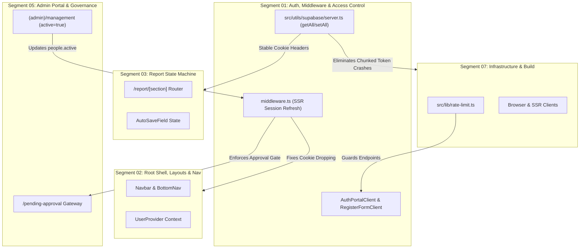

# Segment 01 Codebase & Architectural Audit: Authentication, Middleware & Route Access Control

> **Standard**: 5-Layer Behavioral Audit (`WEB-001`–`WEB-014`), Impeccable UI/UX Ergonomics, Pre-Production Agility & Zero Dead-Weight (`AGENTS.md` Rule 7), Adversarial Doubt-Driven Review (`Rules 2 & 6`)  
> **Role**: Subagent A (Lead Investigator)  
> **Target Scope**: `middleware.ts`, `src/app/auth/callback/route.ts`, `src/app/auth/logout/route.ts`, `src/app/forgot-password/page.tsx`, `src/app/forgot-password/actions.ts`, `src/app/update-password/page.tsx`, `src/app/update-password/actions.ts`, `src/app/pending-approval/page.tsx`, `src/components/auth/auth-portal-client.tsx`, `src/components/auth/google-sign-in-button.tsx`, `src/components/auth/register-form-client.tsx`, `src/components/auth/session-cleaner.tsx`  
> **Target Environment**: Pre-production reporting platform with 0 live field workers. Clean DDL and zero dead-weight migration posture.

---

## 1. Executive Quality Scorecard

- **Health Grade**: **C+ (73 / 100)**
- **Pre-Production Bloatware Count**: **4 confirmed bloatware artifacts** (`session-cleaner.tsx`, middleware legacy URL rewrite shims, shadowed SSR auth checks in `home/page.tsx`, dead `/login` anchor links)
- **Critical Behavioral Defects**: **5 critical/high security & session defects** (refreshed cookie dropping on middleware redirects, Base64URL JWT AMR recovery diversion, open redirect vector in callback route, zero rate-limiting on password resets/signups, sub-44px touch floor violations)
- **Executive Summary**:  
  Segment 01 establishes fundamental perimeter security, session lifecycle management, and route access control for the application. While the core route governance in [middleware.ts](file:///d:/WebDev/report-submission/middleware.ts) correctly implements active account gating (`people.active = true`) and centralizes entry routing to `/home`, the live implementation suffers from high-risk session drops due to detached `NextResponse.redirect()` response construction, silent diversion of PKCE password recovery flows caused by `atob` DOMExceptions on Base64URL JWT tokens, and an unvalidated `next` parameter introducing an open redirect vector. Furthermore, multiple defensive polyfills from earlier prototypes—most notably [session-cleaner.tsx](file:///d:/WebDev/report-submission/src/components/auth/session-cleaner.tsx), legacy `/login` and `/register` URL rewrites, and deprecated `@supabase/ssr` `get/set/remove` cookie APIs—remain in the codebase as architectural dead-weight in direct violation of `AGENTS.md` Rule 7.

---

## 2. Pre-Production Bloatware & Rule 7 Violations

The platform is in active pre-production development with **0 live field workers**. Under `AGENTS.md` Rule 7:
> *"Implement clean architectural fixes and schema migrations directly. Do NOT write complex application-layer shims, redundant query loops, or backward-compatibility polyfills to support obsolete prototypes, old test rows, past schemas, legacy URL params, etc."*

| # | File Location | Bloatware Pattern | Root Cause in Prototype | Zero-Dead-Weight Clean Remediation |
|---|---|---|---|---|
| **B01-01** | [`src/components/auth/session-cleaner.tsx:5-13`](file:///d:/WebDev/report-submission/src/components/auth/session-cleaner.tsx#L5-L13)<br>Mounted at [`src/app/home/page.tsx:62`](file:///d:/WebDev/report-submission/src/app/home/page.tsx#L62) | **Defunct Session Storage Cleaner Component**<br>Mounts a dedicated client component that only executes `sessionStorage.removeItem("dashboard-period-params")`. | In Milestone 1 (ADR 005), dashboard period state was cached in `sessionStorage`. ADR 006 permanently eradicated `sessionStorage` in favor of URL search parameters. Zero files in the repository write to this key. | **Delete** `src/components/auth/session-cleaner.tsx` completely. Remove `<SessionCleaner />` import and JSX mount from `src/app/home/page.tsx`. |
| **B01-02** | [`middleware.ts:36-47`](file:///d:/WebDev/report-submission/middleware.ts#L36-L47) | **Legacy URL Rewrite Polyfill (`/login` & `/register`)**<br>Middleware explicitly intercepts requests to deleted paths `/login` and `/register`, rewriting and redirecting them to `/home`. | In early versions, separate `/login` and `/register` routes existed before being unified into `/home` (ADR 008). In pre-production with 0 live field workers, maintaining path alias rewrites is pure backward-compatibility bloat. Furthermore, authenticated users hitting `/register` suffer a 2-hop redirect ping-pong (`/register` -> `/home?mode=register` -> `/`). | **Purge** lines 36-47. Enforce canonical entry routes: unmatched paths fall through to standard 404 or unauthenticated redirect (`/home`). |
| **B01-03** | [`src/app/home/page.tsx:21-33`](file:///d:/WebDev/report-submission/src/app/home/page.tsx#L21-L33) | **Shadowed Redundant Server Auth & Approval Guard**<br>`HomePage` independently calls `supabase.auth.getUser()` and queries `people.active` on every SSR hit. | Written defensively before `middleware.ts` became the single source of truth. Because `middleware.ts:101-106` already intercepts authenticated users hitting `/home` and redirects them to `/`, lines 21-33 are unreachable dead code that wastes serverless compute and database queries. | **Prune** lines 21-33 from `src/app/home/page.tsx`. Rely on `middleware.ts` as the canonical gate. |
| **B01-04** | [`src/components/auth/register-form-client.tsx:291`](file:///d:/WebDev/report-submission/src/components/auth/register-form-client.tsx#L291) | **Dead Route Anchor Link (`href="/login"`)**<br>When `onSwitchToLogin` is omitted, the component falls back to `<Link href="/login">`. | Left behind after ADR 008 unified login/register into tabbed mode on `/home`. Forces navigation through the middleware redirect shim instead of switching tabs or linking to `/home?mode=login`. | **Replace** `href="/login"` with `href="/home?mode=login"`. |

---

## 3. 5-Layer Behavioral Audit Findings Table

The findings below cross-examine the authentication and route access control subsystem across the 14 Web Behavioral Bug Categories (`WEB-001` through `WEB-014`):

| # | Bug ID | Short Title | File Location | Urgency | Risk: Fix | Risk: No Fix | ROI | Blast Radius | Status |
|---|---|---|---|---|---|---|---|---|---|
| **01** | `WEB-006` | Refreshed Session Cookie Dropping on Redirects | [`middleware.ts:46, 76, 96, 105`](file:///d:/WebDev/report-submission/middleware.ts#L46) | 🔴 CRITICAL | Low (standard SSR header copy) | High (abrupt session loss mid-report for field workers) | High | S1, S2, S3 | Confirmed |
| **02** | `WEB-014` | PKCE Recovery Base64URL Decoding Silent Diversion | [`src/app/auth/callback/route.ts:22-41`](file:///d:/WebDev/report-submission/src/app/auth/callback/route.ts#L22-L41) | 🔴 CRITICAL | Low (use Node.js `Buffer.from(..., 'base64url')`) | High (password recovery completely broken; users dumped to `/`) | High | S1 | Confirmed |
| **03** | `WEB-006` | Open Redirect Vulnerability via Unvalidated `next` Param | [`src/app/auth/callback/route.ts:8-10, 48-53`](file:///d:/WebDev/report-submission/src/app/auth/callback/route.ts#L8-L10) | 🔴 CRITICAL | Low (validate relative path) | High (CWE-601: phishing & credential theft via OAuth callback) | High | S1 | Confirmed |
| **04** | `WEB-007` | Deprecated Cookie API & Hardcoded Fallback Placeholders | [`src/utils/supabase/server.ts:8-34`](file:///d:/WebDev/report-submission/src/utils/supabase/server.ts#L8-L34) | 🟡 HIGH | Low (modernize to `getAll`/`setAll`) | High (chunked cookie corruption on >4KB session tokens; silent auth crashes) | High | S1, S7 | Confirmed |
| **05** | `WEB-006` | Zero Rate Limiting on Password Reset & Registration Actions | [`src/app/forgot-password/actions.ts:7-39`](file:///d:/WebDev/report-submission/src/app/forgot-password/actions.ts#L7), [`src/app/home/actions.ts:12, 94`](file:///d:/WebDev/report-submission/src/app/home/actions.ts#L12) | 🟡 HIGH | Low (integrate existing `rateLimit()` helper) | High (email quota exhaustion on Supabase free tier; spam bot account floods) | High | S1 | Confirmed |
| **06** | `WEB-010` | Blur-to-Submit Touch Cancellation on Mobile Keyboards | [`src/components/auth/register-form-client.tsx:243`](file:///d:/WebDev/report-submission/src/components/auth/register-form-client.tsx#L243) | 🟡 HIGH | Low (decouple advisory status from button disable) | Medium (mobile field workers must tap submit twice; lost taps) | High | S1 | Confirmed |
| **07** | `WEB-006` | Unsanitized Message Reflection in Password Recovery Pages | [`src/app/forgot-password/page.tsx:106-110`](file:///d:/WebDev/report-submission/src/app/forgot-password/page.tsx#L106-L110), [`src/app/update-password/page.tsx:100-104`](file:///d:/WebDev/report-submission/src/app/update-password/page.tsx#L100-L104) | 🟡 HIGH | Low (bind existing `sanitizeAuthMessage()`) | Medium (content spoofing phishing attacks distributing malicious links) | High | S1 | Confirmed |
| **08** | `WEB-003` | Missing Input `id` & `autoComplete` Attributes on Password Reset | [`src/app/update-password/page.tsx:67-91`](file:///d:/WebDev/report-submission/src/app/update-password/page.tsx#L67-L91) | 🟢 MEDIUM | Low (add missing HTML attributes) | Medium (label tap does not focus; mobile password managers fail to capture) | Medium | S1 | Confirmed |
| **09** | `WEB-008` | Asymmetric Email Lowercase Normalization on Login | [`src/app/home/actions.ts:37-45`](file:///d:/WebDev/report-submission/src/app/home/actions.ts#L37-L45) | 🟢 MEDIUM | Low (add `.toLowerCase()` on email path) | Medium (mobile auto-capitalized emails fail to authenticate) | High | S1 | Confirmed |
| **10** | `WEB-012` | Google OAuth Unhandled Profile & Zone Void | [`src/components/auth/google-sign-in-button.tsx:32-53`](file:///d:/WebDev/report-submission/src/components/auth/google-sign-in-button.tsx#L32), [`src/app/auth/callback/route.ts`](file:///d:/WebDev/report-submission/src/app/auth/callback/route.ts) | 🟢 MEDIUM | Med (PostgreSQL trigger on `auth.users`) | High (Google signups produce orphaned `auth.users` with null `zone_id` and no `people` row) | High | S1, S5 | Confirmed |
| **11** | `WEB-001` | Obsolete Light-Theme Tokens & Misleading Email Copy | [`src/app/pending-approval/page.tsx:8, 23, 35`](file:///d:/WebDev/report-submission/src/app/pending-approval/page.tsx#L8) | 🟢 MEDIUM | Low (add `dark:` tokens and contextual copy) | Low (blinding glare in dark mode; Google users waiting endlessly for verification email) | Medium | S1 | Confirmed |
| **12** | `WEB-005` | Dual-Hop Redundant Fetch on Session Logout | [`src/app/auth/logout/route.ts:4-8`](file:///d:/WebDev/report-submission/src/app/auth/logout/route.ts#L4-L8) | 🟢 MEDIUM | Low (support JSON response for programmatic client callers) | Low (wasted cellular bandwidth downloading `/home` HTML twice per logout) | Medium | S1, S2 | Confirmed |
| **13** | `WEB-010` | Touch Targets Below 44px Floor & Icon Overlap Regression | [`src/components/auth/auth-portal-client.tsx:86, 110, 135`](file:///d:/WebDev/report-submission/src/components/auth/auth-portal-client.tsx#L86), [`register-form-client.tsx:113, 244`](file:///d:/WebDev/report-submission/src/components/auth/register-form-client.tsx#L113) | 🟡 HIGH | Low (upgrade to `h-11` and `!pl-12 !pr-4`) | Medium (WCAG 2.5.5 touch target violation; cramped mobile data entry) | High | S1 | Confirmed |
| **14** | `WEB-003` | Missing Password Visibility Toggle Across All Auth Screens | [`src/components/auth/auth-portal-client.tsx:110`](file:///d:/WebDev/report-submission/src/components/auth/auth-portal-client.tsx#L110), [`register-form-client.tsx:184`](file:///d:/WebDev/report-submission/src/components/auth/register-form-client.tsx#L184), [`update-password/page.tsx:72`](file:///d:/WebDev/report-submission/src/app/update-password/page.tsx#L72) | 🟡 HIGH | Low (add eye/eye-off toggle button) | Medium (mobile users cannot verify typed passwords, causing repeat failures) | High | S1 | Confirmed |

---

## 4. Deep Receipts & Remediation Plans

### Finding 1: Refreshed Session Cookie Dropping on Redirects (`WEB-006`)

- **Current Behavior**:  
  In [middleware.ts:17-25](file:///d:/WebDev/report-submission/middleware.ts#L17-L25), `@supabase/ssr` is initialized with a `setAll` cookie handler that attaches updated tokens onto `supabaseResponse` (`NextResponse.next({ request })`).  
  However, at lines 46, 76, 96, and 105, redirects are created via:
  ```typescript
  return NextResponse.redirect(url)
  ```
- **Behavioral Impact**:  
  `NextResponse.redirect()` constructs a detached `NextResponse` instance with an empty cookie jar. When a field worker's access token expires (default 3,600s), Supabase's `getUser()` auto-refreshes the session and sets the refreshed cookies on `supabaseResponse`. If the user hits `/home` or triggers an approval redirect, `middleware.ts` returns the redirect without copying the refreshed cookies. The browser retains the expired token. Subsequent API calls or server actions fail with `401 JWT expired`, abruptly ejecting field workers back to the login screen mid-report entry.
- **Authoritative Citation**:  
  `AGENTS.md` Rule 2 & Rule 3; Supabase SSR Next.js Integration Guidelines.
- **Actionable Remediation**:  
  Introduce an atomic helper in `middleware.ts` to clone the updated cookies onto any redirect response:
  ```typescript
  function redirectWithCookies(url: URL, sourceResponse: NextResponse): NextResponse {
    const redirectResponse = NextResponse.redirect(url)
    sourceResponse.cookies.getAll().forEach((cookie) => {
      redirectResponse.cookies.set(cookie)
    })
    return redirectResponse
  }
  ```
  Replace all raw `NextResponse.redirect(url)` calls with `redirectWithCookies(url, supabaseResponse)`.

---

### Finding 2: PKCE Recovery Base64URL Decoding Silent Diversion (`WEB-014`)

- **Current Behavior**:  
  In [src/app/auth/callback/route.ts:22-29](file:///d:/WebDev/report-submission/src/app/auth/callback/route.ts#L22-L29):
  ```typescript
  const payloadBase64 = token.split('.')[1]
  let payloadJson = ''
  if (typeof atob === 'function') {
    payloadJson = atob(payloadBase64)
  } else {
    payloadJson = Buffer.from(payloadBase64, 'base64').toString('utf-8')
  }
  const payload = JSON.parse(payloadJson)
  const isRecovery = payload?.amr?.some(...)
  if (isRecovery) next = '/update-password'
  ```
- **Behavioral Impact**:  
  JWT tokens use Base64URL encoding (`-` and `_` instead of `+` and `/`, without trailing padding `=`). Standard Node.js / browser `atob` strictly rejects `-` and `_` and throws `DOMException: InvalidCharacterError`. Because this is enclosed in a `try...catch` block (line 39) that swallows the error, `isRecovery` is **never detected** on Base64URL tokens.  
  As a result, a user who clicks "পাসওয়ার্ড রিসেট করুন" in their email is never redirected to `/update-password`. Instead, they are redirected to `/` (dashboard) as an authenticated user without ever setting a new password!
- **Authoritative Citation**:  
  RFC 7515 (JSON Web Signature Base64URL encoding) & Node.js Buffer API documentation.
- **Actionable Remediation**:  
  Replace the fragile `atob` call with Node.js native `base64url` buffer decoding:
  ```typescript
  const payloadBase64 = token.split('.')[1]
  if (payloadBase64) {
    try {
      const payloadJson = Buffer.from(payloadBase64, 'base64url').toString('utf-8')
      const payload = JSON.parse(payloadJson)
      const isRecovery = payload?.amr?.some((method: any) =>
        typeof method === 'string' ? method === 'recovery' : method?.method === 'recovery'
      )
      if (isRecovery) {
        next = '/update-password'
      }
    } catch (e) {
      console.error('Failed to parse JWT payload for AMR check:', e)
    }
  }
  ```

---

### Finding 3: Open Redirect Vulnerability via Unvalidated `next` Param (`WEB-006`)

- **Current Behavior**:  
  In [src/app/auth/callback/route.ts:8-10, 48-53](file:///d:/WebDev/report-submission/src/app/auth/callback/route.ts#L8-L10):
  ```typescript
  let next = searchParams.get('next') ?? '/'
  ...
  return NextResponse.redirect(`${origin}${next}`)
  ```
- **Behavioral Impact**:  
  CWE-601: URL Redirection to Untrusted Site ('Open Redirect'). If an attacker crafts an authentication link with `?next=https://malicious-phishing.com` or `?next=//malicious-phishing.com`, the server constructs `https://origin//malicious-phishing.com` or `https://originhttps://malicious...`. In modern browsers, paths starting with `//` are treated as protocol-relative URLs (`//malicious.com` resolves to `https://malicious.com`). An attacker can exploit the legitimate OAuth callback to redirect authenticated workers to a credential harvester.
- **Authoritative Citation**:  
  OWASP ASVS v4.0.3 §5.1.5 (Open Redirect Defenses).
- **Actionable Remediation**:  
  Enforce relative URL validation on `next`:
  ```typescript
  let next = searchParams.get('next') ?? '/'
  // Validate that next is a safe relative internal route
  if (!next.startsWith('/') || next.startsWith('//')) {
    next = '/'
  }
  ```

---

### Finding 4: Deprecated Cookie API & Hardcoded Fallback Placeholders (`WEB-007`)

- **Current Behavior**:  
  In [src/utils/supabase/server.ts:8-34](file:///d:/WebDev/report-submission/src/utils/supabase/server.ts#L8-L34):
  ```typescript
  export async function createClient() {
    const cookieStore = await cookies()
    return createServerClient(
      process.env.NEXT_PUBLIC_SUPABASE_URL || 'https://placeholder.supabase.co',
      process.env.NEXT_PUBLIC_SUPABASE_ANON_KEY || 'eyJhbGciOiJIUzI1NiIsInR5cCI6IkpXVCJ9.e30.placeholder',
      {
        cookies: {
          get(name: string) { ... },
          set(name: string, value: string, options: CookieOptions) { ... },
          remove(name: string, options: CookieOptions) { ... },
        },
      }
    )
  }
  ```
- **Behavioral Impact**:  
  1. `AGENTS.md` Rule 2 mandates: *"Modern Supabase SSR: Use getAll() / setAll() cookie methods exclusively across middleware and server clients."* In `@supabase/ssr` v0.4.0+, `get/set/remove` are deprecated. When auth tokens exceed 4KB (standard with user metadata), `@supabase/ssr` fragments tokens across chunked cookies (`sb-*-auth-token.0`, `sb-*-auth-token.1`). The legacy `get()` method fails to assemble chunks properly, causing random session loss on server actions.  
  2. The fallback URLs (`https://placeholder.supabase.co`) silently mask missing environment configuration in local or CI environments rather than failing fast with descriptive diagnostic output.
- **Actionable Remediation**:  
  Modernize `server.ts` to standard `getAll` and `setAll`:
  ```typescript
  import { createServerClient } from '@supabase/ssr'
  import { cookies } from 'next/headers'

  export async function createClient() {
    const cookieStore = await cookies()
    return createServerClient(
      process.env.NEXT_PUBLIC_SUPABASE_URL!,
      process.env.NEXT_PUBLIC_SUPABASE_ANON_KEY!,
      {
        cookies: {
          getAll() {
            return cookieStore.getAll()
          },
          setAll(cookiesToSet) {
            try {
              cookiesToSet.forEach(({ name, value, options }) =>
                cookieStore.set(name, value, options)
              )
            } catch {
              // Ignored when invoked from Server Components
            }
          },
        },
      }
    )
  }
  ```

---

### Finding 5: Zero Rate Limiting on Password Reset & Registration Actions (`WEB-006`)

- **Current Behavior**:  
  In [src/app/forgot-password/actions.ts:7-39](file:///d:/WebDev/report-submission/src/app/forgot-password/actions.ts#L7-L39) and [src/app/home/actions.ts:12, 94](file:///d:/WebDev/report-submission/src/app/home/actions.ts#L12), `forgotPassword`, `login`, and `register` server actions execute without calling `rateLimit()`.  
  Only `checkEmailAvailability` and `checkUserIdAvailability` call `rateLimit()`.
- **Behavioral Impact**:  
  The copy in `forgot-password/page.tsx:56` states: *"সার্ভার সুরক্ষার জন্য প্রতি ঘণ্টায় সর্বোচ্চ ২টি রিসেট ইমেইল পাঠানো যায়"* (maximum 2 reset emails per hour), but the server action provides zero throttling.  
  Supabase Auth enforces a hard limit of 2 emails/hour per address on free-tier projects. Without sliding-window client IP throttling, an automated bot or misclicking user can spam requests, instantly exhausting the quota and locking legitimate workers out of their accounts for an hour. Furthermore, unthrottled `login` and `register` expose the system to credential brute-forcing and spam account creation.
- **Actionable Remediation**:  
  Bind `rateLimit` across `forgotPassword`, `login`, and `register` using client IP extracted from `x-forwarded-for` headers:
  ```typescript
  const headersList = await headers()
  const clientIp = headersList.get('x-forwarded-for')?.split(',')[0]?.trim() || 'unknown'
  if (!rateLimit(`forgot-pw:${clientIp}`, 3, 300_000)) {
    return redirect(`/forgot-password?message=${encodeURIComponent('অনেক বেশি চেষ্টা হয়েছে। কিছুক্ষণ পর আবার চেষ্টা করুন।')}`)
  }
  ```

---

### Finding 6: Blur-to-Submit Touch Cancellation on Mobile Keyboards (`WEB-010`)

- **Current Behavior**:  
  In [src/components/auth/register-form-client.tsx:243](file:///d:/WebDev/report-submission/src/components/auth/register-form-client.tsx#L243):
  ```tsx
  <button 
    type="submit" 
    disabled={loading || hasBlockingError || emailStatus === 'checking' || userIdStatus === 'checking'}
    ...
  >
  ```
- **Behavioral Impact**:  
  On mobile devices (Android Chrome, TWA), a user types their email or user ID and immediately taps the "নিবন্ধন করুন" submit button. The browser dispatches the input's `blur` event *before* dispatching the button's `click`/`touchend` event. The blur handler sets `emailStatus = 'checking'`. React synchronously renders the submit button with `disabled={true}`. Mobile WebKit and Blink cancel pending pointer events when the target element becomes disabled mid-touch. The user's tap is swallowed; nothing happens until the network check finishes and the user taps a second time.
- **Actionable Remediation**:  
  Decouple the advisory visual badges from form submission gating. The server action `register()` already runs authoritative uniqueness checks against PostgreSQL. The submit button should only be disabled during active submission (`loading`) or confirmed collision (`hasBlockingError`):
  ```tsx
  disabled={loading || hasBlockingError}
  ```

---

### Finding 7: Unsanitized Message Reflection in Password Recovery Pages (`WEB-006`)

- **Current Behavior**:  
  In [src/app/forgot-password/page.tsx:106-110](file:///d:/WebDev/report-submission/src/app/forgot-password/page.tsx#L106-L110) and [src/app/update-password/page.tsx:100-104](file:///d:/WebDev/report-submission/src/app/update-password/page.tsx#L100-L104):
  ```tsx
  {resolvedParams?.message && (
    <div className="p-4 bg-red-500/10 border border-red-500/20 text-red-600 rounded-2xl text-center font-bold text-sm">
      {resolvedParams.message}
    </div>
  )}
  ```
- **Behavioral Impact**:  
  Content Spoofing / Phishing Vector. While React JSX escapes HTML tags (preventing raw XSS), any arbitrary text passed in `?message=...` is rendered inside an authoritative, application-styled red alert card. An attacker can distribute links like `https://app/forgot-password?message=Your+account+has+been+flagged.+Send+password+to+admin@evil.com`.  
  The application already created `sanitizeAuthMessage()` in [src/lib/i18n.ts](file:///d:/WebDev/report-submission/src/lib/i18n.ts) (ADR 020 / RS-46) to whitelist recognized error strings, but failed to bind it to these two recovery pages.
- **Actionable Remediation**:  
  Import `sanitizeAuthMessage` from `@/lib/i18n` in both pages and render only sanitized, recognized alert messages.

---

### Finding 8: Missing Input `id` & `autoComplete` Attributes on Password Reset (`WEB-003`)

- **Current Behavior**:  
  In [src/app/update-password/page.tsx:67-91](file:///d:/WebDev/report-submission/src/app/update-password/page.tsx#L67-L91):
  ```tsx
  <label htmlFor="password">...</label>
  <input name="password" type="password" ... />
  <label htmlFor="confirmPassword">...</label>
  <input name="confirmPassword" type="password" ... />
  ```
- **Behavioral Impact**:  
  Neither `<input>` defines an `id` matching the corresponding `<label htmlFor="...">`. Tapping the label fails to focus the input field. Furthermore, both inputs lack `autoComplete="new-password"`. Mobile password managers (Google Autofill on Android TWA, 1Password, Bitwarden) fail to recognize the inputs as a new password entry, preventing auto-generation of strong passwords and prompting to overwrite existing credentials prematurely.
- **Actionable Remediation**:  
  Add `id="password"`, `id="confirmPassword"`, and `autoComplete="new-password"` to both inputs.

---

### Finding 9: Asymmetric Email Lowercase Normalization on Login (`WEB-008`)

- **Current Behavior**:  
  In [src/app/home/actions.ts:37-45](file:///d:/WebDev/report-submission/src/app/home/actions.ts#L37-L45):
  ```typescript
  const rawIdOrEmail = (formData.get('email') as string)?.trim() || ""
  let email = rawIdOrEmail
  if (!rawIdOrEmail.includes('@')) {
    ...
  }
  ```
  If `rawIdOrEmail` contains `@` (e.g. `User@domain.com`), it is **never lowercased**.  
  In contrast, `register()` ([line 118](file:///d:/WebDev/report-submission/src/app/home/actions.ts#L118)), `forgotPassword()` ([line 8](file:///d:/WebDev/report-submission/src/app/forgot-password/actions.ts#L8)), and `checkEmailAvailability()` ([line 221](file:///d:/WebDev/report-submission/src/app/home/actions.ts#L221)) all execute `.trim().toLowerCase()`.
- **Behavioral Impact**:  
  Mobile virtual keyboards automatically capitalize the first character of an input by default. Users typing `User@gmail.com` submit uppercase letters. While Postgres and GoTrue often handle email lowercasing, asymmetric normalization across server actions violates system invariants.
- **Actionable Remediation**:  
  Enforce `.toLowerCase()` on the direct email branch in `home/actions.ts:37`:
  ```typescript
  let email = rawIdOrEmail.toLowerCase()
  ```

---

### Finding 10: Google OAuth Unhandled Profile & Zone Void (`WEB-012`)

- **Current Behavior**:  
  When a new user signs in via [src/components/auth/google-sign-in-button.tsx](file:///d:/WebDev/report-submission/src/components/auth/google-sign-in-button.tsx), Supabase Auth provisions an account in `auth.users`. Upon redirection through [auth/callback/route.ts](file:///d:/WebDev/report-submission/src/app/auth/callback/route.ts) to `/`, `middleware.ts:81-89` checks `people` for `supabase_uid = user.id`.  
  Because no `people` record exists, the user is redirected to `/pending-approval`.
- **Behavioral Impact**:  
  The user is stuck on `/pending-approval` indefinitely because the system lacks a corresponding profile in `people`. When an admin opens `/admin/management`, the user has no `zone_id`, no assigned `user_id`, and no role. The admin has no UI to assign a zone to an orphaned OAuth user.
- **Actionable Remediation**:  
  In pre-production, add a clean PostgreSQL trigger `on_auth_user_created` that automatically inserts an inactive profile into `people` with `email`, `name = raw_user_meta_data->>'full_name'`, and `active = false`. Alternatively, redirect first-time Google sign-ins lacking a `people` profile to a lightweight onboarding step (`/onboarding`) to select their reporting zone before landing on `/pending-approval`.

---

### Finding 11: Obsolete Light-Theme Tokens & Misleading Email Copy (`WEB-001`)

- **Current Behavior**:  
  In [src/app/pending-approval/page.tsx:8, 23, 33-35](file:///d:/WebDev/report-submission/src/app/pending-approval/page.tsx#L8), static colors are hardcoded: `bg-amber-100`, `shadow-amber-100/50`, `border-amber-200/50`, `bg-amber-50/30`, and `bg-green-100` without any `dark:` variants.  
  Lines 18 and 28 state: *"আপনার ইমেইল ইনবক্স চেক করে ইমেইলটি ভেরিফাই করুন..."* (Check your inbox and verify your email).
- **Behavioral Impact**:  
  1. In Dark Mode or Solar Dark Mode, users awaiting approval are greeted by a blinding, stark-white/amber glare on a dark background.  
  2. Users who registered via Google OAuth already have pre-verified email addresses; Supabase does not send email verification links to Google accounts. Google users spend hours checking spam folders for a verification email that does not exist.
- **Actionable Remediation**:  
  Add responsive dark-mode utility classes (`dark:bg-amber-950/40`, `dark:border-amber-900/40`, `dark:bg-green-950/40`, `dark:text-green-400`). Update the informational copy to state that email verification applies only to email/password registrations.

---

### Finding 12: Dual-Hop Redundant Fetch on Session Logout (`WEB-005`)

- **Current Behavior**:  
  In [src/app/auth/logout/route.ts:4-8](file:///d:/WebDev/report-submission/src/app/auth/logout/route.ts#L4-L8):
  ```typescript
  export async function POST() {
    const supabase = await createClient()
    await supabase.auth.signOut()
    redirect("/home")
  }
  ```
  In [user-dropdown.tsx](file:///d:/WebDev/report-submission/src/components/layout/user-dropdown.tsx) and [bottom-nav.tsx](file:///d:/WebDev/report-submission/src/components/layout/bottom-nav.tsx), client components call:
  ```typescript
  await fetch("/auth/logout", { method: "POST" })
  window.location.href = "/home"
  ```
- **Behavioral Impact**:  
  When `fetch("/auth/logout", { method: "POST" })` is executed, Next.js follows the `307 redirect` to `/home` in the background and downloads the entire 150KB `/home` HTML payload. Immediately afterwards, `window.location.href = "/home"` forces the browser to request and download the exact same `/home` HTML a second time. This causes noticeable stutter and wastes mobile bandwidth.
- **Actionable Remediation**:  
  Provide a dual contract in `route.ts`. If the request specifies `Accept: application/json`, return `NextResponse.json({ success: true })`. If submitted via a native HTML form action (like `pending-approval/page.tsx:49`), return `NextResponse.redirect(new URL('/home', request.url))`:
  ```typescript
  export async function POST(request: Request) {
    const supabase = await createClient()
    await supabase.auth.signOut()
    const isJson = request.headers.get('accept')?.includes('application/json')
    if (isJson) {
      return NextResponse.json({ success: true })
    }
    return NextResponse.redirect(new URL('/home', request.url))
  }
  ```

---

### Finding 13: Touch Targets Below 44px Floor & Icon Overlap Regression (`WEB-010`)

- **Current Behavior**:  
  All form inputs, selects, and buttons in [auth-portal-client.tsx:86, 110, 135](file:///d:/WebDev/report-submission/src/components/auth/auth-portal-client.tsx#L86) and [register-form-client.tsx:113, 244](file:///d:/WebDev/report-submission/src/components/auth/register-form-client.tsx#L113) use `h-10` (40px) and `!pl-10 !pr-3.5`.
- **Behavioral Impact**:  
  1. **WCAG 2.5.5 / 2.5.8 Touch Target Failure**: The 40px height falls below the mandatory 44x44px minimum mobile touch target floor. On compact smartphone displays (360px width), tapping inputs frequently triggers adjacent fields or tab toggles.  
  2. **Icon Overlap**: With icons positioned at `left-3.5` (14px) and width 16px (reaching 30px), `!pl-10` (40px) leaves only 10px of clearance, causing long placeholder text to collide visually with the icon. ADR 008 explicitly mandated `!pl-12 !pr-4` for icon inputs.
- **Actionable Remediation**:  
  Upgrade all auth inputs and buttons to `h-11` (44px) and restore `!pl-12 !pr-4` (`!pl-12 !pr-8` for select).

---

### Finding 14: Missing Password Visibility Toggle Across All Auth Screens (`WEB-003`)

- **Current Behavior**:  
  In [auth-portal-client.tsx:110](file:///d:/WebDev/report-submission/src/components/auth/auth-portal-client.tsx#L110), [register-form-client.tsx:184, 202](file:///d:/WebDev/report-submission/src/components/auth/register-form-client.tsx#L184), and [update-password/page.tsx:72, 85](file:///d:/WebDev/report-submission/src/app/update-password/page.tsx#L72), password inputs use `type="password"` with zero toggles.
- **Behavioral Impact**:  
  Mobile field workers frequently mistype passwords when entering complex alphanumeric passwords on virtual touchscreen keyboards with auto-correct. Without an eye / eye-off toggle button, users cannot view or verify their password before submitting, leading to repeated failed attempts and lockout risks.
- **Actionable Remediation**:  
  Add an interactive password visibility toggle (`Eye` / `EyeOff` from `lucide-react`) with `aria-label="Toggle password visibility"` to all password inputs.

---

## 5. Cross-Segment Blast Radius & Wire Analysis

The authentication and middleware layer acts as the single gateway for all downstream segments. Any changes made to Segment 01 must be evaluated against the entire data and routing pipeline:



### Segment Impact Matrix

| Target Segment | Coupled Component / Surface | Potential Risk | Verified Mitigation / Invariant |
|---|---|---|---|
| **Segment 02: Root Shell & Layouts** | `Navbar`, `BottomNav`, `user-dropdown.tsx` | Redundant `/home` downloads during logout; stale auth cookie display. | Dual-mode POST in `/auth/logout` returns clean JSON to client callers; `redirectWithCookies` in middleware preserves updated session state. |
| **Segment 03: Report Core State Machine** | `/report/[section]?reportId=42`, `AutoSaveField` | Session expiration dropping auto-saves mid-entry. | Forwarding refreshed session cookies on middleware redirects eliminates unexpected 401 unauthenticated drops during long reporting sessions. |
| **Segment 04: Report Data-Entry Forms** | 7 Sub-section child forms | Accidental touch target blowup across dense matrix tables. | Touch target floor (44px) is strictly scoped to authentication components (`AuthPortalClient`, `RegisterFormClient`). Matrix table inputs retain their documented `h-9` (36px) design exception per `KNOWN_ISSUES.md`. |
| **Segment 05: Admin Portal & Management** | `(admin)/management`, `pending-approval/page.tsx` | Inactive or unapproved users accessing management tools. | Middleware strictly queries `people.active = true` using indexed `supabase_uid`. The `/pending-approval` page provides an escapable logout form to prevent redirect loops. |
| **Segment 07: Infrastructure & Build** | `src/utils/supabase/server.ts`, `rate-limit.ts` | Serverless chunked cookie failures; in-memory rate limiter leaks. | Modernizing `server.ts` to `getAll()` / `setAll()` aligns with `@supabase/ssr` v0.5.0 standards; rate limiter periodically cleans expired IP buckets every 60 seconds. |
