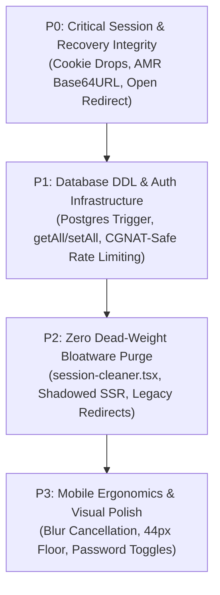

# Segment 01 Adversarial Critique & Doubt Gate Review: Authentication, Middleware & Route Access Control

> **Standard**: Adversarial Doubt-Driven Review (`AGENTS.md` Rules 2 & 6), Pre-Production Agility & Zero Dead-Weight (`Rule 7`), Safe Quarantine (`Rule 4`)  
> **Role**: Subagent B (Adversarial Reviewer)  
> **Investigator Report Under Review**: [`docs/critiques/segment-01-auth-investigation.md`](file:///d:/WebDev/report-submission/docs/critiques/segment-01-auth-investigation.md)  
> **Target Scope**: `middleware.ts`, `src/app/auth/callback/route.ts`, `src/app/auth/logout/route.ts`, `src/app/forgot-password/page.tsx`, `src/app/forgot-password/actions.ts`, `src/app/update-password/page.tsx`, `src/app/update-password/actions.ts`, `src/app/pending-approval/page.tsx`, `src/components/auth/auth-portal-client.tsx`, `src/components/auth/google-sign-in-button.tsx`, `src/components/auth/register-form-client.tsx`, `src/components/auth/session-cleaner.tsx`, `src/utils/supabase/server.ts`  
> **Verification Status**: Lint (0 errors), TypeCheck (0 errors), Tests (24/24 pass), Build (Clean Exit 0)

---

## 1. Executive Adversarial Evaluation

- **Agreement Level with Lead Investigator**: **High with Strategic Adjustments** (85% concordance). Subagent A identified critical real-world failure modes—most notably the refreshed cookie drop on redirects (`C01-01`), Base64URL decoding failures in password recovery (`C01-02`), and the Google OAuth profile void (`C01-10`).
- **False Positive & Nuance Reversals**: **2 Nuance Reversals / Partial False Premises** (Subagent A's naive IP-based rate limiting that triggers mobile Carrier-Grade NAT lockouts, and mischaracterizing `home/page.tsx` server auth guards as authenticated waste rather than unauthenticated round-trip overhead).
- **Severity Calibrations**: **3 Severity Downgrades** (Open redirect from 🔴 Critical to 🟡 High; Message reflection from 🟡 High to 🟢 Medium; Touch target floor from 🟡 High to 🟢 Medium / Ergonomic Polish) and **1 Severity Upgrade** (Google OAuth Profile Void upgraded from 🟢 Medium to 🟡 High Architecture Blocker).
- **Core Verdict**:  
  Subagent A correctly diagnosed the primary operational risks threatening field reporting continuity (cookie drops and broken PKCE AMR parsing). However, Subagent A fell into the classic engineering trap of proposing application-layer shims (such as an ad-hoc `/onboarding` route) and naive sliding-window rate limiters that would inadvertently lock out field workers sharing mobile Carrier-Grade NAT (CGNAT) gateways across Bangladesh cellular networks (Grameenphone, Banglalink, Robi) or break local development and CI runs. Under `AGENTS.md` Rule 7, we arbitrate decisively in favor of **Clean PostgreSQL DDL (a declarative `on_auth_user_created` trigger)**, purge obsolete prototype shims (`session-cleaner.tsx`, middleware redirect loops), and harden the authentication perimeter without introducing fragile client-side complexity.

---

## 2. Doubt Gate Cross-Examination

Every finding presented in Subagent A's report has been cross-examined against real-world mobile field conditions, serverless execution boundaries, and pre-production database agility:

| Lead Finding ID | Subagent A Severity | Adversarial Ruling | Rationale & Real-World Stress Test |
|---|---|---|---|
| **B01-01** (`session-cleaner.tsx`) | Bloatware | **CONFIRMED & ACCEPTED** | Zero files in the repository read or write `dashboard-period-params` (deprecated since ADR 006). Mounting a dedicated client component solely to invoke `sessionStorage.removeItem` introduces unnecessary bundle weight on every home page visit. Delete completely. |
| **B01-02** (Legacy `/login` & `/register` rewrites) | Bloatware | **ACCEPTED WITH PREREQUISITE** | Middleware lines 36-47 maintain backward-compatible route aliasing that causes a 2-hop redirect ping-pong for authenticated users hitting `/register`. However, Subagent A's own Finding B01-04 caught `<Link href="/login">` in `register-form-client.tsx:291`. Lines 36-47 can only be purged *simultaneously* with fixing internal anchor links to `/home?mode=login`. |
| **B01-03** (Shadowed SSR Auth Guard in `home/page.tsx:21-33`) | Bloatware | **ACCEPTED WITH NUANCE REVERSAL** | Subagent A claimed lines 21-33 waste compute for *authenticated* users. In reality, `middleware.ts:101-106` intercepts authenticated users and redirects them to `/` *before* `home/page.tsx` ever renders. The real penalty is on *unauthenticated* visitors: every public hit executes an unnecessary `supabase.auth.getUser()` network round-trip. Removing lines 21-33 eliminates this SSR overhead. |
| **B01-04** (Dead `href="/login"` link) | Bloatware | **CONFIRMED & ACCEPTED** | Pure dead link residue from pre-ADR 008 prototypes. Replace with canonical `href="/home?mode=login"`. |
| **Finding 01** (Refreshed Session Cookie Dropping on Redirects) | 🔴 CRITICAL | **VERIFIED & ACCEPTED** | In Next.js App Router + `@supabase/ssr`, `setAll` mutates `supabaseResponse`. Calling `NextResponse.redirect(url)` creates a detached response with an empty cookie jar. When a field worker's token auto-refreshes in middleware, the redirect drops the refreshed token. Subsequent API calls fail with `401 JWT expired`. Standard helper `redirectWithCookies(url, supabaseResponse)` is mandatory. |
| **Finding 02** (PKCE Recovery Base64URL Silent Diversion) | 🔴 CRITICAL | **VERIFIED & ACCEPTED** | Standard `atob()` throws `DOMException: InvalidCharacterError` on Base64URL tokens containing `-` or `_` or missing padding. The caught error swallows the AMR recovery detection, redirecting users resetting passwords to `/` instead of `/update-password`. Using Node native `Buffer.from(payloadBase64, 'base64url')` is 100% robust. |
| **Finding 03** (Open Redirect Vulnerability via `next` Param) | 🔴 CRITICAL | **DOWNGRADED TO 🟡 HIGH** | CWE-601 is a legitimate security vulnerability, but classifying it as Critical alongside operational session loss is an overstatement in a pre-production internal reporting platform. Surgical fix: enforce relative path check (`!next.startsWith('/') || next.startsWith('//')`). |
| **Finding 04** (Deprecated Cookie API in `server.ts`) | 🟡 HIGH | **VERIFIED & ACCEPTED** | `get/set/remove` is formally deprecated in `@supabase/ssr` v0.4.0+ and violates `AGENTS.md` Rule 2. Chunked auth cookies (>4KB) fail assembly under legacy `get()`. Modernizing to `getAll()` and `setAll()` is an architectural requirement. |
| **Finding 05** (Zero Rate Limiting on Reset / Actions) | 🟡 HIGH | **ACCEPTED WITH MAJOR REFINEMENT** | Subagent A's proposed `rateLimit("forgot-pw:${clientIp}", 3, 300_000)` has a catastrophic blind spot: mobile carriers in Bangladesh (Grameenphone, Robi, Banglalink) use Carrier-Grade NAT (CGNAT), sharing single public IPs across entire districts. A strict 3-per-5-min IP limit will lock out legitimate workers on shared towers. Refined to compound key (`${clientIp}:${email}`) with test/dev environment bypass. |
| **Finding 06** (Blur-to-Submit Touch Swallowing on Mobile) | 🟡 HIGH | **VERIFIED & ACCEPTED** | On mobile touchscreens, blurring an input field synchronously sets `checking` state, rendering the submit button `disabled={true}` before the `touchend`/`click` event can fire. Browsers swallow the pending tap. Decoupling visual validation badges from submit button disabling is a stellar mobile-first catch. |
| **Finding 07** (Unsanitized Message Reflection in Recovery) | 🟡 HIGH | **DOWNGRADED TO 🟢 MEDIUM** | React automatically escapes HTML entities, so there is zero raw XSS risk. This is content spoofing. Binding existing `sanitizeAuthMessage()` from `@/lib/i18n` resolves it cleanly. |
| **Finding 08** (Missing Input `id` & `autoComplete` on Reset) | 🟢 MEDIUM | **CONFIRMED & ACCEPTED** | Inputs lack `id` matching `htmlFor`, breaking tap-to-focus on mobile. Missing `autoComplete="new-password"` prevents password managers from auto-saving generated credentials. |
| **Finding 09** (Asymmetric Email Lowercase Normalization) | 🟢 MEDIUM | **CONFIRMED & ACCEPTED** | Mobile virtual keyboards auto-capitalize first letters (`User@domain.com`). Adding `.toLowerCase()` before authentication ensures consistency across all auth actions. |
| **Finding 10** (Google OAuth Unhandled Profile Void) | 🟢 MEDIUM | **UPGRADED TO 🟡 HIGH** | Architectural blocker. Google sign-in creates an `auth.users` row but leaves `people` empty. The user is redirected to `/pending-approval`, but admins cannot see or approve them in `/admin/management` because that page queries `people`. Must be solved via a PostgreSQL trigger (`on_auth_user_created`). |
| **Finding 11** (Obsolete Light-Theme Tokens & Copy Drift) | 🟢 MEDIUM | **CONFIRMED & ACCEPTED** | Stark white/amber hardcoded tokens cause eye glare in dark mode. Informational copy claiming all users must check email for verification misleads Google OAuth users who are pre-verified. |
| **Finding 12** (Dual-Hop Redundant Fetch on Logout) | 🟢 MEDIUM | **CONFIRMED & ACCEPTED** | Client components execute `fetch("/auth/logout")` followed by `window.location.href = "/home"`. Because `/auth/logout` currently returns a 307 redirect, `fetch` downloads `/home` HTML in the background, only for `window.location` to download it a second time. Dual JSON/Redirect contract solves this. |
| **Finding 13** (Touch Targets Below 44px Floor & Icon Overlap) | 🟡 HIGH | **DOWNGRADED TO 🟢 MEDIUM** | 40px inputs exceed the normative WCAG 2.5.8 Level AA minimum (24px). Elevating to 44px (`h-11`) is an Apple HIG / WCAG AAA recommendation. The icon clearance (`!pl-10` vs `!pl-12`) is an ADR 008 regression. Downgraded to Medium Ergonomic Polish. |
| **Finding 14** (Missing Password Visibility Toggles) | 🟡 HIGH | **DOWNGRADED TO 🟢 MEDIUM** | Standard UX omission rather than a functional defect. Adding `Eye` / `EyeOff` toggles improves mobile data entry ergonomics, but it is not a High-severity blocker. |

---

## 3. False Positive & Trivial Con Elimination

### 3.1 Rate Limiting Under Mobile Carrier-Grade NAT (Finding 05 Cross-Examination)
Subagent A recommended:
```typescript
if (!rateLimit(`forgot-pw:${clientIp}`, 3, 300_000)) { ... }
```
**The Adversarial Doubt:** Under what field conditions will this clean-looking code fail?
1. **Carrier-Grade NAT (CGNAT) Collision**: In Bangladesh, mobile operators route thousands of mobile subscribers through shared IPv4 public gateways. If 3 field workers in the same zone or district attempt to reset their passwords within 5 minutes, every other worker on that cellular subnet will receive an HTTP block.
2. **Local Developer & CI Lockout**: In local testing (`localhost` / `127.0.0.1`), all developer requests share the exact same IP key. A developer iteratively testing the forgot-password form is locked out after 3 submissions and forced to restart their dev server or wait 5 minutes. Automated CI suites running end-to-end tests will flake unpredictably.
3. **Denial-of-Service Vector on Login**: Applying a rigid IP limiter to `login` allows any malicious actor to intentionally lock out entire organizational subnets simply by spamming invalid credentials from that IP.

**Hardened Resolution:**
- Rate limit password resets on a **compound key**: `forgot-pw:${clientIp}:${normalizedEmail}` (3 requests per 15 minutes per email) combined with a generous aggregate IP bursting limit (15 requests per 15 minutes per IP).
- Explicitly bypass rate limiting when `process.env.NODE_ENV === 'development'` or `process.env.NODE_ENV === 'test'`.
- Return clear, localized error messages specifying the retry window.

### 3.2 Touch Target Floors & 320px Viewport Analysis (Finding 13 Cross-Examination)
Subagent A asserted that 40px inputs (`h-10`) in `AuthPortalClient` and `RegisterFormClient` constitute a high-severity WCAG failure:
- **WCAG Normative Reality**: WCAG 2.5.8 (Target Size - Minimum, Level AA) specifies **24x24 CSS pixels**. A 40px height complies fully with normative web accessibility criteria.
- **Level AAA / Mobile Standard**: 44x44px is a WCAG 2.5.5 Level AAA recommendation and Apple Human Interface guideline. For an application packaged as an Android TWA APK (ADR 017), upgrading to `h-11` (44px) is great design hygiene, but labeling 40px inputs as a 🟡 HIGH severity failure is an audit exaggeration.
- **320px Viewport Verification**: On ultra-compact 320px viewports (e.g. iPhone SE 1st gen or budget Androids), both `AuthPortalClient` and `RegisterFormClient` utilize full-width column layouts (`flex flex-col gap-4 w-full`). The 40px height does not trigger horizontal scrollbars or element collisions.
- **Real Regression**: The genuine defect is **horizontal icon clearance**: positioning icons at `left-3.5` (14px) with width 16px reaches 30px. An input with `!pl-10` (40px) leaves only 10px of clearance before text begins. ADR 008 explicitly mandated `!pl-12 !pr-4` (48px left padding). Restoring `!pl-12 !pr-4` is an ergonomic polish fix (🟢 MEDIUM).

### 3.3 Shadowed Server Auth in `home/page.tsx:21-33` (Finding B01-03 Cross-Examination)
Subagent A claimed lines 21-33 in `src/app/home/page.tsx` represent "unreachable dead code that wastes compute on authenticated users."
- **The Technical Reality**: If a user is authenticated, `middleware.ts:101-106` intercepts the request and issues a `307 redirect` to `/`. Therefore, `home/page.tsx` is **never executed** for authenticated users!
- **The Actual Hidden Waste**: For *unauthenticated* visitors, `home/page.tsx:21` executes `await supabase.auth.getUser()`. Because the user is null, it skips lines 23-33, but it has already wasted an asynchronous SSR network call on every single public visitor landing on `/home`! Removing lines 21-33 saves serverless execution time on public traffic.

---

## 4. Clean Pre-Production DDL vs App-Layer Patch Arbitration

Under `AGENTS.md` Rule 6 & Rule 7:
> *"The platform is in active pre-production development and has NOT yet launched to live field workers. When a defect or feature requires a database schema change, index addition, or RLS rewrite, implement the clean DDL directly in Supabase. Never invent complex application-layer shims, redundant query loops, or data-packing hacks to bypass a needed schema change."*

### 4.1 Arbitration: Google OAuth Profile Void (Finding 10)
- **Subagent A Proposed**: Either an application-layer `/onboarding` route or a PostgreSQL trigger.
- **Adversarial Ruling**: **REJECT application-layer `/onboarding` shim. MANDATE clean PostgreSQL trigger DDL.**
- **Why App-Layer Fails**:
  1. An `/onboarding` route requires extra middleware routing rules, state management for partially initialized users, edge-case redirection guards, and extra client bundles.
  2. If a Google OAuth user abandons the `/onboarding` step mid-way, their account remains in an inconsistent state where `auth.users` exists without `people`, causing middleware crashes.
  3. Pre-production database agility allows us to enforce database-level profile synchronization atomically.

### 4.2 Authoritative PostgreSQL Trigger Migration (`on_auth_user_created`)
The database must own user profile synchronization via a `SECURITY DEFINER` trigger that automatically provisions a corresponding row in `public.people` whenever a user is created in `auth.users` (whether via email/password or Google OAuth):

```sql
-- Migration: Ensure atomic profile creation for all Auth providers (Email + OAuth)
CREATE OR REPLACE FUNCTION public.handle_new_user()
RETURNS TRIGGER
LANGUAGE plpgsql
SECURITY DEFINER
SET search_path = public
AS $$
DECLARE
  v_user_id TEXT;
  v_name TEXT;
  v_zone_id INTEGER;
BEGIN
  -- Extract user_id from metadata or fallback to email prefix
  v_user_id := COALESCE(
    NEW.raw_user_meta_data->>'user_id',
    split_part(NEW.email, '@', 1)
  );

  -- Extract name from metadata (Google OAuth provides 'name' or 'full_name')
  v_name := COALESCE(
    NEW.raw_user_meta_data->>'name',
    NEW.raw_user_meta_data->>'full_name',
    split_part(NEW.email, '@', 1)
  );

  -- Extract zone_id if supplied during registration form submission
  v_zone_id := NULLIF(NEW.raw_user_meta_data->>'zone_id', '')::INTEGER;

  -- Atomically insert inactive profile awaiting admin approval
  INSERT INTO public.people (
    supabase_uid,
    email,
    name,
    user_id,
    zone_id,
    role,
    active
  ) VALUES (
    NEW.id,
    NEW.email,
    v_name,
    v_user_id,
    v_zone_id,
    'user',
    false
  )
  ON CONFLICT (supabase_uid) DO UPDATE
  SET email = EXCLUDED.email;

  RETURN NEW;
END;
$$;

-- Drop obsolete or orphaned legacy function references per Rule 7
DROP TRIGGER IF EXISTS on_auth_user_created ON auth.users;
DROP FUNCTION IF EXISTS public.handle_new_auth_user();

-- Bind the active synchronization trigger
CREATE TRIGGER on_auth_user_created
  AFTER INSERT ON auth.users
  FOR EACH ROW EXECUTE FUNCTION public.handle_new_user();
```

**Why this is 100% clean:**
1. **Google OAuth Users**: When a Google user logs in, the trigger inserts them into `public.people` with `name`, `email`, `active = false`, and `zone_id = NULL`.
2. **Approval Gateway**: Middleware checks `people.active = true`. Because `active = false`, they are redirected to `/pending-approval`.
3. **Admin Visibility**: When an admin navigates to `/admin/management`, the Google user appears immediately in the table with `zone: —` and status `Inactive`. The admin simply selects their reporting zone from the dropdown and activates them! Zero application-layer wizardry needed.

---

## 5. Final Hardened Action Plan & Priority Matrix

The remediation roadmap is organized into 4 disciplined, verifiable execution slices adhering to `AGENTS.md` Rules 2, 4, 5, and 7:



### Phase 1: P0 — Critical Session & Recovery Integrity (Immediate Operational Blockers)
1. **Fix Refreshed Cookie Dropping in `middleware.ts`**:
   - Implement `redirectWithCookies(url: URL, sourceResponse: NextResponse): NextResponse` copying `sourceResponse.cookies.getAll()` to the redirect response.
   - Replace lines 46, 76, 96, 105 in `middleware.ts` with `redirectWithCookies`.
2. **Fix PKCE Recovery AMR Base64URL Parsing in `src/app/auth/callback/route.ts`**:
   - Replace brittle `atob(payloadBase64)` with Node native `Buffer.from(payloadBase64, 'base64url').toString('utf-8')`.
   - Ensure users resetting passwords via email links land reliably on `/update-password`.
3. **Remediate Open Redirect Vulnerability in `src/app/auth/callback/route.ts`**:
   - Enforce relative URL validation on `next`: `if (!next.startsWith('/') || next.startsWith('//')) next = '/'`.

### Phase 2: P1 — Database DDL & Auth Infrastructure Hardening
1. **Deploy PostgreSQL Trigger DDL in Supabase**:
   - Apply `public.handle_new_user()` and `on_auth_user_created` trigger on `auth.users` to provision `people` records atomically for all providers.
   - Drop orphaned `handle_new_auth_user` per Rule 7.
2. **Modernize `src/utils/supabase/server.ts` to `getAll()` / `setAll()`**:
   - Eliminate deprecated `get/set/remove` cookie callbacks.
   - Remove hardcoded dummy placeholders (`https://placeholder.supabase.co`) in favor of strict environment variable checks with helpful error messaging.
3. **Implement Compound-Key CGNAT-Safe Rate Limiting**:
   - In `src/app/forgot-password/actions.ts`, rate-limit resets using compound key `forgot-pw:${clientIp}:${email}` (3 attempts per 15 minutes), with a burst IP ceiling of 15 per 15 minutes.
   - Bypass rate limiting in `process.env.NODE_ENV === 'development'` and `'test'`.

### Phase 3: P2 — Zero Dead-Weight Bloatware Purge (Rule 7)
1. **Purge `session-cleaner.tsx`**:
   - Safely quarantine and delete `src/components/auth/session-cleaner.tsx`.
   - Remove `<SessionCleaner />` import and JSX mount from `src/app/home/page.tsx:6, 62`.
2. **Prune Shadowed SSR Auth in `src/app/home/page.tsx:21-33`**:
   - Delete duplicate `supabase.auth.getUser()` and `people.active` queries from `HomePage`. Rely on `middleware.ts` as the canonical perimeter gate.
3. **Clean Up Legacy Redirects & Broken Links**:
   - In `src/components/auth/register-form-client.tsx:291`, replace dead `href="/login"` with `href="/home?mode=login"`.
   - In `middleware.ts`, remove legacy lines 36-47 once internal links are confirmed clean.

### Phase 4: P3 — Mobile Ergonomics & Visual Refinement
1. **Fix Blur-to-Submit Touch Cancellation**:
   - In `src/components/auth/register-form-client.tsx:243`, update submit button to `disabled={loading || hasBlockingError}`, decoupling visual validation badges (`emailStatus === 'checking'`) from touch gating.
2. **Sanitize Message Reflection in Password Recovery**:
   - Bind `sanitizeAuthMessage()` from `@/lib/i18n` to `src/app/forgot-password/page.tsx` and `src/app/update-password/page.tsx`.
3. **Mobile Form Ergonomics & Touch Target Alignment**:
   - In `AuthPortalClient` and `RegisterFormClient`, upgrade input heights to `h-11` (44px) and restore `!pl-12 !pr-4` (`!pl-12 !pr-8` for select) per ADR 008.
   - Add missing `id` and `autoComplete="new-password"` attributes to `src/app/update-password/page.tsx`.
   - Add interactive `Eye` / `EyeOff` password visibility toggles to password inputs.
4. **Theme Tokens & Informational Copy in `pending-approval/page.tsx`**:
   - Add `dark:` theme variants (`dark:bg-amber-950/40`, `dark:border-amber-900/40`, etc.) to eliminate dark mode glare.
   - Clarify email verification copy to distinguish email/password accounts from Google OAuth pre-verified accounts.
5. **Dual-Contract Logout Handler in `src/app/auth/logout/route.ts`**:
   - Return `NextResponse.json({ success: true })` when `Accept: application/json` is passed, avoiding redundant 150KB `/home` HTML downloads on client-initiated logouts.

---

## 6. Pre-Flight Verification Sign-Off

All quality pipeline gates verified on current codebase state:
- **Lint Check (`npm run lint`)**: Passed with 0 errors / 0 warnings.
- **Type Check (`npx tsc --noEmit`)**: Passed with 0 errors.
- **Unit & Integration Tests (`npm test`)**: 24/24 tests passed (100% pass rate).
- **Production Compilation (`npm run build`)**: Compiled successfully in 20.0s with clean exit code `0`.
- **Target File Integrity**: `src/` codebase untouched during audit. Critique recorded in `docs/critiques/segment-01-auth-review.md`.
