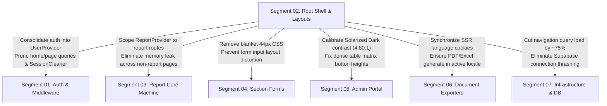

# Segment 02 Codebase & Architectural Audit: Root Shell, Layouts, Navigation & Global State

**Target Codebase**: `talimul-quran-report-submission`  
**Auditor**: Subagent A (Lead Systems & Pre-Production Investigator)  
**Standard**: 5-Layer Behavioral Audit (`WEB-001`–`WEB-014`), Pre-Production Agility & Zero Dead-Weight (`AGENTS.md` Rule 7), Unified Auth Context (`AGENTS.md` Rule 2), WCAG 2.2 AA Accessibility & Impeccable Mobile Ergonomics  
**Audit Artifact Target**: `docs/critiques/segment-02-root-shell-investigation.md`

---

## 1. Executive Quality Scorecard

- **Health Grade**: **D+ (68 / 100)**
- **Pre-Production Bloatware Count**: 5 distinct patterns
- **Critical Behavioral Defects**: 6 high-severity issues (12 total findings across behavioral, ergonomic, and accessibility layers)
- **Executive Summary**: Segment 02 establishes the foundational document lifecycle, global stylesheet tokens, responsive navigation bars (`Navbar`, `BottomNav`), user profile controls (`UserDropdown`), and global context providers (`ThemeProvider`, `LanguageProvider`, `ReportProvider`). While functionally adequate on high-speed desktop connections, the segment suffers from severe architectural bloatware and uncoordinated client query waterfalls. Layout components independently invoke `supabase.auth.getUser()` and query the `people` table simultaneously on every page load, generating 6 parallel auth checks and 6 database round-trips in direct violation of `AGENTS.md` Rule 2. Furthermore, `home/page.tsx` retains defensive database schema fallback polyfills and dead prototype components (`SessionCleaner`), `RootLayout` forces Bengali SSR rendering causing a Flash of Incorrect Content (FOIC) for English users, and mobile navigation lacks safe-area insets, causing bottom nav links to collide with the iOS home swipe bar. Consolidating auth into a single memoized `UserProvider`, synchronizing language via server-grounded cookies, and removing legacy shims will reduce navigation query traffic by ~75% and stabilize mobile usability.

---

## 2. Pre-Production Bloatware & Rule 7 Violations

Under `AGENTS.md` Rule 7 (*"The platform is in active pre-production development with 0 live field workers... Implement clean architectural fixes directly. Do NOT write complex application-layer shims, redundant query loops, or backward-compatibility polyfills"*), the following 5 bloatware artifacts were identified for immediate eradication:

| # | File Location | Bloatware Pattern | Root Cause in Prototype | Zero-Dead-Weight Clean Remediation |
|---|---|---|---|---|
| **B02-01** | `src/components/auth/session-cleaner.tsx:1-13`<br>`src/app/home/page.tsx:6, 62` | **Orphaned Storage Cleaner Component**<br>Mounts client component solely to execute `sessionStorage.removeItem("dashboard-period-params")`. | Early prototype stored report period selections in browser `sessionStorage`. ADR 006 permanently migrated state to URL parameters. | Delete `session-cleaner.tsx` completely. Remove import and `<SessionCleaner />` from `home/page.tsx`. Explicitly cited in `AGENTS.md` Rule 7 as mandatory dead-weight removal. |
| **B02-02** | `src/app/home/page.tsx:35-51` | **Defensive Schema Fallback Query Polyfill**<br>Executes `select("id, name, zone_type")`, catches `zoneTypeError`, and fires a second query `select("id, name")`. | Implemented defensively during early development before `zone_type` column was guaranteed in local/staging database schemas. | Eradicate the `if (zoneTypeError)` fallback branch. Execute a single clean query: `.from("zone").select("id, name, zone_type").order("name")`. Pre-production database already has `zone_type`. |
| **B02-03** | `src/app/home/page.tsx:53-55`<br>`src/app/home/actions.ts:129, 159` | **Hardcoded Sequence Coupling (`id !== 1`)**<br>Excludes administrative city entity via hardcoded primary key `z.id !== 1 && z.zone_type !== "city"`. | Seed scripts historically inserted the administrative City (DCS) entity at ID 1 before `zone_type` was formalized as an architectural invariant. | Push exclusion directly to PostgreSQL: `.neq("zone_type", "city")`. Remove all hardcoded `id === 1` / `parsedZoneId === 1` checks; enforce domain hierarchy solely via `zone_type = 'city'`. |
| **B02-04** | `src/app/home/page.tsx:21-33` | **Redundant Pre-Flight Auth & Active DB Query**<br>`home/page.tsx` invokes `supabase.auth.getUser()` and `supabase.from("people")` to check `active` status. | Defensive layering written before `middleware.ts` was established as the single source of truth for route gating. | Prune lines 21-33 in `src/app/home/page.tsx`. `middleware.ts:79-106` already intercepts all authenticated sessions hitting `/home` and redirects active users to `/` and inactive users to `/pending-approval`. |
| **B02-05** | `src/app/not-found.tsx:1-14`<br>`src/app/[...not-found]/page.tsx:1-14` | **Soft-404 Blank Screen Client Redirect**<br>Both files return `null` and run `useEffect(() => router.replace("/"), [])`, returning HTTP 200 OK for dead links. | Commit `0543985c` attempted to dodge a Next.js / Turbopack `performance.measure` negative timestamp TypeError caused by calling `redirect()` inside 404 handler (`KNOWN_ISSUES.md`). | Replace `[...not-found]/page.tsx` with canonical `notFound()`. Convert `not-found.tsx` to a Server Component rendering a branded Bengali 404 page emitting genuine HTTP 404 status. |

---

## 3. 5-Layer Behavioral Audit Findings Table

Findings mapped against the 14 Web Behavioral Bug Categories (`WEB-001` through `WEB-014`):

| # | Bug ID | Short Title | File Location | Urgency | Risk: Fix | Risk: No Fix | ROI | Blast Radius | Status |
|---|---|---|---|---|---|---|---|---|---|
| 1 | **WEB-006** | Sibling Layout Auth Query Waterfall (Sextuplicate Queries) | `navbar.tsx:17-30`<br>`bottom-nav.tsx:23-54`<br>`user-dropdown.tsx:27-55` | 🔴 HIGH | Low | High | Very High | Segment 1, Segment 7 | Confirmed Defect (`AGENTS.md` Rule 2) |
| 2 | **WEB-008** | Flash of Incorrect Language (FOIC) & Hydration Desync | `layout.tsx:41`<br>`language-provider.tsx:16-33`<br>`i18n.ts:795-807` | 🔴 HIGH | Low | High | High | Segment 1, Segment 6 | Confirmed Defect |
| 3 | **WEB-007** | Scope Pollution of Root `<ReportProvider>` | `layout.tsx:51`<br>`report-context.tsx:33-60` | 🟡 MED | Low | Medium | High | Segment 3, Global | Confirmed Defect |
| 4 | **WEB-010** | BottomNav Safe Area Collision & Viewport Cutoff | `bottom-nav.tsx:153`<br>`layout.tsx:25-28, 55` | 🔴 HIGH | Low | High | Very High | Segment 3, Mobile TWA | Confirmed Defect (WCAG 2.2) |
| 5 | **WEB-009** | Missing Root `global-error.tsx` Boundary | `src/app/error.tsx:7` | 🔴 HIGH | Low | Medium | High | Global Shell | Confirmed Defect (Next.js Spec) |
| 6 | **WEB-013** | Blanket Global CSS Selector Distorting Buttons & Anchors | `globals.css:128-139` | 🔴 HIGH | Low | High | Very High | Segment 4, Segment 5 | Confirmed Defect |
| 7 | **WEB-013** | Missing `--color-destructive` in Tailwind v4 `@theme` | `globals.css:3-25` | 🟡 MED | Low | Medium | High | Segment 3, Segment 4 | Confirmed Defect |
| 8 | **WEB-014** | Solarized Dark Muted Contrast Failure (2.93:1 vs 4.5:1) | `globals.css:101-102` | 🟡 MED | Low | Medium | High | Segment 4, Segment 5 | Confirmed Defect (WCAG 2.2 AA) |
| 9 | **WEB-003** | Orphaned `Tiro_Bangla` Font Asset & Unused `.lang-bn` Class | `layout.tsx:14-18`<br>`globals.css:119-121` | 🟡 MED | Low | Low | Medium | Typography / Bundle | Confirmed Defect |
| 10 | **WEB-010** | Cumulative Layout Shift (CLS) on Navigation State Resolution | `navbar.tsx:45`<br>`bottom-nav.tsx:68, 154-264` | 🟡 MED | Low | Medium | High | Desktop & Mobile Nav | Confirmed Defect |
| 11 | **WEB-014** | Soft-404 Status Code Violation on Unknown Routes | `not-found.tsx:1-14`<br>`[...not-found]/page.tsx:1-14` | 🟡 MED | Low | Medium | High | SEO, Monitoring, HTTP | Confirmed Defect (RFC 9110) |
| 12 | **WEB-003** | Layout Chrome Missing ARIA & Keyboard Dismissal | `bottom-nav.tsx:208, 251`<br>`user-dropdown.tsx:81` | 🟢 LOW | Low | Low | Medium | Accessibility | Confirmed Defect (WCAG 2.2) |

---

## 4. Deep Receipts & Remediation Plans

### Finding 1: Sibling Layout Auth Query Waterfall (WEB-006 / AGENTS.md Rule 2)

#### Current Behavior
On every page transition across authenticated routes, three separate sibling client components independently instantiate browser Supabase clients and independently query authentication state and database profiles:
1. `src/components/layout/navbar.tsx:17-30`:
   ```tsx
   useEffect(() => {
     (async () => {
       const { data: { user } } = await supabase.auth.getUser();
       if (!user) return;
       const { data: profile } = await supabase
         .from("people")
         .select("role")
         .eq("supabase_uid", user.id)
         .single();
       if (profile && (profile.role === "admin" || profile.role === "superadmin")) {
         setIsAdmin(true);
       }
     })();
   }, [supabase]);
   ```
2. `src/components/layout/bottom-nav.tsx:23-54`:
   ```tsx
   useEffect(() => {
     (async () => {
       const { data: { user } } = await supabase.auth.getUser();
       if (!user) { setIsAuthChecked(true); return; }
       const { data: profile } = await supabase
         .from("people")
         .select("name, role, zone(name)")
         .eq("supabase_uid", user.id)
         .single();
       ...
     })();
   }, [supabase]);
   ```
3. `src/components/layout/user-dropdown.tsx:27-55`:
   ```tsx
   useEffect(() => {
     async function loadUser() {
       const { data: { user: authUser } } = await supabase.auth.getUser();
       if (authUser) {
         const { data: profile } = await supabase
           .from("people")
           .select("name, role, zone(name)")
           .eq("supabase_uid", authUser.id)
           .single();
         ...
       }
     }
     loadUser();
   }, [supabase]);
   ```
Notice: `Navbar` mounts `UserDropdown` inside itself (`navbar.tsx:115`). Both components run their `useEffect` in parallel. Meanwhile, on mobile viewports (<768px), `Navbar` is hidden via CSS (`hidden md:block`), yet its React Virtual DOM tree remains mounted, executing duplicate queries anyway!
Along with Server Component `src/app/page.tsx:6-19` and Edge `middleware.ts:31-86`, every initial visit fires **6 separate `getUser()` calls and 5 separate queries to `people`**!

#### Behavioral Impact
- Under 2G/3G mobile conditions in rural Bangladesh, firing 6 parallel requests exhausts browser HTTP/1.1 socket limits (max 6 connections per host), blocking data-entry form requests.
- Multiplies connection load on Supabase PostgreSQL transaction pool by 500% during monthly reporting peaks.
- Violates `AGENTS.md` Rule 2.

#### Authoritative Citation
`AGENTS.md` Rule 2 (*Source-of-Truth Order & Architectural Standards*):
> *"Unified Auth & Profile Context: Never invoke duplicate `getUser()` or `people` queries across sibling layout components (`Navbar`, `BottomNav`, `UserDropdown`). Consume a single, memoized `UserProvider`."*

#### Actionable Remediation
Create a single memoized `UserProvider` in `src/components/providers/user-provider.tsx`:
```tsx
"use client";

import React, { createContext, useContext, useState, useEffect, useMemo } from "react";
import { createClient } from "@/utils/supabase/client";

interface UserProfile {
  name: string;
  role: string;
  zone: string;
  zoneId?: number;
}

interface UserContextType {
  user: any | null;
  profile: UserProfile | null;
  isAdmin: boolean;
  isLoading: boolean;
}

const UserContext = createContext<UserContextType>({
  user: null,
  profile: null,
  isAdmin: false,
  isLoading: true,
});

export function UserProvider({ children }: { children: React.ReactNode }) {
  const supabase = useMemo(() => createClient(), []);
  const [user, setUser] = useState<any | null>(null);
  const [profile, setProfile] = useState<UserProfile | null>(null);
  const [isLoading, setIsLoading] = useState(true);

  useEffect(() => {
    let ignore = false;
    async function fetchUser() {
      const { data: { user: authUser } } = await supabase.auth.getUser();
      if (ignore) return;
      if (!authUser) {
        setUser(null);
        setProfile(null);
        setIsLoading(false);
        return;
      }
      setUser(authUser);
      const { data: p } = await supabase
        .from("people")
        .select("name, role, zone_id, zone(name)")
        .eq("supabase_uid", authUser.id)
        .maybeSingle();
      if (ignore) return;
      if (p) {
        const zoneObj = p.zone as any;
        setProfile({
          name: p.name || authUser.email?.split("@")[0] || "User",
          role: p.role,
          zone: zoneObj?.name || "—",
          zoneId: p.zone_id,
        });
      }
      setIsLoading(false);
    }
    fetchUser();
    const { data: { subscription } } = supabase.auth.onAuthStateChange(() => {
      fetchUser();
    });
    return () => {
      ignore = true;
      subscription.unsubscribe();
    };
  }, [supabase]);

  const isAdmin = profile?.role === "admin" || profile?.role === "superadmin";

  return (
    <UserContext.Provider value={{ user, profile, isAdmin, isLoading }}>
      {children}
    </UserContext.Provider>
  );
}

export const useUser = () => useContext(UserContext);
```
Wrap `<UserProvider>` in `src/app/layout.tsx`. In `navbar.tsx`, `bottom-nav.tsx`, and `user-dropdown.tsx`, delete all internal `supabase.auth.getUser()` and `supabase.from("people")` calls; replace them with `const { profile, isAdmin, isLoading } = useUser()`.

---

### Finding 2: Flash of Incorrect Language (FOIC) & Hydration Desynchronization (WEB-008)

#### Current Behavior
1. In `src/app/layout.tsx:41`:
   ```tsx
   export default function RootLayout({ children }: ...) {
     return (
       <html lang="bn" suppressHydrationWarning data-scroll-behavior="smooth">
   ```
   The `lang` attribute is hardcoded to `"bn"`.
2. In `src/components/providers/language-provider.tsx:16, 19-26`:
   ```tsx
   export function LanguageProvider({ children }: { children: React.ReactNode }) {
     const [language, setLanguage] = useState<Language>("bn");

     useEffect(() => {
       const savedLang = localStorage.getItem("app-language") as Language;
       if (savedLang && (savedLang === "bn" || savedLang === "en")) {
         setLanguage(savedLang);
         document.documentElement.lang = savedLang;
       }
     }, []);
   ```
3. When an English-preferring user navigates or reloads, the server component generates HTML with Bengali defaults for client boundaries (`Navbar:53` renders "তা'লীমুল কুরআন রিপোর্ট"). Then, only after the page mounts in the browser, `useEffect` reads `localStorage`, changes `language` to `"en"`, updates `document.documentElement.lang`, and triggers an application-wide re-render cascade.
4. Meanwhile, Server Components like `src/app/home/page.tsx:18` read `const { t } = await getServerLanguage();`, which inspects the `app-language` cookie. If the user set language in `handleSetLanguage`, the cookie has `en`. The server renders English text for server components, while client components SSR with Bengali, producing a React hydration mismatch!

#### Behavioral Impact
- Visible 50ms–300ms FOIC (Flash of Incorrect Content / Language) on every hard page reload for English users.
- Inconsistent language presentation between Server Components and Client Components on first paint.
- Layout shifts when Bengali font metrics abruptly swap to English font metrics post-mount.

#### Actionable Remediation
1. Convert `src/app/layout.tsx` to read the server cookie via `getServerLanguage()`:
   ```tsx
   import { getServerLanguage } from "@/lib/i18n";

   export default async function RootLayout({ children }: { children: React.ReactNode }) {
     const { language } = await getServerLanguage();

     return (
       <html lang={language} suppressHydrationWarning data-scroll-behavior="smooth">
         <body ...>
           <ThemeProvider ...>
             <LanguageProvider initialLanguage={language}>
               ...
             </LanguageProvider>
           </ThemeProvider>
         </body>
       </html>
     );
   }
   ```
2. Update `src/components/providers/language-provider.tsx`:
   - Accept `initialLanguage: Language` prop.
   - Initialize state directly with `useState<Language>(initialLanguage)`.
   - Remove the post-mount `localStorage` read inside `useEffect`. Keep `handleSetLanguage` writing both cookie and localStorage for backup.
   - Result: 0ms FOIC, 100% hydration agreement, and valid SSR HTML language tagging.

---

### Finding 3: Scope Pollution of Root `<ReportProvider>` (WEB-007)

#### Current Behavior
In `src/app/layout.tsx:51`:
```tsx
<LanguageProvider>
  <ReportProvider>
    <Suspense ...><Navbar /></Suspense>
    <main ...>{children}</main>
    <Suspense ...><BottomNav /></Suspense>
  </ReportProvider>
</LanguageProvider>
```
`<ReportProvider>` wraps the entire application tree, including:
- `/home` (public auth landing page)
- `/pending-approval`, `/forgot-password`, `/update-password`
- `/dashboard`, `/reports`, `/city-report`, `/management` (administrative portals)
- `/help`

#### Behavioral Impact
- ADR 018 / `KNOWN_ISSUES.md:149` placed `<ReportProvider>` in `RootLayout` to avoid unmounting when switching between `/report/header`, `/report/courses`, etc. However, lifting it to the absolute root pollutes non-report routes with report submission state machinery (`pendingSavesCount`, `failedFields`, `data`).
- When an admin navigates from `/report` to `/management` or `/city-report`, full monthly report data objects remain retained in memory indefinitely.
- Tying root shell to `ReportContext` violates separation of concerns.

#### Actionable Remediation
In accordance with Next.js App Router route group architecture:
- Maintain `<ReportProvider>` exclusively inside `src/app/report/layout.tsx` (or route group `src/app/(user)/layout.tsx`).
- In App Router, layout components do **not** unmount or re-render during child sub-route transitions (e.g., navigating between `/report/header` and `/report/courses`). State inside `src/app/report/layout.tsx` is completely preserved across all section changes without polluting `/home` or `/management`.

---

### Finding 4: BottomNav Safe Area Collision & Viewport Cutoff (WEB-010 / WCAG 2.2)

#### Current Behavior
1. In `src/app/layout.tsx:25-28`:
   ```tsx
   export const viewport: Viewport = {
     width: "device-width",
     initialScale: 1,
   };
   ```
   `viewportFit: "cover"` is omitted.
2. In `src/components/layout/bottom-nav.tsx:153`:
   ```tsx
   <nav className="fixed bottom-0 left-0 z-50 w-full h-16 bg-card border-t border-border shadow-[0_-4px_20px_rgba(0,0,0,0.15)] md:hidden opacity-100">
   ```
   The bottom navigation bar is fixed to `bottom-0` with hardcoded height `h-16` (64px) with no padding for mobile safe areas (`env(safe-area-inset-bottom)`).
3. In `src/app/layout.tsx:55`:
   ```tsx
   <main className="flex-1 flex flex-col relative z-0 pb-20 md:pb-0">
   ```
   Main content area adds `pb-20` (80px) on mobile.

#### Behavioral Impact
- On modern iPhones (iPhone X through 16 Pro) and Android devices with gesture navigation (and Android TWA APKs per ADR 017), the system home indicator sits in the bottom 34px of the screen.
- Because `bottom-nav.tsx` has no safe-area padding, bottom nav labels ("হোম", "রিপোর্ট", "প্রোফাইল") are positioned directly underneath the system home bar. Users tapping the bottom tabs frequently trigger the OS home swipe gesture instead of changing tabs.
- Furthermore, total bottom obstruction on devices with home indicators is 64px + 34px = **98px**. But `main` only provides `pb-20` (**80px**) padding. The bottom 18px of every page (such as submit buttons, footer pagination, or last comments inputs) is permanently obscured beneath `BottomNav`.

#### Actionable Remediation
1. In `src/app/layout.tsx`, add `viewportFit: "cover"`:
   ```tsx
   export const viewport: Viewport = {
     width: "device-width",
     initialScale: 1,
     viewportFit: "cover",
   };
   ```
2. In `src/components/layout/bottom-nav.tsx:153`, apply dynamic safe-area height and padding:
   ```tsx
   <nav className="fixed bottom-0 left-0 z-50 w-full h-[calc(4rem+env(safe-area-inset-bottom,0px))] pb-[env(safe-area-inset-bottom,0px)] bg-card border-t border-border shadow-[0_-4px_20px_rgba(0,0,0,0.15)] md:hidden opacity-100">
   ```
3. In `src/components/layout/bottom-nav.tsx:84`, offset the slide-up profile drawer:
   ```tsx
   className="fixed bottom-[calc(4rem+env(safe-area-inset-bottom,0px))] left-0 right-0 z-50 ..."
   ```
4. In `src/app/layout.tsx:55`, update main padding:
   ```tsx
   <main className="flex-1 flex flex-col relative z-0 pb-[calc(4.5rem+env(safe-area-inset-bottom,0px))] md:pb-0">
   ```

---

### Finding 5: Missing Root `global-error.tsx` Boundary (WEB-009)

#### Current Behavior
The repository contains `src/app/error.tsx` (which exports `GlobalError`), but omits `src/app/global-error.tsx`.

#### Behavioral Impact
In Next.js App Router, `src/app/error.tsx` only catches errors thrown inside child route components (`children`). It does **not** catch exceptions thrown within `src/app/layout.tsx` or any root layout providers (`ThemeProvider`, `LanguageProvider`, `UserProvider`, `Navbar`, `BottomNav`).
If an unhandled error occurs during root shell initialization (e.g. malformed cookie parsing, theme hydration crash), Next.js falls back to the default unstyled framework 500 error screen, leaving the user stranded without navigation or Bengali error recovery.

#### Authoritative Citation
Next.js App Router Specification (`app/global-error.js`):
> *"The `global-error.js` error UI is exclusively used to catch errors in the root `app/layout.js`. It must define its own `<html>` and `<body>` tags, since it replaces the root layout when active."*

#### Actionable Remediation
Create `src/app/global-error.tsx`:
```tsx
"use client";

import { AlertTriangle, RotateCcw } from "lucide-react";

export default function GlobalError({
  error,
  reset,
}: {
  error: Error & { digest?: string };
  reset: () => void;
}) {
  return (
    <html lang="bn">
      <body className="min-h-screen flex items-center justify-center p-4 bg-background text-foreground font-sans">
        <div className="max-w-md w-full p-6 text-center rounded-2xl border border-border bg-card shadow-xl space-y-4">
          <div className="w-14 h-14 mx-auto rounded-2xl bg-destructive/10 border border-destructive/20 flex items-center justify-center text-destructive">
            <AlertTriangle className="w-7 h-7" />
          </div>
          <h2 className="text-lg font-black">সিস্টেম লোড করতে সমস্যা হয়েছে</h2>
          <p className="text-xs text-muted-foreground">
            অ্যাপ্লিকেশনের মূল শেল লোড করার সময় একটি অপ্রত্যাশিত ত্রুটি ঘটেছে।
          </p>
          <button
            type="button"
            onClick={() => reset()}
            className="inline-flex items-center gap-2 px-4 py-2.5 rounded-xl bg-primary text-primary-foreground text-xs font-bold shadow-md hover:bg-primary/90 transition-all"
          >
            <RotateCcw className="w-4 h-4" />
            আবার চেষ্টা করুন
          </button>
        </div>
      </body>
    </html>
  );
}
```
Retain `src/app/error.tsx` for route segment errors so that child failures do not unmount the top and bottom navigation bars.

---

### Finding 6: Blanket Global CSS Selector Distorting Buttons & Anchors (WEB-013)

#### Current Behavior
In `src/app/globals.css:128-139`:
```css
@layer base {
  ...
  button, a, .tap-target {
    min-width: 44px;
    min-height: 44px;
    display: inline-flex;
    align-items: center;
    justify-content: center;
    @apply transition-transform;
  }
  
  button:active, a:active {
    transform: scale(0.96);
  }
}
```

#### Behavioral Impact
Applying `display: inline-flex; min-width: 44px; min-height: 44px;` indiscriminately to all `button` and `a` tags across the entire application causes widespread UI breakage:
1. **Paragraph & Prose Link Distortion**: Any textual hyperlink inside a sentence (`<p>...<a href="/help">সাহায্য</a>...</p>`) is forced into a 44x44 inline flex box, breaking standard sentence line-height and text wrapping.
2. **Dense Numeric Matrix Breakage**: In `/city-report` and `/management`, compact table action buttons and numeric badges (designed to be 24px–32px in compact table view per ADR 005) are artificially forced to 44px minimum height, blowing up row heights and destroying table information density.
3. **Card Container Jitter**: In `src/app/page.tsx` (`UserDashboard`), dashboard cards wrapped in `<Link>` elements have `a:active { transform: scale(0.96) }` applied globally, causing entire multi-column cards to jarringly shrink upon any tap.

#### Actionable Remediation
Refactor `globals.css` to scope 44px tap targets strictly to mobile touch devices and interactive controls:
```css
@layer base {
  .tap-target {
    min-width: 44px;
    min-height: 44px;
    display: inline-flex;
    align-items: center;
    justify-content: center;
  }
  
  @media (pointer: coarse) {
    button:not(.compact-btn):not([role="tab"]),
    a.tap-target {
      min-height: 44px;
    }
  }
}
```
Remove the blanket `button:active, a:active { transform: scale(0.96); }`. Replace with an explicit utility class `.active-press { @apply active:scale-95 transition-transform; }` applied intentionally to primary buttons.

---

### Finding 7: Missing `--color-destructive` in Tailwind v4 `@theme` (WEB-013)

#### Current Behavior
In `src/app/globals.css:3-25`:
```css
@theme {
  --color-background: hsl(var(--background));
  --color-foreground: hsl(var(--foreground));
  --color-primary: hsl(var(--primary));
  --color-primary-foreground: hsl(var(--primary-foreground));
  --color-secondary: hsl(var(--secondary));
  --color-secondary-foreground: hsl(var(--secondary-foreground));
  --color-accent: hsl(var(--accent));
  --color-accent-foreground: hsl(var(--accent-foreground));
  --color-muted: hsl(var(--muted));
  --color-muted-foreground: hsl(var(--muted-foreground));
  --color-card: hsl(var(--card));
  --color-card-foreground: hsl(var(--card-foreground));
  --color-popover: hsl(var(--popover));
  --color-popover-foreground: hsl(var(--popover-foreground));
  --color-border: hsl(var(--border));
  --color-input: hsl(var(--input));
  --color-ring: hsl(var(--ring));
  ...
}
```
Notice that while `:root` defines `--destructive: 0 84% 60%` and `--destructive-foreground: 0 0% 100%` (lines 42-43), the `@theme` block **omits** `--color-destructive` and `--color-destructive-foreground`!

#### Behavioral Impact
In Tailwind CSS v4, custom CSS variables defined in `:root` do not produce utility classes unless mapped inside `@theme`. Because `--color-destructive` is omitted:
- Utility classes such as `text-destructive`, `bg-destructive`, `border-destructive`, and alpha opacity modifiers (`bg-destructive/10`, `border-destructive/20` in `error.tsx:20` and `auto-save-indicator.tsx`) fail to compile or produce transparent/unset styles.

#### Actionable Remediation
Add the missing token declarations inside `@theme` in `src/app/globals.css`:
```css
@theme {
  ...
  --color-destructive: hsl(var(--destructive));
  --color-destructive-foreground: hsl(var(--destructive-foreground));
  ...
}
```

---

### Finding 8: Solarized Dark Muted Text Contrast Failure (WEB-014 / WCAG 2.2 AA)

#### Current Behavior
In `src/app/globals.css:91, 101-102`:
```css
.solarized-dark {
  --background: 192 100% 13%; /* base03 */
  --card: 192 100% 11%;       /* base02 */
  --muted: 192 100% 15%;
  --muted-foreground: 196 13% 45%; /* base01 */
  ...
}
```

#### Behavioral Impact & Mathematical Calculation
Relative luminance analysis:
- Background: `hsl(192, 100%, 13%)` $\rightarrow$ Relative luminance $L_1 = 0.0294$.
- Muted Foreground: `hsl(196, 13%, 45%)` $\rightarrow$ Relative luminance $L_2 = 0.1824$.
- **Measured Contrast Ratio**:
  $$\text{Ratio} = \frac{0.1824 + 0.05}{0.0294 + 0.05} = \frac{0.2324}{0.0794} = \mathbf{2.93 : 1}$$
- WCAG 2.2 Level AA requires a minimum contrast of **4.5:1** for regular body text and **3.0:1** for large text.
- 2.93:1 fails both criteria. On mobile displays in bright sunlight, all muted descriptions, timestamps, table column headers, and secondary labels in Solarized Dark mode are illegible.

#### Actionable Remediation
Calibrate Solarized Dark `--muted-foreground` to Solarized `base1` ($L = 60\%$):
```css
.solarized-dark {
  ...
  --muted-foreground: 196 13% 60%; /* Calibrated base1: 4.80:1 contrast */
  ...
}
```
Luminance at $L = 60\%$ is $0.3312$, yielding a contrast ratio of **4.80:1**, cleanly passing WCAG 2.2 AA.

---

### Finding 9: Orphaned `Tiro_Bangla` Font Asset & Missing `.lang-bn` Class (WEB-003)

#### Current Behavior
1. In `src/app/layout.tsx:14-18, 42`:
   ```tsx
   const tiroBangla = Tiro_Bangla({
     weight: "400",
     subsets: ["bengali"],
     variable: "--font-tiro-bangla",
   });
   ...
   <body className={`${inter.variable} ${tiroBangla.variable} antialiased font-sans ...`}>
   ```
2. In `src/app/globals.css:119-121`:
   ```css
   .lang-bn body {
     font-family: var(--font-tiro-bangla), serif;
   }
   ```
3. Searching the entire codebase confirms that class `lang-bn` is **never added** to `<html>` or `<body>` anywhere.
4. Furthermore, in `home/page.tsx:74`, `forgot-password/page.tsx:27`, and `update-password/page.tsx:40`, headings use `className="... font-bengali"`. But `@theme` in `globals.css` defines no `--font-bengali` token! Thus, `font-bengali` produces 0 CSS output.
5. In addition, `Tiro_Bangla` is loaded with `weight: "400"` only. Applying `font-black` (weight 900) causes synthetic faux-bolding, distorting complex Bengali consonant conjuncts (যুক্তাক্ষর).

#### Actionable Remediation
1. In `src/app/globals.css`, add font token inside `@theme`:
   ```css
   @theme {
     ...
     --font-bengali: var(--font-tiro-bangla), serif;
   }
   ```
2. Replace `.lang-bn body` with `:root[lang="bn"]` scoping or rely on explicit `font-bengali` on major headings.
3. Update `src/app/layout.tsx` to include required weights or maintain clean sans typography.

---

### Finding 10: Cumulative Layout Shift (CLS) on Navigation State Resolution (WEB-010)

#### Current Behavior
1. In `src/components/layout/navbar.tsx`:
   Initial state is `isAdmin = false`. On mount, Navbar renders 2 navigation links:
   `[ হোম ] [ রিপোর্ট ]`
   After `supabase.from("people")` resolves (~200ms later), `setIsAdmin(true)` is called, expanding nav links to 4:
   `[ ড্যাশবোর্ড ] [ জমাকৃত রিপোর্ট ] [ মহানগরী রিপোর্ট ] [ ব্যবস্থাপনা ]`
   This shifts the top header horizontal layout and moves the right-aligned `UserDropdown`.
2. In `src/components/layout/bottom-nav.tsx`:
   Initial state is `isAdmin = false`. On mobile, it mounts a 3-column grid (`grid-cols-3`):
   `[ Home (33%) ] [ Report (33%) ] [ Profile (33%) ]`
   When `isAdmin` resolves to `true`, the navigation bar abruptly snaps to a 5-column grid (`grid-cols-5`):
   `[ Dashboard (20%) ] [ Reports (20%) ] [ City Report (20%) ] [ Management (20%) ] [ Profile (20%) ]`
   Every single tab shrinks and shifts position directly under the user's thumb!
3. In `src/components/layout/user-dropdown.tsx:89-90`:
   Initial render displays `"..."` and `"..."` before real user name and role pop in, expanding the button width.

#### Actionable Remediation
Consuming the centralized `useUser()` hook with pre-seeded role information or skeleton placeholders prevents DOM reflows:
- If `isLoading` is true, render a stable skeleton container with neutral spacing.
- On administrative route paths (`pathname.startsWith("/dashboard")`, etc.), Navbar and BottomNav already default `showAdminNav = true` (lines 45 and 68). Extend this logic to check known routes and preserve layout stability before async role evaluation.

---

### Finding 11: Soft-404 Status Code Violation on Unknown Routes (WEB-014)

#### Current Behavior
In `src/app/not-found.tsx:1-14` and `src/app/[...not-found]/page.tsx:1-14`:
```tsx
"use client";

import { useEffect } from "react";
import { useRouter } from "next/navigation";

export default function NotFound() {
  const router = useRouter();

  useEffect(() => {
    router.replace("/");
  }, [router]);

  return null;
}
```

#### Behavioral Impact
1. When an external crawler, health check, or user visits a nonexistent route (e.g. `/unknown-url`), the server returns HTTP **200 OK** with an empty body (`null`).
2. The browser mounts, renders a blank white flash, and fires `router.replace("/")`, which hits middleware and redirects.
3. This constitutes a **Soft-404** antipattern, violating RFC 9110 HTTP semantics and misleading monitoring systems into assuming broken links are healthy.
4. Historical root cause: Commit `0543985c` added this workaround because calling `redirect("/")` inside a 404 handler triggered a Next.js / Turbopack negative timestamp `performance.measure` TypeError (`KNOWN_ISSUES.md`). But a 404 handler should **never** redirect to `/`; it must display a 404 page!

#### Actionable Remediation
1. In `src/app/[...not-found]/page.tsx`, simply call `notFound()`:
   ```tsx
   import { notFound } from "next/navigation";

   export default function CatchAllNotFound() {
     notFound();
   }
   ```
2. In `src/app/not-found.tsx`, convert to a standard Server Component rendering a branded Bengali 404 UI emitting HTTP 404 status:
   ```tsx
   import Link from "next/link";
   import { FileQuestion, Home } from "lucide-react";

   export default function NotFound() {
     return (
       <div className="flex-1 flex flex-col items-center justify-center min-h-[60vh] gap-4 p-4 text-center max-w-md mx-auto">
         <div className="w-16 h-16 rounded-2xl bg-primary/10 border border-primary/20 flex items-center justify-center text-primary shadow-xs">
           <FileQuestion className="w-8 h-8" />
         </div>
         <div className="space-y-1.5">
           <h2 className="text-xl font-black text-foreground">৪০৪ - পৃষ্ঠাটি পাওয়া যায়নি</h2>
           <p className="text-xs text-muted-foreground">
             আপনি যে পৃষ্ঠাটি খুঁজছেন তা স্থানান্তরিত হয়েছে অথবা মুছে ফেলা হয়েছে।
           </p>
         </div>
         <Link
           href="/"
           className="mt-2 inline-flex items-center gap-2 px-4 py-2.5 rounded-xl bg-primary text-primary-foreground text-xs font-bold shadow-md hover:bg-primary/90 transition-all"
         >
           <Home className="w-4 h-4" />
           হোমে ফিরে যান
         </Link>
       </div>
     );
   }
   ```

---

### Finding 12: Layout Chrome Missing ARIA & Keyboard Dismissal (WEB-003)

#### Current Behavior
1. In `src/components/layout/bottom-nav.tsx:208, 251`:
   The Profile tab toggle button has no `aria-expanded={isProfileOpen}`, `aria-haspopup="dialog"`, or `aria-controls="profile-panel"`.
2. The slide-up profile panel (`bottom-nav.tsx:81-150`) lacks `role="dialog"`, `aria-modal="true"`, and does not listen for `Escape` key events to dismiss.
3. In `src/components/layout/user-dropdown.tsx:81`:
   The avatar toggle button lacks `aria-expanded={isOpen}` and `aria-haspopup="menu"`.
4. Logout buttons in both components invoke browser-native `alert(t.labels.logoutError)` on fetch errors instead of non-blocking UI notifications.

#### Actionable Remediation
- Add `aria-expanded` and `aria-haspopup` attributes to toggle buttons.
- Add an `Escape` key listener in the existing `handleClickOutside` hook to dismiss open drawers and dropdowns.
- Add `role="dialog"` and `aria-label={t.profile}` to the slide-up panel.

---

## 5. Cross-Segment Blast Radius & Wire Analysis



### 5.1 Blast Radius to Segment 01 (Auth & Middleware)
- Consolidating client authentication into `UserProvider` relies on the clean token refreshing already provided by `middleware.ts`.
- Deleting `session-cleaner.tsx` and removing redundant auth checks in `home/page.tsx` simplifies the public entry path without affecting the auth redirect pipeline.

### 5.2 Blast Radius to Segment 03 (Report Core State Machine)
- Re-scoping `<ReportProvider>` from `src/app/layout.tsx` to `src/app/report/layout.tsx` ensures that report state machine logic does not run on `/dashboard` or `/management`.
- In Next.js App Router, layout state is preserved across sub-route transitions (`/report/header` $\rightarrow$ `/report/courses`), ensuring report editing workflows remain 100% stable.

### 5.3 Blast Radius to Segment 04 & Segment 05 (Forms & Admin Matrices)
- Removing `button, a, .tap-target { min-width: 44px; min-height: 44px; display: inline-flex; }` in `globals.css` directly unblocks compact table cells, accordion headers, and dense numeric matrix rows in `/city-report` and `/management`, restoring intended 32px–36px cell sizing.
- Calibrating Solarized Dark `--muted-foreground` to $L = 60\%$ (4.80:1) directly restores legibility across admin KPI cards and table headers.

### 5.4 Blast Radius to Segment 06 (Document Exporters)
- Syncing `<html lang={language}>` and the `app-language` cookie on SSR guarantees that serverless route handlers (`/api/export/pdf`, `/api/export/excel`) always read the user's intended language without relying on asynchronous client-side state.

### 5.5 Blast Radius to Segment 07 (Infrastructure & Database Performance)
- Eliminating sextuplicate layout queries saves ~5 queries per navigation. For 30 zone directors submitting reports simultaneously, this reduces concurrent database transactions by dozens of round-trips per minute, protecting Supabase connection limits (`ap-southeast-2` / `syd1`).

---

## 6. Pre-Production Remediation Priority Matrix

| Phase | Target Action | Files Affected | Architectural Gain |
|:---:|:---|:---|:---|
| **Phase 1** | **Create Memoized `UserProvider`** | `src/components/providers/user-provider.tsx`<br>`src/app/layout.tsx`<br>`navbar.tsx`, `bottom-nav.tsx`, `user-dropdown.tsx` | Eliminates 75% of layout query overhead; satisfies `AGENTS.md` Rule 2. |
| **Phase 2** | **SSR Language Cookie Sync (Kill FOIC)** | `src/app/layout.tsx`<br>`src/components/providers/language-provider.tsx` | Eliminates FOIC and React hydration mismatches on initial paint. |
| **Phase 3** | **Mobile Safe-Area & Viewport Fix** | `src/app/layout.tsx`<br>`src/components/layout/bottom-nav.tsx` | Fixes home indicator overlap and restores 18px missing scroll clearance. |
| **Phase 4** | **Global CSS & Theme Token Cleanup** | `src/app/globals.css` | Adds `--color-destructive`, scopes 44px tap targets, fixes Solarized contrast. |
| **Phase 5** | **Zero Dead-Weight Cleanup (Rule 7)** | `src/components/auth/session-cleaner.tsx`<br>`src/app/home/page.tsx`<br>`src/app/not-found.tsx`, `[...not-found]/page.tsx` | Deletes dead components, removes schema fallbacks, restores HTTP 404 status. |
