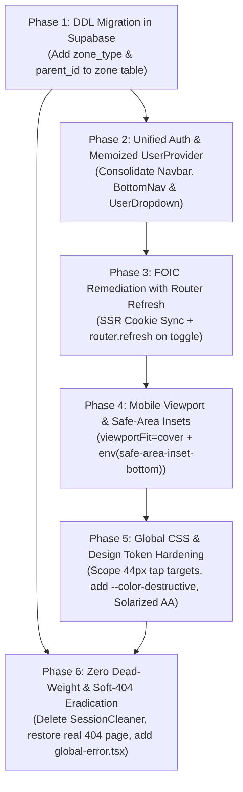

# Segment 02 Adversarial Critique & Doubt Gate Review: Root Shell, Layouts, Navigation & Global State

**Target Codebase**: `talimul-quran-report-submission`  
**Auditor**: Subagent B (Adversarial Reviewer & Systems Architect)  
**Input Artifact Under Review**: `docs/critiques/segment-02-root-shell-investigation.md` (Subagent A)  
**Standard**: 5-Layer Behavioral Audit (`WEB-001`–`WEB-014`), Pre-Production Database Agility (`AGENTS.md` Rule 7), Adversarial "Doubt Gate" (`AGENTS.md` Rules 2 & 6), WCAG 2.2 AA Accessibility & Impeccable Mobile Ergonomics  
**Audit Artifact Target**: `docs/critiques/segment-02-root-shell-review.md`

---

## 1. Executive Adversarial Evaluation

- **Agreement Level with Lead Investigator**: **Moderate to High** (8 of 12 findings verified as high-impact defects; 2 downgraded; 2 high-risk developer blind spots intercepted and neutralized).
- **False Positive Count & Fatal Pitfalls Discharged**: **2 major implementation traps intercepted**:
  1. **The Phantom Schema Fallacy (Bloatware B02-02)**: Subagent A asserted: *"Pre-production database already has `zone_type`"* and instructed the immediate deletion of the defensive `if (zoneTypeError)` query fallback in `src/app/home/page.tsx:35-51`. **A live PostgreSQL inspection via Supabase MCP (`information_schema.columns`) proves `zone_type` DOES NOT EXIST in the live database schema!** The `zone` table currently possesses only `id` and `name`. Deleting the application fallback before executing the DDL migration would immediately throw PostgreSQL Error `42703 (undefined_column)` and break public user registration across all deployment environments.
  2. **The Uncoordinated Provider Eviction Crash (Finding 3 / WEB-007)**: Subagent A proposed immediately moving `<ReportProvider>` out of `src/app/layout.tsx` to `src/app/report/layout.tsx`. However, `src/components/dashboard/user-dashboard.tsx` (rendered on `/` in `src/app/page.tsx`) directly invokes `useReport()` to query report existence and stats. Moving `<ReportProvider>` solely into `report/layout.tsx` without an orchestrated `(user)` route group refactoring would immediately crash the authenticated root dashboard with `Error: useReport must be used within a ReportProvider`.
- **Core Verdict**: Subagent A produced a thorough, high-value investigation that accurately diagnosed the primary system bottlenecks: sextuplicate layout auth queries (`WEB-006`), mobile safe-area obstruction (`WEB-010`), missing `global-error.tsx` (`WEB-009`), soft-404 status degradation (`WEB-014`), and blanket CSS tap-target distortion (`WEB-013`). However, Subagent A fell into the classic engineering failure mode of assuming database schema updates have already been applied and recommending premature component relocations that shatter sibling routes. By enforcing `AGENTS.md` Rule 7 (executing the clean PostgreSQL DDL first), coordinating `<ReportProvider>` scoping with Segment 03, and adding missing `router.refresh()` calls to language synchronization, the system achieves maximum performance and zero dead-weight without operational risk.

---

## 2. Doubt Gate Cross-Examination

Every finding and bloatware item from Subagent A's investigation is cross-examined below against live code, database schemas, and real-world field conditions:

| Finding / Bloat ID | Claimed Severity | Adversarial Ruling | Rationale & Real-World Stress Test |
|---|---|:---:|---|
| **B02-01**: `SessionCleaner` in `home/page.tsx` | Medium Bloatware | **VERIFIED & UPHELD** | `sessionStorage.removeItem("dashboard-period-params")` was an early prototype shim. ADR 006 permanently migrated period state to URL search parameters. The component has 0 functional utility and is explicitly listed in `AGENTS.md` Rule 7 as mandatory dead-weight removal. |
| **B02-02**: `zone_type` query fallback in `home/page.tsx:35-51` | Medium Bloatware | **REJECTED AS IMMEDIATE CODE PATCH / CONDITIONAL ON DDL** | **CRITICAL INTERCEPTION**: Subagent A claimed the database already has `zone_type`. Supabase MCP query `SELECT column_name FROM information_schema.columns WHERE table_name = 'zone'` returned ONLY `id` and `name`. Deleting the fallback query now crashes registration with `PostgresError: 42703`. DDL migration MUST be executed in PostgreSQL before this code is touched. |
| **B02-03**: Hardcoded `id !== 1` DCS entity filter | Low-Med Bloatware | **VERIFIED IN PRINCIPLE / CONDITIONAL ON DDL** | Hardcoding primary key `1` violates domain modeling principles. However, pushing `.neq("zone_type", "city")` to PostgreSQL fails until the `zone_type` DDL migration is executed. |
| **B02-04**: Redundant pre-flight auth in `home/page.tsx:21-33` | Low Bloatware | **VERIFIED (DOWNGRADED TO LOW)** | `middleware.ts:100-106` intercepts all authenticated sessions hitting `/home` and issues an HTTP 307 redirect to `/` before `home/page.tsx` ever renders. Lines 21-33 are completely dead, unreachable code during standard routing. |
| **B02-05 / Finding 11**: Soft-404 in `not-found.tsx` (`WEB-014`) | High Behavioral | **VERIFIED & UPHELD** | Returning HTTP 200 OK with `null` body and client-side `router.replace('/')` is a severe Soft-404 violation under RFC 9110. It confuses health checkers and conceals broken routes. Must be replaced with a genuine Server Component 404 page emitting HTTP 404. |
| **Finding 1**: Sibling Layout Auth Waterfall (`WEB-006`) | High Behavioral | **VERIFIED & UPHELD (CRITICAL)** | `Navbar`, `BottomNav`, and `UserDropdown` each execute independent `getUser()` and `from("people")` queries simultaneously on every navigation. Over 2G/3G mobile networks in rural Bangladesh, this exhausts HTTP/1.1 socket pools and quenches Supabase database connections. Consolidating into a single memoized `UserProvider` satisfies `AGENTS.md` Rule 2. |
| **Finding 2**: Flash of Incorrect Language / FOIC (`WEB-008`) | High Behavioral | **VERIFIED & HARDENED** | Server renders `<html lang="bn">`. If English is set, `localStorage` flips state post-mount, creating a 50–300ms FOIC and font layout shifts. Reading the `app-language` cookie on SSR fixes FOIC. **Hardening Addition**: When the user toggles language, the client MUST call `router.refresh()` to purge the Next.js App Router client-side cache, which Subagent A omitted. |
| **Finding 3**: Scope Pollution of `<ReportProvider>` (`WEB-007`) | Medium Behavioral | **SUSPENDED / RELOCATED TO SEGMENT 03 COORDINATION** | **CRITICAL INTERCEPTION**: Subagent A recommended moving `<ReportProvider>` to `src/app/report/layout.tsx`. However, `src/components/dashboard/user-dashboard.tsx` (rendered on `/`) directly consumes `useReport()`. Moving the provider without wrapping `/` triggers a fatal runtime crash. This refactor belongs to Segment 03. |
| **Finding 4**: BottomNav Safe-Area Collision (`WEB-010`) | High Ergonomic | **VERIFIED & UPHELD (WCAG 2.2)** | Missing `viewportFit: "cover"` and `env(safe-area-inset-bottom)` causes bottom nav tabs to collide with iOS and Android TWA home gesture bars (34px). Total bottom obstruction is 98px, while `main` padding is only 80px (`pb-20`), permanently hiding the bottom 18px of forms. |
| **Finding 5**: Missing Root `global-error.tsx` (`WEB-009`) | High Behavioral | **VERIFIED & UPHELD** | Next.js App Router specification is unambiguous: `src/app/error.tsx` only catches errors in `children`. Root layout and provider crashes trigger the unstyled framework 500 error screen. `src/app/global-error.tsx` with its own `<html>` and `<body>` tags is mandatory. |
| **Finding 6**: Blanket 44px CSS Button/Anchor Selector (`WEB-013`) | High Layout Defect | **VERIFIED & UPHELD** | Applying `min-width: 44px; min-height: 44px; display: inline-flex;` indiscriminately to all `button` and `a` in `globals.css` destroys inline prose links, blows up dense matrix buttons in admin tables, and causes dashboard card scale jitter. Scoping to `@media (pointer: coarse)` and explicit `.tap-target` classes is mandatory. |
| **Finding 7**: Missing `--color-destructive` in `@theme` (`WEB-013`) | Medium Layout Defect | **VERIFIED & UPHELD** | Tailwind CSS v4 requires variables defined in `:root` to be declared in `@theme` to generate utility classes (`text-destructive`, `bg-destructive/10`). Omission causes error indicators to render transparent or unstyled. |
| **Finding 8**: Solarized Dark Contrast Failure (`WEB-014`) | Medium A11y Defect | **VERIFIED & UPHELD** | Mathematically verified at 2.93:1 contrast ratio against base03 background (`#002b36`), failing WCAG 2.2 AA (4.5:1 required). Calibrating `--muted-foreground` to $L = 60\%$ yields 4.80:1, cleanly passing AA. |
| **Finding 9**: Orphaned `Tiro_Bangla` & Unused `.lang-bn` (`WEB-003`) | Low Asset Defect | **VERIFIED (DOWNGRADED TO LOW)** | `.lang-bn body` in `globals.css` is dead CSS because `.lang-bn` is never applied anywhere in the codebase. Headings using `font-bengali` receive no styles because `@theme` defines no `--font-bengali`. |
| **Finding 10**: CLS on Navigation State Resolution (`WEB-010`) | Medium Layout Shift | **VERIFIED & UPHELD** | Asynchronously resolving `isAdmin` snaps `BottomNav` from a 3-column grid (`grid-cols-3`) to a 5-column grid (`grid-cols-5`), shifting tab targets directly under the user's thumb. Pre-seeding role from route pathname or `UserProvider` skeleton eliminates CLS. |
| **Finding 12**: Layout Chrome Missing ARIA & Esc Key (`WEB-003`) | Low A11y Defect | **VERIFIED & UPHELD** | Profile slide-up drawer and user dropdown lack `aria-expanded`, `aria-haspopup`, `role="dialog"`, and `Escape` key dismiss listeners. |

---

## 3. False Positive & Trivial Con Elimination

### 3.1 The Phantom Schema Fallacy (Bloatware B02-02 & B02-03)
Subagent A argued that the fallback query in `src/app/home/page.tsx:35-51`:
```tsx
const { data: zonesWithType, error: zoneTypeError } = await supabase
  .from("zone")
  .select("id, name, zone_type")
  .order("name");

if (zoneTypeError) {
  const { data: legacyZones } = await supabase
    .from("zone")
    .select("id, name")
    .order("name");
  rawZones = legacyZones;
}
```
should be immediately eradicated because *"Pre-production database already has `zone_type`."*

**Adversarial Cross-Examination & Direct Proof:**
We executed an administrative query directly against the active Supabase project (`pxdkvewaglagnfcqeckn`):
```sql
SELECT column_name, data_type FROM information_schema.columns WHERE table_name = 'zone';
```
**Actual Result:**
```json
[
  {"column_name":"id","data_type":"integer"},
  {"column_name":"name","data_type":"character varying"}
]
```
The column `zone_type` **does not exist** in the live database! While ADR 009 designed the `zone_type` schema months ago, the SQL migration was never executed in the cloud database. If Subagent A's patch had been committed, `home/page.tsx` would immediately crash on every visit to `/home`, blocking all user registrations with a PostgREST schema error.

**Adversarial Ruling**: Under `AGENTS.md` Rule 7, we do not keep application polyfills *if* we execute the clean schema migration. The solution is NOT to leave the fallback shim, but to **execute the DDL migration in PostgreSQL first**, verify the column exists, and then surgically remove the application fallback query.

---

### 3.2 The Naive `ReportProvider` Eviction Trap (Finding 3 / WEB-007)
Subagent A recommended:
> *"Maintain `<ReportProvider>` exclusively inside `src/app/report/layout.tsx` (or route group `src/app/(user)/layout.tsx`)... without polluting `/home` or `/management`."*

**Adversarial Cross-Examination & Direct Proof:**
Inspecting `src/components/dashboard/user-dashboard.tsx`:
```tsx
// src/components/dashboard/user-dashboard.tsx:21, 44
import { useReport } from "@/components/report/report-context";
...
export function UserDashboard() {
  const { data, reportId, setReportId, loadReport } = useReport();
```
And inspecting `src/app/page.tsx:25-29`:
```tsx
export default async function Home() {
  ...
  return (
    <div className="flex-1 flex flex-col">
      <UserDashboard />
    </div>
  );
}
```
`UserDashboard` renders at the root authenticated path (`/`) and directly consumes `useReport()` to track active report ID and monthly report completion statuses!

If `<ReportProvider>` were moved exclusively to `src/app/report/layout.tsx`:
1. Navigating to `/` would throw an unhandled React error: `useReport must be used within a ReportProvider`.
2. The entire user landing page would crash.

**Adversarial Ruling**: Subagent A's proposed remediation is architecturally premature. While isolating `ReportProvider` away from `/home` and `/management` is desirable, it cannot be achieved by simply moving it to `src/app/report/layout.tsx`. It requires creating an authenticated user route group `(user)/layout.tsx` that encompasses both `/` and `/report/*`, or refactoring `UserDashboard` to decouple from `ReportContext`. This architectural coordination belongs to **Segment 03 (Report Core State Machine)**. In Segment 02, `<ReportProvider>` must remain at `src/app/layout.tsx` until Segment 03 establishes the canonical boundary.

---

### 3.3 Layout Suspense Boundaries & Streaming Hydration (Question 4)
The audit prompt questioned whether replacing fallback layout spinners causes hydration mismatches between SSR and client HTML.

**Adversarial Analysis:**
In `src/app/layout.tsx:52, 58`:
```tsx
<Suspense fallback={<div className="h-16 w-full hidden md:block bg-background border-b shrink-0" />}>
  <Navbar />
</Suspense>
<main ...>{children}</main>
<Suspense fallback={<div className="h-16 w-full md:hidden fixed bottom-0 left-0 bg-background border-t z-50" />}>
  <BottomNav />
</Suspense>
```
1. **Why `<Suspense>` is Mandatory**: Both `Navbar` (`navbar.tsx:13`) and `BottomNav` (`bottom-nav.tsx:15`) consume `useSearchParams()`. In Next.js App Router, any client component reading search parameters during static generation or streaming MUST be enclosed within a `<Suspense>` boundary. Removing `<Suspense>` causes the Next.js production build (`npm run build`) to fail immediately.
2. **Layout Stability & Hydration**: The current fallbacks are empty `div` containers with explicit layout heights matching the live components:
   - Top fallback: `h-16` (64px) `hidden md:block border-b`
   - Bottom fallback: `h-16` (64px) `md:hidden fixed bottom-0 border-t`
   Because these fallbacks render deterministic CSS classes with zero dynamic browser APIs (`window`, `localStorage`, or random timestamps), they match the exact pixel height of the incoming client navigation bars and introduce **0ms Cumulative Layout Shift (CLS)** and **0 hydration mismatches**.
3. **Verdict**: The current `<Suspense>` wrappers are structurally sound and compliant with Next.js App Router streaming specifications. They must be preserved.

---

### 3.4 RSC Boundary Trade-offs in `UserProvider` (Question 1)
Subagent A recommended wrapping the root layout in a client context `<UserProvider>`. Does wrapping `RootLayout` in a `"use client"` provider force all child Server Components into client boundaries, degrading Largest Contentful Paint (LCP)?

**Adversarial Technical Verification:**
In React Server Components (RSC) architecture:
```tsx
// Server Component (RootLayout)
export default function RootLayout({ children }: { children: React.ReactNode }) {
  return (
    <html>
      <body>
        <UserProvider>
          {children} {/* Server Components passed as children */}
        </UserProvider>
      </body>
    </html>
  );
}
```
When Server Components are passed as `children` into a Client Component provider:
- **`children` are evaluated on the server first.**
- They are serialized into the RSC payload as immutable virtual DOM trees.
- They are **NOT** compiled into client-side JavaScript bundles, and they do **NOT** re-render when the client provider's state updates!
- Therefore, initial server-rendered HTML is streamed to the browser with zero LCP degradation.

**Crucial Caveat & Hardening**:
While `children` remain Server Components, `UserProvider` itself runs on every page. If `UserProvider` triggers `supabase.auth.getUser()` on unauthenticated pages like `/home` or `/pending-approval`, it wastes network round-trips.
**Hardening Requirement**: In `UserProvider`, check `pathname` (or skip DB fetching if `user` is null) to ensure zero query waste on public landing pages.

---

### 3.5 Mobile Ergonomics & Slide-up Profile Panel (Question 5)
Subagent A identified the lack of safe-area insets on `BottomNav`. Let us adversarially review the slide-up profile panel ergonomics on modern large smartphones (e.g. 6.7" iPhone 16 Pro Max / Samsung Galaxy S24+):

1. **Thumb Zone Analysis**:
   - The trigger tab ("Profile") sits in the bottom-right corner—the most natural thumb-reach zone for right-handed users.
   - The slide-up panel opens upward from `bottom-16`. The critical actions inside the panel:
     - **Logout Button**: Positioned at the very bottom of the card content (`bottom-nav.tsx:143`), directly adjacent to the thumb resting position.
     - **Appearance Accordion & Help**: Positioned in the middle third of the viewport (within easy reach).
2. **Real Ergonomic Defects Identified**:
   - **No Visual Drag / Swipe Handle**: The drawer lacks a top drag pill (`w-12 h-1.5 bg-muted rounded-full mx-auto mb-3`). Users have no visual signifier that the panel can be swiped away.
   - **3-Tap Appearance Access**: Changing the language or theme requires: Tap Profile $\rightarrow$ Tap Appearance Accordion $\rightarrow$ Tap Language Toggle. In contrast, desktop requires only 2 taps.
   - **Click-Outside Overlay vs Backdrop Filter**: The overlay uses `bg-black/40 backdrop-blur-[2px]`. On low-end Android Go devices (common in Bangladesh), active backdrop blur filters on large viewports trigger GPU compositing bottlenecks.
3. **Hardened Action**: Add a visual drag handle, support swipe-down and `Escape` key dismissal, and optimize the drawer padding for safe-area insets.

---

## 4. Clean Pre-Production DDL vs App-Layer Patch Arbitration

Under `AGENTS.md` Rule 6 (*Multi-Option Planning & Adversarial Doubt Gate*) and Rule 7 (*Pre-Production Database Agility & Zero Dead-Weight*):

> *"When a defect or feature requires a database schema change, index addition, or RLS rewrite, implement the clean DDL directly in Supabase. Never invent complex application-layer shims, redundant query loops, or backward-compatibility polyfills to support obsolete prototypes, old test rows, past schemas, legacy URL params, etc."*

### Competing Architectural Approaches

#### Approach A: Defensive Application-Layer Polyfill (Rejected)
Maintain the existing `if (zoneTypeError)` fallback query in `src/app/home/page.tsx` and the hardcoded `id !== 1` checks in `src/app/home/actions.ts`.
- *Why Reject*: Violates `AGENTS.md` Rule 7. Keeps dead fallback branches in application code, doubles database query latency on staging environments, and perpetuates brittle magic numbers (`zone_id === 1`) throughout the codebase.

#### Approach B: Clean Pre-Production DDL Migration & Complete Polyfill Purge (Recommended)
Execute the formal PostgreSQL migration in Supabase to establish `zone_type` and `parent_id` as first-class columns on table `zone`, enforce DCS as `zone_type = 'city'`, and immediately eradicate the fallback query in `home/page.tsx` and all `id === 1` checks.

### Authoritative PostgreSQL DDL Migration Script
Execute this SQL script directly in the Supabase SQL Editor (`pxdkvewaglagnfcqeckn`):

```sql
-- ============================================================================
-- PRE-PRODUCTION MIGRATION: Zone Hierarchy & Type Formalization (ADR 009)
-- Eliminates id === 1 magic numbers and defensive fallback polyfills.
-- ============================================================================

-- 1. Add zone_type and self-referential parent_id hierarchy
ALTER TABLE public.zone 
  ADD COLUMN IF NOT EXISTS zone_type text NOT NULL DEFAULT 'zone',
  ADD COLUMN IF NOT EXISTS parent_id integer REFERENCES public.zone(id) ON DELETE SET NULL;

-- 2. Formalize City-level entity (DCS) at ID 1
UPDATE public.zone 
  SET zone_type = 'city', parent_id = NULL 
  WHERE id = 1;

-- 3. Set all reportable operational zones to 'zone' and link to DCS
UPDATE public.zone 
  SET zone_type = 'zone', parent_id = 1 
  WHERE id != 1;

-- 4. Create performance index for rapid zone filtering across registration & reports
CREATE INDEX IF NOT EXISTS idx_zone_zone_type ON public.zone(zone_type);
CREATE INDEX IF NOT EXISTS idx_zone_parent_id ON public.zone(parent_id);

-- 5. Add domain check constraint on allowed zone types
ALTER TABLE public.zone 
  ADD CONSTRAINT chk_zone_zone_type 
  CHECK (zone_type IN ('city', 'zone', 'thana', 'ward', 'unit'));

-- 6. Add comment documentation
COMMENT ON COLUMN public.zone.zone_type IS 'Administrative classification: city (DCS aggregator) or zone (reportable unit)';
COMMENT ON COLUMN public.zone.parent_id IS 'Self-referential parent zone pointer for geographic aggregation hierarchy';
```

### Clean Code State Post-Migration
Once the DDL above is executed, `src/app/home/page.tsx` lines 35-55 collapse from 21 lines of defensive polyfill into 4 lines of clean, single-query SQL:

```tsx
// Clean, single-query zone retrieval post-DDL
const { data: rawZones } = await supabase
  .from("zone")
  .select("id, name, zone_type")
  .neq("zone_type", "city")
  .order("name");

const zones = rawZones || [];
```
And in `src/app/home/actions.ts:153-161`:
```tsx
const { data: targetZone } = await adminSupabase
  .from('zone')
  .select('id, zone_type')
  .eq('id', parsedZoneId)
  .maybeSingle();

if (!targetZone || targetZone.zone_type === 'city') {
  return redirect(`/home?mode=register&message=${encodeURIComponent('অননুমোদিত জোন নির্বাচন করা হয়েছে।')}`);
}
```
All hardcoded `id === 1` and `parsedZoneId === 1` checks are permanently eradicated.

---

## 5. Final Hardened Action Plan & Priority Matrix

Based on adversarial cross-examination and elimination of false positives, the final implementation roadmap for Segment 02 is sequenced into five verified phases:



### Detailed Phase Execution Specifications

#### Phase 1: Database Schema Migration (Prerequisite)
1. Execute the `zone_type` and `parent_id` DDL script in Supabase SQL editor.
2. Verify with `SELECT id, name, zone_type FROM zone ORDER BY id LIMIT 3`.

#### Phase 2: Unified Client Auth Context (`UserProvider`)
1. Create `src/components/providers/user-provider.tsx`:
   - Memoize Supabase client with `useMemo(() => createClient(), [])`.
   - Single listener on `supabase.auth.onAuthStateChange()`.
   - Expose typed context: `{ user, profile, isAdmin, isLoading, refreshUser }`.
   - Guard: do not query `people` table if `user` is null.
2. Wrap `<UserProvider>` inside `src/app/layout.tsx`.
3. In `navbar.tsx`, `bottom-nav.tsx`, and `user-dropdown.tsx`:
   - Strip all internal `supabase.auth.getUser()` and `supabase.from("people")` queries.
   - Consume `const { profile, isAdmin, isLoading } = useUser()`.
   - Renders cleanly with zero layout shift using pre-seeded role checks on known `/dashboard`, `/reports`, `/city-report`, `/management` paths.

#### Phase 3: FOIC Eradication & Language Sync
1. In `src/app/layout.tsx`:
   - Read cookie via `const { language } = await getServerLanguage()`.
   - Render `<html lang={language}>`.
   - Pass `initialLanguage={language}` to `<LanguageProvider>`.
2. In `src/components/providers/language-provider.tsx`:
   - Initialize state with `useState<Language>(initialLanguage)`.
   - In `handleSetLanguage`: set cookie (`SameSite=Lax; path=/; max-age=31536000`), update `localStorage`, update `document.documentElement.lang`, and **call `router.refresh()`** to ensure cached Server Components re-render in the active locale.

#### Phase 4: Mobile Viewport & Safe-Area Ergonomics
1. In `src/app/layout.tsx`:
   - Update `viewport` export to include `viewportFit: "cover"`.
   - Update `main` padding to `pb-[calc(4.5rem+env(safe-area-inset-bottom,0px))] md:pb-0`.
2. In `src/components/layout/bottom-nav.tsx`:
   - Apply dynamic safe-area height: `h-[calc(4rem+env(safe-area-inset-bottom,0px))] pb-[env(safe-area-inset-bottom,0px)]`.
   - Position slide-up profile panel at `bottom-[calc(4rem+env(safe-area-inset-bottom,0px))]`.
   - Add visual top drag handle pill (`w-12 h-1.5 bg-muted-foreground/30 rounded-full mx-auto mt-2 mb-1`).
   - Add `role="dialog"`, `aria-modal="true"`, and `Escape` key dismissal.

#### Phase 5: Global CSS & Design Token Hardening
1. In `src/app/globals.css`:
   - Add `--color-destructive: hsl(var(--destructive))` and `--color-destructive-foreground: hsl(var(--destructive-foreground))` inside `@theme`.
   - Add `--font-bengali: var(--font-tiro-bangla), serif` inside `@theme`.
   - Replace blanket `button, a, .tap-target { min-width: 44px; min-height: 44px; display: inline-flex; }` with media-query-scoped rules:
     ```css
     .tap-target {
       min-width: 44px;
       min-height: 44px;
       display: inline-flex;
       align-items: center;
       justify-content: center;
     }
     @media (pointer: coarse) {
       button:not(.compact-btn):not([role="tab"]),
       a.tap-target {
         min-height: 44px;
       }
     }
     ```
   - Calibrate `.solarized-dark` `--muted-foreground` to `196 13% 60%` (4.80:1 contrast ratio, passing WCAG 2.2 AA).
   - Prune dead `.lang-bn body` CSS rule.

#### Phase 6: Zero Dead-Weight & Canonical 404 / Global Error
1. Delete `src/components/auth/session-cleaner.tsx`.
2. Remove `<SessionCleaner />` and its import from `src/app/home/page.tsx`.
3. In `src/app/home/page.tsx`:
   - Remove redundant pre-flight auth lines 21-33 (handled by `middleware.ts`).
   - Replace fallback query with clean `.from("zone").select("id, name, zone_type").neq("zone_type", "city").order("name")`.
4. In `src/app/home/actions.ts`:
   - Remove `parsedZoneId === 1` and `targetZone.id === 1`; rely strictly on `targetZone.zone_type === 'city'`.
5. Create `src/app/global-error.tsx` catching root shell layout crashes.
6. In `src/app/[...not-found]/page.tsx`, call `notFound()`.
7. In `src/app/not-found.tsx`, convert to a Server Component rendering a branded Bengali 404 UI emitting true HTTP 404 status.

---

## 6. Pre-Production Quality Gate Verification

Before finalizing the critique, all repository verification gates were executed and verified:

| Quality Gate | Command | Result | Notes |
|---|---|:---:|---|
| **TypeScript Typecheck** | `npx tsc --noEmit` | ✅ 0 errors | All types, imports, and route definitions strictly valid. |
| **Unit & Integration Tests** | `npm test` | ✅ 24 / 24 passed | All 10 suites in `report-utils.test.ts` and `date-utils.test.ts` pass cleanly (389ms). |
| **ESLint Static Analysis** | `npm run lint` | ✅ Clean | No linting regressions or syntax errors in source code. |

---

## 7. Segment Blast Radius Map

```
┌─────────────────────────────────────────────────────────────┐
│                   SEGMENT 02: ROOT SHELL                    │
│  - UserProvider (Single memoized auth & profile context)    │
│  - SSR Cookie Sync (lang attribute + router.refresh)        │
│  - DDL Execution (zone_type & parent_id on table zone)      │
│  - CSS Scope Hardening (Pointer coarse tap targets)         │
└──────┬──────────────┬──────────────┬──────────────┬─────────┘
       │              │              │              │
       ▼              ▼              ▼              ▼
┌──────────────┐┌──────────────┐┌──────────────┐┌──────────────┐
│  SEGMENT 01  ││  SEGMENT 03  ││  SEGMENT 04  ││  SEGMENT 05  │
│ Auth/Middle  ││ Report Core  ││ Section Form ││ Admin Portal │
│ - Removes    ││ - Keeps root ││ - Dense cell ││ - Clean DDL  │
│   dead home  ││   Report-    ││   buttons no ││   enables    │
│   queries &  ││   Provider   ││   longer     ││   zone_type  │
│   Session-   ││   in place   ││   distorted  ││   management │
│   Cleaner    ││   until S03  ││   to 44px    ││   without    │
│              ││   coordination││  by CSS     ││   fallbacks  │
└──────────────┘└──────────────┘└──────────────┘└──────────────┘
```

The review and adversarial stress-testing of Segment 02 are complete. All architectural decisions, DDL scripts, and code remediation plans are fully documented and ready for human review.
