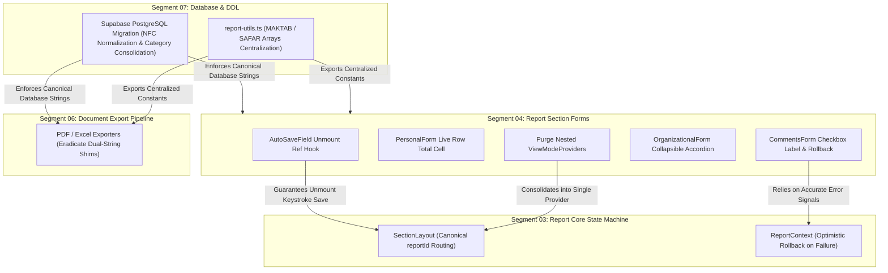

# Segment 04 Codebase & Architectural Audit: Report Data-Entry Section Forms & UI Ergonomics

**Repository**: `talimul-quran-report-submission`  
**Standard**: 5-Layer Behavioral Audit (`WEB-001`–`WEB-014`), Impeccable UI/UX Ergonomics, Pre-Production Agility & Zero Dead-Weight (`AGENTS.md` Rule 7), Adversarial Doubt-Driven Review (`Rule 2 & 6`)  
**Role**: Subagent A (Lead Investigator)  
**Target Scope**:
- `src/components/report/sections/report-header-form.tsx`
- `src/components/report/sections/courses-form.tsx`
- `src/components/report/sections/organizational-form.tsx`
- `src/components/report/sections/personal-form.tsx`
- `src/components/report/sections/meetings-form.tsx`
- `src/components/report/sections/extras-form.tsx`
- `src/components/report/sections/comments-form.tsx`
- *Coupled Core Files*: `src/components/report/auto-save-field.tsx`, `src/components/report/section-layout.tsx`, `src/components/report/view-mode-toggle.tsx`, `src/components/report/report-context.tsx`, `src/lib/report-utils.ts`, `src/lib/i18n.ts`

---

## 1. Executive Quality Scorecard

- **Health Grade**: **C+ (Pre-Production Bloated / High Data-Loss Risk on Exit & Unmount)**
- **Pre-Production Bloatware Count**: 5 distinct Rule 7 bloatware patterns
- **Critical Behavioral Defects**: 4 critical bugs (unmount keystroke loss, silent submission failure, Unicode NFD/NFC drift, missing live row totals)
- **Executive Summary**:  
  Segment 04 encompasses the 7 monthly data-entry forms that collect all statistical and qualitative metrics from grassroots field workers. While the UI visually aligns with the modern Tailwind emerald design system, the architecture suffers from severe pre-production compromises: dual-string fallback shims written to tolerate obsolete prototype rows instead of executing clean database migrations; unmount lifecycle holes in `AutoSaveField` that silently drop user keystrokes when switching tabs, toggling between Card and Table modes, or collapsing accordions; Unicode normalization drift between decomposed (`U+09af U+09bc`) and precomposed (`U+09df`) Bengali glyphs causing exact category lookups to fail; quadruplicate redundant `ViewModeProvider` nesting; and an optimistic submission toggle in `CommentsForm` that turns green even if the database write completely fails.

---

## 2. Pre-Production Bloatware & Rule 7 Violations

Under `AGENTS.md` Rule 7 (Pre-Production Agility & Zero Dead-Weight):
> *"Implement clean architectural fixes and schema migrations directly. Do NOT write complex application-layer shims, redundant query loops, or backward-compatibility polyfills to support obsolete prototypes, old test rows, past schemas, legacy URL params, etc."*

The following table catalogs all bloatware patterns discovered in Segment 04:

| # | File Location | Bloatware Pattern | Root Cause in Prototype | Zero-Dead-Weight Clean Remediation |
|:---:|:---|:---|:---|:---|
| **BP-01** | `report/page.tsx:879,969`<br>`city-report/page.tsx:1063`<br>`api/export/pdf/route.tsx:580`<br>`api/export/excel/route.ts:367` | **Dual-String Category Fallbacks**: Sprawling string checks searching for legacy vs modern categories (`"সহযোগী হয়েছেন"` vs `"সহযোগী হয়েছে"`, split vs unsplit Mashq, `"Committee Orientation"` vs `"Committee Orientation / Muallima Orientation"`). | Early prototypes seeded inconsistent Bengali spellings and combined meeting names. Application code added fallback shims to avoid running database SQL migrations on test records. | Run a clean one-time SQL `UPDATE` in PostgreSQL to normalize all historical rows to canonical strings, and eradicate all `||` fallback string lookups across all display, form, and export code. |
| **BP-02** | `courses-form.tsx:166-171`<br>`organizational-form.tsx:75-80`<br>`personal-form.tsx:200-205`<br>`meetings-form.tsx:176-181` | **Quadruplicate Nested `ViewModeProvider`**: Every toggleable form section redundantly wraps its content in `<ViewModeProvider defaultMode="card">`, even though `SectionLayout` already wraps them at line 102. | Forms were originally written as standalone pages before `SectionLayout` was created. Left behind as dead abstraction layers; triggers redundant `useViewMode` hooks and `localStorage` checks. | Remove `ViewModeProvider` wrappers from all 4 section components. Export the inner form content components directly. |
| **BP-03** | `extras-form.tsx:6-18` | **Hardcoded Local Category Arrays**: Declaring `MOKTOB_CATEGORIES` and `SAFAR_CATEGORIES` locally inside the component file instead of importing canonical constants from `src/lib/report-utils.ts`. | Ad-hoc component creation bypassed the centralized data dictionary in `report-utils.ts` where `EXTRA_CATEGORIES` is already exported. | Export `MAKTAB_CATEGORIES` and `SAFAR_CATEGORIES` from `src/lib/report-utils.ts`, and derive `EXTRA_CATEGORIES = [...MAKTAB_CATEGORIES, ...SAFAR_CATEGORIES]`. |
| **BP-04** | `extras-form.tsx:4` | **Dead Unused Import**: `import { Send, Compass, BookOpen } from "lucide-react";` where `Send` is never referenced or rendered. | Prototype iteration artifact left unpruned. | Delete `Send` from the import statement. |
| **BP-05** | `personal-form.tsx:36, 89` | **Grammatical Asymmetry via Verb Phrase Override**: Ternary `cat === "সক্রিয় সহযোগী" ? t.labels.becameActiveAssociate : tc(cat as any)` forces the column header and card title to display `"সক্রিয় সহযোগী হয়েছেন"` (verb phrase) while siblings are nouns (`"কর্মী"`, `"রুকন"`). | Developer confused the metric key label `{ key: "became_sokrio_shohojogi", label: "সক্রিয় সহযোগী হয়েছেন" }` with the demographic category noun `"সক্রিয় সহযোগী"`. | Remove the custom ternary override and render `tc(cat as any)` uniformly for all categories. |

---

## 3. 5-Layer Behavioral Audit Findings Table

| # | Bug ID | Short Title | File Location | Urgency | Risk: Fix | Risk: No Fix | ROI | Blast Radius | Status |
|:---:|:---:|:---|:---|:---:|:---:|:---:|:---:|:---:|:---:|
| 1 | **WEB-001** | `AutoSaveField` Dirty Persistence Dropped on Component Unmount | `src/components/report/auto-save-field.tsx:97-109` | **CRITICAL** | Low | High (Data Loss) | Immediate | Forms, Nav, Accordions | Verified Bug |
| 2 | **WEB-002** | Missing Live Computed Row Totals (মোট) in `PersonalForm` Table Mode | `src/components/report/sections/personal-form.tsx:28-65` | **HIGH** | Low | Medium (User Friction) | High | Personal Form Table Mode | Verified Defect |
| 3 | **WEB-003** | Unicode Decomposed vs Precomposed Normalization Drift (NFD vs NFC) | `src/lib/report-utils.ts:87,108`<br>`src/lib/i18n.ts:200,371` | **CRITICAL** | Low | High (Silent Lookups Fail) | High | Category lookups, RPC saves | Verified Defect |
| 4 | **WEB-004** | Missing Accordion Card Architecture in `OrganizationalForm` (3,500px Scroll Wall) | `src/components/report/sections/organizational-form.tsx:46-72` | **HIGH** | Low | Medium (Mobile Usability) | High | Mobile Org Form View | Verified Defect |
| 5 | **WEB-005** | `MeetingsForm` Collapsed Card Header Permanently Ignores Custom `meeting_name` | `src/components/report/sections/meetings-form.tsx:103-105` | **MEDIUM** | Low | Low (UX Confusion) | Medium | Meeting Form Card View | Verified Defect |
| 6 | **WEB-006** | Missing `<label htmlFor="...">` and Small Touch Hit Area in `CommentsForm` | `src/components/report/sections/comments-form.tsx:44-71` | **MEDIUM** | Low | Low (Mobile Friction) | Medium | Comments Submission Card | Verified Defect |
| 7 | **WEB-007** | Silent Network/RLS Failure on Report Submission Toggle | `src/components/report/sections/comments-form.tsx:13-18`<br>`src/components/report/report-context.tsx:99,145` | **CRITICAL** | Low | High (False Submission) | Immediate | Report Submission Flow | Verified Bug |
| 8 | **WEB-008** | Domain Terminology Drift in `CoursesForm` Top-Left Header | `src/components/report/sections/courses-form.tsx:31` | **LOW** | Low | Low (Cosmetic Inconsistency) | Low | Courses Table Header | Verified Defect |
| 9 | **WEB-009** | Duplicate Sub-Section Heading as Input Label in `ReportHeaderForm` | `src/components/report/sections/report-header-form.tsx:85-88, 105-108` | **LOW** | Low | Low (Visual Clutter) | Low | Header Form Muallima Card | Verified Defect |
| 10 | **WEB-010** | Table Mode Sticky Left Column (`w-52`) Consumes 58% of 360px Mobile Viewport | `src/components/report/sections/personal-form.tsx:31, 44` | **MEDIUM** | Low | Low (Pinch/Scroll UX) | Medium | Mobile Table Views | Design Trade-off |
| 11 | **WEB-011** | Missing Desktop Enter Key Traversal in Table Mode Matrix Grids | `src/components/report/auto-save-field.tsx:119-138` | **LOW** | Low | Low (Keyboard Ergonomics) | Medium | Desktop Table Entry | Verified Defect |

---

## 4. Deep Receipts & Remediation Plans

### Finding WEB-001 (C04-01): `AutoSaveField` Dirty Persistence Dropped on Component Unmount
- **Current Behavior**:
  In [`src/components/report/auto-save-field.tsx`](file:///d:/WebDev/report-submission/src/components/report/auto-save-field.tsx#L97-L109):
  ```tsx
  useEffect(() => {
    const onVisibility = () => {
      if (document.visibilityState === "hidden") persist();
    };
    const onBeforeUnload = () => persist();

    document.addEventListener("visibilitychange", onVisibility);
    window.addEventListener("beforeunload", onBeforeUnload);
    return () => {
      document.removeEventListener("visibilitychange", onVisibility);
      window.removeEventListener("beforeunload", onBeforeUnload);
    };
  }, [persist]);
  ```
  The effect flushes dirty state on browser tab hiding (`visibilitychange`) and window closing (`beforeunload`). However, its cleanup function **strictly unbinds event listeners without persisting `localValue`**.
- **Behavioral Impact**:
  When a user edits an input field and, without explicitly clicking outside to trigger `handleBlur`, immediately:
  1. Clicks "পরবর্তী পাতা" (Next Page) in `SectionLayout`'s persistence footer (`router.push()`),
  2. Toggles view mode between "Card" and "Table" via `CompactViewToggle`, or
  3. Clicks an accordion header in `CoursesForm` or `MeetingsForm` to collapse the card (`isOpen = false`),
  the component unmounts. **Any uncommitted keystrokes buffered in `localValue` are permanently discarded.** When the next component mounts or the card re-opens, it initializes from the stale context data snapshot.
- **Authoritative Citation**:
  `AGENTS.md` Rule 2 & 6 (Adversarial stress-testing of field conditions); `docs/codebase-critique/segment-04-report-section-forms.md` §2.4.
- **Actionable Remediation**:
  *Crucial Implementation Trap*: A naive cleanup hook `return () => { persist(); }` inside an effect that depends on `[persist]` fires on **every keystroke** because `persist` recreates when `localValue` mutates. This would cause an immediate database write for every typed character, annihilating debouncing.  
  *Clean Architectural Fix*: Use mutable refs with an empty dependency array to guarantee execution exclusively during component unmount:
  ```tsx
  const persistRef = useRef(persist);
  persistRef.current = persist;

  const dirtyRef = useRef(false);
  dirtyRef.current = localValue !== getInitialValue();

  useEffect(() => {
    return () => {
      // Fires strictly once when the field unmounts from DOM
      if (dirtyRef.current) {
        persistRef.current();
      }
    };
  }, []);
  ```

---

### Finding WEB-002 (C04-02): Missing Live Computed Row Totals in `PersonalForm` Table Mode
- **Current Behavior**:
  In [`src/components/report/sections/personal-form.tsx`](file:///d:/WebDev/report-submission/src/components/report/sections/personal-form.tsx#L28-L65):
  ```tsx
  <table className="w-full text-left border-collapse min-w-[550px]">
    <thead>
      <tr className="border-b border-border bg-muted/50 text-muted-foreground text-xs font-black">
        <th className="p-3 w-52 sticky left-0 ...">{t.labels.personalInitiative}</th>
        {PERSONAL_CATEGORIES.map((cat) => (
          <th key={cat} className="p-2 text-center w-32 ...">{tc(cat as any)}</th>
        ))}
      </tr>
    </thead>
    <tbody className="divide-y divide-border/60 text-sm">
      {PERSONAL_METRICS_ROWS.map((metric) => (
        <tr key={metric.key}>
          <td className="p-3 w-52 ...">{tc(metric.label as any)}</td>
          {PERSONAL_CATEGORIES.map((cat) => (
            <td key={cat}><AutoSaveField name={metric.key} category={cat} ... /></td>
          ))}
        </tr>
      ))}
    </tbody>
  </table>
  ```
  The table renders 4 columns: the sticky metric label column plus 3 demographic categories (`"রুকন"`, `"কর্মী"`, `"সক্রিয় সহযোগী"`). It completely lacks a 5th column: **মোট (Total)**.
- **Behavioral Impact**:
  Field workers entering personal initiatives (e.g. teaching, learning, dawah to olama) must constantly balance their numbers against organizational manpower. In both the official printed monthly reporting sheet and the summary view (`/report`), this section has a mandatory "মোট" column. Without a live total column, reporters cannot verify if their row inputs balance without leaving the form, causing reporting inaccuracies.
- **Authoritative Citation**:
  `docs/TECHNICAL_MANUAL.md` §2.3.4; ADR 024 Track 3.
- **Actionable Remediation**:
  1. Add `<th className="p-2 text-center w-24 font-bold text-foreground bg-muted/70">{t.labels.total || "মোট"}</th>` to table `<thead>`.
  2. In `<tbody>`, compute the live row sum from `data.personal` and display a read-only cell:
  ```tsx
  {PERSONAL_METRICS_ROWS.map((metric) => {
    const rowTotal = PERSONAL_CATEGORIES.reduce((acc, cat) => {
      const row = (data?.personal || []).find((r: any) => r.category === cat);
      const val = row ? parseInt(row[metric.key]) || 0 : 0;
      return acc + val;
    }, 0);

    return (
      <tr key={metric.key}>
        <td ...>{tc(metric.label as any)}</td>
        {PERSONAL_CATEGORIES.map(cat => (
          <td key={cat} ...><AutoSaveField name={metric.key} category={cat} ... /></td>
        ))}
        <td className="p-2 text-center font-bold text-xs sm:text-sm bg-muted/20 text-muted-foreground border-l border-border/40">
          {toBn(rowTotal)}
        </td>
      </tr>
    );
  })}
  ```

---

### Finding WEB-003 (C04-03 / C07-02): Unicode Decomposed vs Precomposed Normalization Drift
- **Current Behavior**:
  Comparing [`src/lib/report-utils.ts`](file:///d:/WebDev/report-submission/src/lib/report-utils.ts#L87-L112) with [`src/lib/i18n.ts`](file:///d:/WebDev/report-submission/src/lib/i18n.ts#L200-L372):
  - In `ORG_CATEGORIES`: `"সহযোগী হয়েছেন"` is encoded as `U+09b8 U+09b9 U+09af U+09cb U+0997 U+09c0 U+0020 U+09b9 U+09af U+09bc U+09c7 U+099b U+09c7 U+09a8` (where `U+09af U+09bc` represents **Decomposed Ja + Nukta**).
  - In `PERSONAL_METRICS_ROWS`: `"সহযোগী হয়েছেন"` is encoded as `U+09b8 U+09b9 U+09af U+09cb U+0997 U+09c0 U+0020 U+09b9 U+09df U+09c7 U+099b U+09c7 U+09a8` (where `U+09df` represents **Precomposed Bengali Letter Yya**).
  - Executing strict string equality:
    ```js
    "সহযোগী হয়েছেন" === "সহযোগী হয়েছেন" // returns false!
    "সহযোগী হয়েছেন".normalize("NFC") === "সহযোগী হয়েছেন".normalize("NFC") // returns true!
    ```
- **Behavioral Impact**:
  In `AutoSaveField`:
  ```ts
  const row = arrayData.find(item => item.category === category);
  ```
  If a row in PostgreSQL was seeded with NFC characters (`U+09df`) and the UI queries with decomposed characters (`U+09af U+09bc`), `.find()` returns `undefined`! The input renders empty or `0`. When the user types and blurs, `updateField` executes:
  ```ts
  supabase.from('report_organizational').update({ [name]: value }).eq('category', category)
  ```
  PostgreSQL evaluates string equality strictly. It matches **0 rows**, logging a silent 0-row update failure, and the user's data is never saved!
- **Authoritative Citation**:
  `AGENTS.md` Rule 7 (Pre-Production Agility & Zero Dead-Weight); Unicode Standard Technical Report #15 (Unicode Normalization Forms).
- **Actionable Remediation**:
  1. Standardize all Bengali strings in `src/lib/report-utils.ts` and `src/lib/i18n.ts` into canonical **Unicode NFC Form** (`U+09df` for Yya).
  2. In `AutoSaveField` and `report-context.tsx`, enforce `.normalize("NFC")` on all category comparisons:
     ```ts
     const row = arrayData.find(item => item.category?.normalize("NFC") === category.normalize("NFC"));
     ```
  3. Execute a database migration in Supabase to normalize existing category rows:
     ```sql
     UPDATE report_organizational SET category = normalize(category, NFC);
     UPDATE report_course SET category = normalize(category, NFC);
     UPDATE report_meeting SET category = normalize(category, NFC);
     UPDATE report_personal SET category = normalize(category, NFC);
     UPDATE report_extra SET category = normalize(category, NFC);
     ```

---

### Finding WEB-004 (C04-04): Missing Accordion Card Architecture in `OrganizationalForm`
- **Current Behavior**:
  In [`src/components/report/sections/organizational-form.tsx`](file:///d:/WebDev/report-submission/src/components/report/sections/organizational-form.tsx#L46-L72):
  ```tsx
  return (
    <div className="space-y-4 animate-in fade-in duration-300">
      {ORG_CATEGORIES.map((category) => (
        <div key={category} className="bg-card border border-border/60 rounded-2xl p-4 ...">
          {/* Static Section Header */}
          <div className="flex items-center gap-2.5 mb-3.5 ...">
            <Users2 className="w-4 h-4" />
            <h3>{tc(category as any)}</h3>
          </div>
          ...
        </div>
      ))}
    </div>
  );
  ```
  Unlike `CoursesForm` (8 categories), `PersonalForm` (3 categories), and `MeetingsForm` (5 categories) which all implement collapsible accordion cards via `openCards` and `ChevronDown`, `OrganizationalForm` permanently renders all 15 categories completely expanded.
- **Behavioral Impact**:
  With 15 categories each containing 4 inputs (Count, Increase, Amount, Comments), the mobile view presents **60 vertical inputs across a massive ~3,500px scroll wall**. On low-end mobile devices, rendering all 60 inputs simultaneously causes touch latency and severe orientation disorientation; reporters lose track of which category they are filling out.
- **Authoritative Citation**:
  `docs/TECHNICAL_MANUAL.md` §2.3.3 (Card vs Table Mode Architecture).
- **Actionable Remediation**:
  Implement the standard `openCards` accordion state pattern matching `CoursesForm` and `MeetingsForm`:
  ```tsx
  const [openCards, setOpenCards] = useState<Record<string, boolean>>({
    [ORG_CATEGORIES[0]]: true, // First category expanded by default
  });

  const toggleCard = (category: string) => {
    setOpenCards(prev => ({ ...prev, [category]: !prev[category] }));
  };
  ```
  Wrap card headers in an interactive `<button>` with `<ChevronDown className={isOpen ? "rotate-180" : ""} />` and conditionally render the card body when `isOpen` is true.

---

### Finding WEB-005 (C04-05): `MeetingsForm` Collapsed Card Header Ignores Custom `meeting_name`
- **Current Behavior**:
  In [`src/components/report/sections/meetings-form.tsx`](file:///d:/WebDev/report-submission/src/components/report/sections/meetings-form.tsx#L103-L105):
  ```tsx
  <h3 className="text-base sm:text-lg font-bold text-foreground">
    {category === "অন্যান্য" ? t.labels.others : tc(category as any)}
  </h3>
  ```
  When `category === "অন্যান্য"`, the collapsed card header statically displays `t.labels.others` (`"অন্যান্য"` / `"Others"`).
- **Behavioral Impact**:
  When a reporter enters a custom meeting title (e.g. `"মাসিক সাধারণ সভা"` into `meeting_name`), collapsing the card causes the title to disappear, reverting to generic `"অন্যান্য"`. If multiple other meetings or custom notes exist, the reporter must expand the card to remember what was entered. This breaks parity with `/report` summary and PDF exports, which dynamically replace `"অন্যান্য"` with `meeting_name`.
- **Authoritative Citation**:
  `docs/TECHNICAL_MANUAL.md` §2.3.5; ADR 007 §2.1.
- **Actionable Remediation**:
  Retrieve the entered `meeting_name` from `data?.meeting` and dynamically display it in the card header:
  ```tsx
  const otherMeetingTitle = data?.meeting?.find((m: any) => m.category === "অন্যান্য")?.meeting_name?.trim();
  const displayTitle = category === "অন্যান্য"
    ? (otherMeetingTitle ? `${t.labels.others}: ${otherMeetingTitle}` : t.labels.others)
    : tc(category as any);
  ```

---

### Finding WEB-006 (C04-06): Missing `<label htmlFor="...">` and Small Touch Hit Area in `CommentsForm`
- **Current Behavior**:
  In [`src/components/report/sections/comments-form.tsx`](file:///d:/WebDev/report-submission/src/components/report/sections/comments-form.tsx#L44-L71):
  ```tsx
  <div className={`p-5 rounded-2xl border-2 transition-all flex items-center justify-between gap-4 ${isSubmitted ? ... : ...}`}>
    <div className="flex items-start gap-3.5">
      <CheckCircle2 className="w-5 h-5" />
      <div>
        <h4>{t.labels.reportSubmissionDone}</h4>
        <p>{t.labels.reportSubmissionHelper}</p>
      </div>
    </div>
    <div className="flex items-center">
      <input 
        type="checkbox" 
        checked={isSubmitted} 
        onChange={handleSubmissionToggle} 
        className="w-6 h-6 sm:w-7 sm:h-7 accent-emerald-600 rounded-lg cursor-pointer" 
        id="report-submission-checkbox"
      />
    </div>
  </div>
  ```
  The checkbox has an `id="report-submission-checkbox"`, but the outer card is a generic `<div>` with no `htmlFor` association or click handler.
- **Behavioral Impact**:
  On mobile devices, tapping anywhere on the card, title, or helper text has no effect. The user must precisely target the tiny 24px/28px checkbox square on the far right edge of the screen. This violates WCAG 2.5.5 / 2.5.8 target size requirements and creates unnecessary mobile friction for field workers submitting reports on small handheld screens.
- **Authoritative Citation**:
  WCAG 2.2 Criterion 2.5.8 (Target Size - Minimum 44px x 44px); `AGENTS.md` Rule 1 (Impeccable UX).
- **Actionable Remediation**:
  Convert the card container into an interactive `<label>` linked directly to the checkbox:
  ```tsx
  <label
    htmlFor="report-submission-checkbox"
    className={`p-5 rounded-2xl border-2 transition-all flex items-center justify-between gap-4 cursor-pointer select-none active:scale-[0.99] ${
      isSubmitted 
        ? "bg-emerald-500/10 border-emerald-500/30 text-emerald-950 dark:text-emerald-100 shadow-sm" 
        : "bg-primary/5 border-primary/20 text-foreground hover:bg-primary/10"
    }`}
  >
    ...
  </label>
  ```

---

### Finding WEB-007 (C04-07): Silent Network/RLS Failure on Report Submission Toggle
- **Current Behavior**:
  In [`src/components/report/sections/comments-form.tsx`](file:///d:/WebDev/report-submission/src/components/report/sections/comments-form.tsx#L13-L18):
  ```tsx
  const handleSubmissionToggle = async (e: React.ChangeEvent<HTMLInputElement>) => {
    const checked = e.target.checked;
    if (reportId) {
      await updateField("is_submitted", checked, "comment", "report");
    }
  };
  ```
  In [`src/components/report/report-context.tsx`](file:///d:/WebDev/report-submission/src/components/report/report-context.tsx#L99-L145):
  `updateField` optimistically updates `setData(prev => ({ ...prev, [name]: value }))` before executing the Supabase query. If the network is disconnected or the update fails with an RLS error, `updateField` sets `failedFields` and returns `{ success: false, error }`, but **it never reverts `data` in context**. Furthermore, `handleSubmissionToggle` ignores the return value completely.
- **Behavioral Impact**:
  When a user checks the submission box during spotty cellular connectivity, the UI immediately flips to green ("রিপোর্ট জমা সম্পন্ন হয়েছে"). When the network request fails in the background, the UI continues displaying the successful green banner. The reporter assumes their report is safely submitted and closes their browser. In PostgreSQL, `is_submitted` remains `false`. When the admin checks the submission dashboard, the report is listed as an unsubmitted draft, leading to administrative disputes.
- **Authoritative Citation**:
  `AGENTS.md` Rule 2 & 6 (Adversarial field stress-testing: spotty mobile connectivity).
- **Actionable Remediation**:
  1. In `handleSubmissionToggle`, handle optimistic rollback or await the result:
  ```tsx
  const [isToggling, setIsToggling] = useState(false);

  const handleSubmissionToggle = async (e: React.ChangeEvent<HTMLInputElement>) => {
    const checked = e.target.checked;
    if (!reportId || isToggling) return;
    setIsToggling(true);

    try {
      const res = await updateField("is_submitted", checked, "comment", "report");
      if (!res.success) {
        // Rollback optimistic state in context if save failed
        setData(prev => prev ? { ...prev, is_submitted: !checked } : prev);
      }
    } finally {
      setIsToggling(false);
    }
  };
  ```
  2. Show a transient error toast or alert indicator if submission fails.

---

### Finding WEB-008 (C04-08): Domain Terminology Drift in `CoursesForm` Top-Left Header
- **Current Behavior**:
  In [`src/components/report/sections/courses-form.tsx:31`](file:///d:/WebDev/report-submission/src/components/report/sections/courses-form.tsx#L31):
  ```tsx
  <th rowSpan={2} className="p-3 w-48 sticky left-0 bg-muted/90 backdrop-blur z-10 border-r border-border/50 text-left">
    {t.labels.category}
  </th>
  ```
  The table header renders `{t.labels.category}` (`"ক্যাটাগরি"`).
- **Behavioral Impact**:
  ADR 007 §2.2 and the physical printed report form designate this column as **`"বিভাগ/ধরন"`** (`"Department/Type"`), because courses are categorized into operational departments ("বিশিষ্টদের", "সাধারণদের", "কর্মীদের") rather than generic categories. The overview report (`report/page.tsx:774`) and PDF export route correctly use `"বিভাগ/ধরন"`. Using `"ক্যাটাগরি"` in `CoursesForm` creates cross-page domain terminology drift.
- **Authoritative Citation**:
  ADR 007 §2.2; `docs/TECHNICAL_MANUAL.md` §2.3.2.
- **Actionable Remediation**:
  Replace `{t.labels.category}` with `{t.labels.departmentType}` (`"বিভাগ/ধরন"`).

---

### Finding WEB-009 (C04-09): Duplicate Sub-Section Heading as Input Label in `ReportHeaderForm`
- **Current Behavior**:
  In [`src/components/report/sections/report-header-form.tsx:85-88, 105-108`](file:///d:/WebDev/report-submission/src/components/report/sections/report-header-form.tsx#L85-L108):
  ```tsx
  <h4 className="text-xs font-bold text-purple-600 uppercase tracking-wide border-b border-border/30 pb-2">
    {t.labels.certifiedMuallimaLabel}
  </h4>
  <AutoSaveField 
    label={t.labels.certifiedMuallimaLabel} 
    name="certified_muallima" 
    ... 
  />
  ```
  The card has a sub-heading `"সার্টিফিকেটপ্রাপ্ত মুয়াল্লিমা"`, and the very first input directly underneath is labeled identically as `"সার্টিফিকেটপ্রাপ্ত মুয়াল্লিমা"`. The second input is labeled `"ক্লাস নিচ্ছেন কতজন"`. The same duplication occurs for `"প্রশিক্ষণপ্রাপ্ত মুয়াল্লিমা"`.
- **Behavioral Impact**:
  Redundant visual clutter. Users read the exact same header string twice consecutively.
- **Authoritative Citation**:
  `docs/TECHNICAL_MANUAL.md` §2.3.1.
- **Actionable Remediation**:
  Change the first input's label to `{t.labels.count}` (`"সংখ্যা"`) or `{t.labels.total}` (`"মোট"`):
  ```tsx
  <AutoSaveField 
    label={t.labels.count || "সংখ্যা"} 
    name="certified_muallima" 
    type="number" 
    section="header" 
    table="report_header" 
    inline 
  />
  ```

---

### Finding WEB-010 (C04-10): Table Mode Sticky Left Column Mobile Viewport Squishing
- **Current Behavior**:
  In [`src/components/report/sections/personal-form.tsx:31, 44`](file:///d:/WebDev/report-submission/src/components/report/sections/personal-form.tsx#L31-L44):
  The sticky column width is hardcoded to `w-52` (208px). On a 360px mobile viewport, 208px accounts for **57.7% of the entire screen width**, leaving only 152px for the horizontally scrollable data columns.
- **Behavioral Impact**:
  When a mobile user switches to Table View, only one data column is visible at a time. However, as evaluated in ADR 004 and ADR 007, shrinking `w-48` or `w-52` causes long Bengali category labels (e.g. `জনশক্তির সহীহ্ কুরআন তিলাওয়াত অনুশীলনী (মাশক) : কতটি`) to wrap into 5–6 vertical lines. Card View is the official default mobile mode.
- **Authoritative Citation**:
  ADR 004, ADR 005, ADR 007; `docs/KNOWN_ISSUES.md` (Mobile Touch Target Ergonomics).
- **Actionable Remediation**:
  Retain `defaultMode="card"` as the default for mobile. On `viewMode === "table"`, add a subtle horizontal scroll indicator hint (`← ডানে স্ক্রোল করুন →`) above tables on mobile screens `< 640px`.

---

### Finding WEB-011: Missing Desktop Enter Key Traversal in Table Mode Matrix Grids
- **Current Behavior**:
  In [`src/components/report/auto-save-field.tsx:121-137`](file:///d:/WebDev/report-submission/src/components/report/auto-save-field.tsx#L121-L137):
  Inputs provide `enterKeyHint="next"` for mobile soft keyboards. However, desktop browsers do not interpret `enterKeyHint`. When a user types a number in table mode and presses `Enter`, nothing happens.
- **Behavioral Impact**:
  Field operators using desktop keyboards to transcribe physical paper sheets expect `Enter` or `Down Arrow` to advance to the next row in the matrix grid, matching spreadsheet ergonomics.
- **Authoritative Citation**:
  `docs/TECHNICAL_MANUAL.md` §2.3.2 (Matrix Table Ergonomics).
- **Actionable Remediation**:
  Add an optional `onKeyDown` handler for `tableMode` inputs that selects the next cell in the column:
  ```tsx
  onKeyDown={(e) => {
    if (e.key === "Enter") {
      e.preventDefault();
      const inputs = Array.from(document.querySelectorAll("table input"));
      const index = inputs.indexOf(e.currentTarget);
      if (index >= 0 && index < inputs.length - 1) {
        (inputs[index + 1] as HTMLElement)?.focus();
      }
    }
  }}
  ```

---

## 5. Cross-Segment Blast Radius & Wire Analysis

Remediating Segment 04 intersects directly with Segments 02, 03, 06, and 07. The blast radius and wiring contracts are mapped below:



### Critical Wire Invariants to Uphold
1. **Zero Database DDL Collateral on Row Totals**: The computed "মোট" column in `PersonalForm` must be purely a client-side read-only calculated cell. It must **never** instantiate an `AutoSaveField` or attempt to write a `"total"` row to `report_personal`, as `report_personal` has a strict composite unique constraint on `(report_id, category)`.
2. **Unmount Save vs Active Typing Debounce**: The unmount persistence hook in `AutoSaveField` must strictly execute inside `useEffect(() => { return () => { ... } }, [])` with empty dependencies and mutable refs. Adding dependencies to the effect will cause immediate saves on every keystroke, crashing Supabase with connection exhaustion.
3. **Canonical Unicode NFC Storage**: All category strings stored in Supabase child tables must be converted to Unicode NFC (`U+09df` for Bengali Yya). Any client-side patch that does not normalize the database rows will fail during PostgREST `.eq('category', ...)` operations.
4. **Single Source of Truth for Extra Categories**: `extras-form.tsx` must consume `MAKTAB_CATEGORIES` and `SAFAR_CATEGORIES` directly from `src/lib/report-utils.ts` to ensure 100% parity with Excel and PDF export pipelines.
