# Segment 05 Investigation: Routing, Canonical Navigation & Fallback Demolition

**Repository**: `Jabir-A-H/report-submission` (`Talimul Quran Report Submission`)  
**Auditor**: Subagent A (Lead Investigator)  
**Target Domain**: Segment 05 — Routing, Canonical Navigation & Fallback Demolition  
**Evaluation Standard**: Pre-Production Agility (`AGENTS.md` Rule 7), 5-Layer Behavioral Trace (`WEB-001`–`WEB-014`), Zero Dead-Weight Policy, Adversarial Doubt Gate (`Rule 2 & 6`)  
**Date**: 2026-11-15  

---

## 1. Executive Scorecard: Routing & Navigation Architecture

| Issue ID | Documented Topic | Documented Status | Audited Live Status | Confidence | Live Code & DB Evidence |
|:---|:---|:---|:---|:---:|:---|
| **RS-10** | Non-monthly report rows can be created by URL tampering | RESOLVED (ADR 021) | **LEAKY GUARD / INCOMPLETE** | 100% | [`report/[section]/page.tsx#L94-L97`](file:///d:/WebDev/report-submission/src/app/report/[section]/page.tsx#L94-L97) hardcoded `dbReportType = "মাসিক"`, BUT [`user-dashboard.tsx#L141-L161`](file:///d:/WebDev/report-submission/src/components/dashboard/user-dashboard.tsx#L141-L161) still passes `p_report_type: dbReportType` to `get_or_create_report`. Direct navigation to `/?type=quarterly&month=1&year=2026` creates non-monthly rows in `public.report`. PostgreSQL lacks a `CHECK` constraint on `report_type` (live DB has row `id=37` with `report_type = 'Monthly'`). |
| **RS-60** | Period/report state fragile across three pages; bare URL bailouts | PLANNED (ADR 022) | **UNRESOLVED ARCHITECTURAL DEBT** | 100% | [`user-dashboard.tsx#L168-L170`](file:///d:/WebDev/report-submission/src/components/dashboard/user-dashboard.tsx#L168-L170), [`#L300-L306`](file:///d:/WebDev/report-submission/src/components/dashboard/user-dashboard.tsx#L300-L306). Dashboard resolves `repId` via RPC once, but discards it in section `<Link>` hrefs, serializing composite `type/month/year` instead. [`report/[section]/page.tsx#L46-L59`](file:///d:/WebDev/report-submission/src/app/report/[section]/page.tsx#L46-L59) strictly demands composite parameters and immediately bails out (`router.replace("/")`) on bare URLs or canonical `?reportId=42`. |
| **Roadmap Tier 11** | Canonical `reportId` sub-section navigation (`?reportId=42`) | PLANNED (ADR 024) | **READY FOR ARCHITECTURAL CUTOVER** | 100% | Section pages execute 4 sequential network calls (`getUser`, `people`, `get_or_create_report` RPC, and 7-table select) wasting ~450ms+ on mobile. Switching to `/report/[section]?reportId=42` drops re-fetch round-trips to zero (when cached in `ReportContext`) or exactly one PostgREST query on cold reloads. |
| **Backlog Item 3** | DCS Zone 1 Entity & 2-Tier Hierarchy Governance (ADR 009) | DEFERRED / PARTIAL | **HALF-MIGRATED HYBRID STATE** | 100% | Live Supabase DB has `zone_type` and `parent_id` on `public.zone` (`id=1` is `'city'`). However: (1) All 6 SQL views (`view_city_*_agg`) still filter on `WHERE (r.zone_id <> 1)`; (2) All 13 upazila zones have `parent_id = null`; (3) [`dashboard/page.tsx#L103,L108`](file:///d:/WebDev/report-submission/src/app/(admin)/dashboard/page.tsx#L103-L108), [`home/actions.ts#L129,L159`](file:///d:/WebDev/report-submission/src/app/home/actions.ts#L129-L159), and [`home/page.tsx#L38,L43`](file:///d:/WebDev/report-submission/src/app/home/page.tsx#L38-L43) still maintain defensive `id === 1` checks; (4) [`management/page.tsx#L196-L205`](file:///d:/WebDev/report-submission/src/app/(admin)/management/page.tsx#L196-L205) retains an obsolete `42703` fallback insert. |
| **KI-023 Trap 1** | Phantom Schema Fallacy (`zone_type` assumption without DDL) | RESOLVED (2026-11-10) | **REVERSED SCHEMA DRIFT** | 100% | DDL migration was executed on 2026-11-10 in Supabase project `pxdkvewaglagnfcqeckn`. `zone_type` and `parent_id` are live in PostgreSQL. Frontend code is now lagging behind the live schema by retaining unneeded defensive fallbacks. |
| **RS-48** | Supabase cookie handling on middleware redirects | VERIFY-FIRST | **CONFIRMED BUG / LATENT DEFECT** | 95% | [`middleware.ts#L19-L24`](file:///d:/WebDev/report-submission/middleware.ts#L19-L24), [`#L59-L63`](file:///d:/WebDev/report-submission/middleware.ts#L59-L63). `setAll` writes refreshed session cookies to `supabaseResponse`. When `NextResponse.redirect(url)` is returned, it creates a fresh response object without transferring `supabaseResponse.cookies`, causing refreshed session cookies to be silently dropped. |
| **RS-67 / AGENTS.md Rule 2** | Quadruplicate client auth/profile network flooding | VERIFY-FIRST | **CONFIRMED ARCHITECTURAL DEFECT** | 100% | [`navbar.tsx#L17-L30`](file:///d:/WebDev/report-submission/src/components/layout/navbar.tsx#L17-L30), [`bottom-nav.tsx#L23-L54`](file:///d:/WebDev/report-submission/src/components/layout/bottom-nav.tsx#L23-L54), and [`user-dropdown.tsx#L27-L55`](file:///d:/WebDev/report-submission/src/components/layout/user-dropdown.tsx#L27-L55) each independently execute `supabase.auth.getUser()` and `supabase.from("people").select(...)` on every page mount. This generates 6 redundant network round-trips per page load, directly violating `AGENTS.md` Rule 2. |
| **RS-74 / SessionCleaner** | SessionCleaner retention & `sessionStorage` shims | RESOLVED (Tier 14) | **VERIFIED QUARANTINED / 0 IN SRC** | 100% | Quarantined to [`.discard/session-cleaner.tsx`](file:///d:/WebDev/report-submission/.discard/session-cleaner.tsx) in Tier 14. Grep verified 0 occurrences of `sessionStorage` or `localStorage` across all 68 files in `src/`. Ready for permanent deletion. |
| **Middleware Rewrites** | Legacy `/login` & `/register` rewrites | RESOLVED (Tier 14) | **VERIFIED PRUNED / DOCS DRIFT** | 100% | Rewrites were completely removed from [`middleware.ts`](file:///d:/WebDev/report-submission/middleware.ts). However, [`TECHNICAL_MANUAL.md#L52`](file:///d:/WebDev/report-submission/docs/TECHNICAL_MANUAL.md#L52) still asserts that legacy `/login` and `/register` requests are rewritten to `/home?mode=register`, representing stale documentation drift. |

---

## 2. Issue-by-Issue Reality Check

### 2.1 RS-10: Single-Month Editing Boundary Enforcement & The Leaky Dashboard RPC Hole
- **Documented Defect**: In early versions, a field worker visiting `/report/[section]?type=quarterly&month=1&year=2026` passed `type=quarterly` directly to the `get_or_create_report` RPC, creating non-monthly report rows with child category rows that could never be edited or submitted cleanly.
- **The Partial Fix in ADR 021**:
  In [`src/app/report/[section]/page.tsx#L94-L97`](file:///d:/WebDev/report-submission/src/app/report/[section]/page.tsx#L94-L97), the section switcher hardcoded:
  ```typescript
  // RS-10: Data entry forms are strictly monthly. Field workers cannot create or edit non-monthly report rows.
  const targetMonth = selectedMonth;
  const dbReportType = "মাসিক";
  ```
  This effectively guarded the section data-entry page from directly executing the RPC with non-monthly types.
- **The Critical Leaky Hole in `UserDashboard`**:
  An exhaustive trace of [`src/components/dashboard/user-dashboard.tsx#L141-L161`](file:///d:/WebDev/report-submission/src/components/dashboard/user-dashboard.tsx#L141-L161) reveals that `UserDashboard` **was never patched** with this guard:
  ```typescript
  // Map dynamic URL types to Bangla report types
  const REPORT_TYPE_MAP: Record<string, string> = {
    monthly: "মাসিক",
    quarterly: "ত্রৈমাসিক",
    halfYearly: "ষান্মাসিক",
    nineMonth: "নয়-মাসিক",
    yearly: "বার্ষিক",
    "মাসিক": "মাসিক",
    "ত্রৈমাসিক": "ত্রৈমাসিক",
    "ষান্মাসিক": "ষান্মাসিক",
    "নয়-মাসিক": "নয়-মাসিক",
    "বার্ষিক": "বার্ষিক",
  };
  const dbReportType = REPORT_TYPE_MAP[selectedType] || "মাসিক";

  // Call database RPC to get or create report
  const { data: repId, error: rpcErr } = await supabase.rpc("get_or_create_report", {
    p_zone_id: person.zone_id,
    p_year: selectedYear,
    p_month: dbReportType !== "মাসিক" ? 1 : selectedMonth,
    p_report_type: dbReportType,
  });
  ```
- **Behavioral Defect Demonstration**:
  1. If a user navigates to `/?type=quarterly&month=1&year=2026`, `UserDashboard` executes `get_or_create_report` with `p_report_type = "ত্রৈমাসিক"`, creating an unintended non-monthly row in `public.report`.
  2. The sections grid renders cards whose `<Link>` hrefs point to:
     ```html
     <a href="/report/courses?type=quarterly&month=1&year=2026">
     ```
  3. When the user taps the link, `/report/courses` mounts and executes its own `fetchActiveReport()`, which forces `dbReportType = "মাসিক"`, calling `get_or_create_report` with `p_report_type = "মাসিক"`.
  4. **The Split-Brain Result**: `UserDashboard` created a `ত্রৈমাসিক` report (e.g. `id = 100`), while the section editor created and edited an entirely different `মাসিক` report (e.g. `id = 101`). The `ত্রৈমাসিক` report remains orphaned in the database.
- **Database Schema Vulnerability**:
  A live Supabase query on `pg_constraint` for `public.report` confirms there is **ZERO `CHECK` constraint** on `report_type`:
  ```sql
  SELECT conname, pg_get_constraintdef(oid) 
  FROM pg_constraint 
  WHERE conrelid = 'public.report'::regclass;
  -- Result: PRIMARY KEY (id), FOREIGN KEY (zone_id), UNIQUE (zone_id, month, year, report_type)
  ```
  Querying live rows in `public.report` confirms the vulnerability:
  ```json
  [{"id": 37, "zone_id": 12, "year": 2026, "month": 1, "report_type": "Monthly", "is_submitted": false}]
  ```
  Row `id = 37` was created with `report_type = 'Monthly'` (English ASCII) because neither PostgreSQL nor the RPC validates the type string.
- **Pre-Production Agility Verdict**:
  Under Rule 7, application-layer string shims must be replaced with authoritative database constraints:
  1. Execute clean DDL: Update row 37 to `'মাসিক'` and add `ALTER TABLE public.report ADD CONSTRAINT report_type_check CHECK (report_type = 'মাসিক');`.
  2. In `get_or_create_report` RPC, enforce `p_report_type := 'মাসিক'`.
  3. In `UserDashboard`, enforce `dbReportType = "মাসিক"`.

---

### 2.2 RS-60 & Roadmap Tier 11: Fragile Period Composite Navigation vs. Canonical `reportId`
- **Documented Defect**:
  `user-dashboard.tsx`, `report/[section]/page.tsx`, and `report/page.tsx` each reconstruct "which report" from 3 URL query parameters (`type`, `month`, `year`). If any parameter is dropped or malformed, the page bails out with an immediate `router.replace("/")`.
- **Live Code Audit**:
  1. In [`src/components/dashboard/user-dashboard.tsx#L156-L170`](file:///d:/WebDev/report-submission/src/components/dashboard/user-dashboard.tsx#L156-L170), the dashboard executes `get_or_create_report`, resolves `repId`, stores it in `ReportContext` via `setReportId(repId)`, and loads the data bundle.
  2. **The Discarding Flaw**: In [`user-dashboard.tsx#L300-L306`](file:///d:/WebDev/report-submission/src/components/dashboard/user-dashboard.tsx#L300-L306), when rendering section cards, it completely ignores `repId` and renders:
     ```tsx
     <Link 
       href={`/report/${section.id}?type=${typeParam}&month=${monthParam}&year=${yearParam}`}
       className="..."
     >
     ```
  3. **The Unnecessary Re-Fetch Cascade in `SectionSwitcher`**:
     When the field worker lands on `/report/courses?type=monthly&month=3&year=2026`:
     - Line 50: Checks `isValidParam` on `type`, `month`, and `year`. If any is missing, it drops back to `/`.
     - Lines 106-118: Fires `supabase.auth.getUser()`.
     - Lines 114-118: Fires `supabase.from("people").select("zone_id, role")`.
     - Lines 135-140: Calls `supabase.rpc("get_or_create_report", ...)`.
     - Only on line 151 does it check `if (reportIdRef.current === repId)` to avoid re-running the 7-table select!
     - **Result**: Even though the report was already resolved and loaded in memory on the dashboard, opening a section page triggers **3 redundant network requests** before rendering. On 3G/4G networks in Bangladesh, this introduces an unnecessary 300ms–500ms spinner delay.
  4. **The Bare URL Failure Trap**:
     If a field worker bookmarks `/report/courses`, shares a direct link, or refreshes after an in-app browser session reset:
     - `hasValidParams` evaluates to `false`.
     - Line 57 fires `router.replace("/")`.
     - The worker is dumped on the dashboard with a blank period picker and must re-select the month, re-click "যান", and re-select the section.
  5. **Admin / Export Architectural Asymmetry**:
     In [`src/app/(admin)/reports/page.tsx#L503-L506`](file:///d:/WebDev/report-submission/src/app/(admin)/reports/page.tsx#L503-L506), the admin reports table links directly using the canonical database ID:
     ```tsx
     <Link href={`/report?zone_id=${report.zone_id}&report_id=${report.id}`}>
     ```
     The admin system already recognizes that database entities are identified by primary key IDs, while the field worker flow remains trapped in brittle composite string serialization.

---

### 2.3 Backlog Item 3 / ADR 009: DCS Zone 1 Entity & 2-Tier Hierarchy Governance
- **Historical Background**:
  DCS (ডি সি এস — `zone_id = 1`) represents the city-level central administration, not an active reporting upazila. In Phase 3.5 (ADR 009), a 2-tier hierarchy (`zone_type` and `parent_id`) was designed. Because running DDL on live production was previously feared, the codebase resorted to defensive magic number checks (`zone_id === 1`).
- **Live Database Inspection via Supabase MCP**:
  Executing SQL against Supabase project `pxdkvewaglagnfcqeckn` reveals:
  ```json
  [
    {"id": 1, "name": "ডি সি এস", "zone_type": "city", "parent_id": null},
    {"id": 2, "name": "শ্যামপুর জোন", "zone_type": "upazila", "parent_id": null},
    {"id": 3, "name": "ডেমরা জোন", "zone_type": "upazila", "parent_id": null},
    ...
    {"id": 14, "name": "সবুজবাগ মুগদা জোন", "zone_type": "upazila", "parent_id": null}
  ]
  ```
  The `zone_type` and `parent_id` columns **do exist**! DCS is configured with `zone_type = 'city'`.
- **The Incomplete Migration Audit**:
  1. **SQL Aggregation Views Still Rely on Magic Numbers**:
     Inspecting `view_definition` across all 6 views (`view_city_course_agg`, `view_city_extra_agg`, `view_city_header_agg`, `view_city_meeting_agg`, `view_city_organizational_agg`, `view_city_personal_agg`) reveals:
     ```sql
     -- Actual Live SQL in Supabase:
     SELECT r.year, r.month, r.report_type, ...
     FROM (report r JOIN report_header rh ON ((r.id = rh.report_id)))
     WHERE (r.zone_id <> 1)
     GROUP BY r.year, r.month, r.report_type;
     ```
     **Critical Finding**: Not a single one of the 6 aggregation views has been updated to use the clean hierarchy schema! They all remain hardcoded to `WHERE (r.zone_id <> 1)`. If another city-level administrative zone is added (or if zone IDs shift), the views will corrupt city aggregation totals.
  2. **Orphaned `parent_id` Hierarchy**:
     All 13 reporting zones (ids 2..14) have `parent_id = null`. To represent a true 2-tier hierarchy where zones belong to DCS, their `parent_id` should be `1`.
  3. **Persistent Magic Number 1 Checks in Frontend Code**:
     - [`src/app/(admin)/dashboard/page.tsx#L103`](file:///d:/WebDev/report-submission/src/app/(admin)/dashboard/page.tsx#L103):
       ```typescript
       (z) => z.id !== 1 && z.zone_type !== "city"
       ```
     - [`src/app/(admin)/dashboard/page.tsx#L108`](file:///d:/WebDev/report-submission/src/app/(admin)/dashboard/page.tsx#L108):
       ```typescript
       person?.role === "superadmin" || person?.zone_id === 1 || person?.role === "admin";
       ```
       `person?.zone_id === 1` is used as a proxy for administrative authorization!
     - [`src/app/home/actions.ts#L129`](file:///d:/WebDev/report-submission/src/app/home/actions.ts#L129):
       ```typescript
       if (isNaN(parsedZoneId) || parsedZoneId === 1)
       ```
     - [`src/app/home/actions.ts#L159`](file:///d:/WebDev/report-submission/src/app/home/actions.ts#L159):
       ```typescript
       if (!targetZone || targetZone.id === 1 || targetZone.zone_type === 'city')
       ```
     - [`src/app/home/page.tsx#L38`](file:///d:/WebDev/report-submission/src/app/home/page.tsx#L38):
       ```typescript
       .from("zone").select("id, name, zone_type").neq("id", 1).order("name")
       ```
     - [`src/app/(admin)/management/page.tsx#L196-L205`](file:///d:/WebDev/report-submission/src/app/(admin)/management/page.tsx#L196-L205):
       ```typescript
       // Fallback for unmigrated database schemas missing zone_type/parent_id columns
       if (error && error.code === "42703") {
         const res = await supabase.from("zone").insert([{ name: newZoneName.trim() }]).select().single();
         data = res.data; error = res.error;
       }
       ```
       This `42703` (undefined column) catch block is pure pre-production bloatware.

---

### 2.4 RS-67 & AGENTS.md Rule 2: Quadruplicate Client Auth/Profile Network Flooding
- **System Rule Contract (`AGENTS.md` Rule 2)**:
  > *"Unified Auth & Profile Context: Never invoke duplicate `getUser()` or `people` queries across sibling layout components (`Navbar`, `BottomNav`, `UserDropdown`). Consume a single, memoized `UserProvider`."*
- **Live Code Audit**:
  Tracing client components rendered inside [`src/app/layout.tsx`](file:///d:/WebDev/report-submission/src/app/layout.tsx):
  1. [`src/components/layout/navbar.tsx#L17-L30`](file:///d:/WebDev/report-submission/src/components/layout/navbar.tsx#L17-L30):
     ```typescript
     useEffect(() => {
       (async () => {
         const { data: { user } } = await supabase.auth.getUser();
         if (!user) return;
         const { data: profile } = await supabase.from("people").select("role").eq("supabase_uid", user.id).single();
         if (profile && (profile.role === "admin" || profile.role === "superadmin")) setIsAdmin(true);
       })();
     }, [supabase]);
     ```
  2. [`src/components/layout/bottom-nav.tsx#L23-L54`](file:///d:/WebDev/report-submission/src/components/layout/bottom-nav.tsx#L23-L54):
     ```typescript
     useEffect(() => {
       (async () => {
         const { data: { user } } = await supabase.auth.getUser();
         if (!user) return;
         const { data: profile } = await supabase.from("people").select("name, role, zone(name)").eq("supabase_uid", user.id).single();
         // ...
       })();
     }, [supabase]);
     ```
  3. [`src/components/layout/user-dropdown.tsx#L27-L55`](file:///d:/WebDev/report-submission/src/components/layout/user-dropdown.tsx#L27-L55):
     ```typescript
     useEffect(() => {
       async function loadUser() {
         const { data: { user: authUser } } = await supabase.auth.getUser();
         if (authUser) {
           const { data: profile } = await supabase.from("people").select("name, role, zone(name)").eq("supabase_uid", authUser.id).single();
           // ...
         }
       }
       loadUser();
     }, [supabase]);
     ```
- **Network Cascade Analysis**:
  On every single navigation event, the browser simultaneously dispatches:
  - 3 parallel requests to Supabase Auth `GET /auth/v1/user`
  - 3 parallel PostgREST queries to `GET /rest/v1/people`
  - Plus whatever queries the active page component dispatches (`page.tsx` executes another `getUser` and `people` query!).
  This totals **6 to 8 network round-trips** on a fresh page render just to resolve the user's role and zone name! This introduces significant latency, connection pool pressure, and battery drain on mobile devices in Bangladesh.

---

### 2.5 RS-48: Supabase Cookie Handling on Middleware Redirects
- **Audit Target**: [`middleware.ts`](file:///d:/WebDev/report-submission/middleware.ts)
- **Live Code Findings**:
  Lines 17–25 implement the modern `getAll`/`setAll` pattern:
  ```typescript
  setAll(cookiesToSet) {
    cookiesToSet.forEach(({ name, value, options }) => request.cookies.set(name, value))
    supabaseResponse = NextResponse.next({ request })
    cookiesToSet.forEach(({ name, value, options }) =>
      supabaseResponse.cookies.set(name, value, options)
    )
  }
  ```
  When the session token is refreshed during `getUser()`, `@supabase/ssr` writes the refreshed tokens to `supabaseResponse.cookies`.
  However, on lines 59–63, 79–83, and 87–92:
  ```typescript
  if (!user && !isPublicRoute) {
    const url = request.nextUrl.clone()
    url.pathname = '/home'
    url.search = ""
    return NextResponse.redirect(url)
  }
  ```
  `NextResponse.redirect(url)` creates an entirely **new** `NextResponse` object!
  The cookies stored in `supabaseResponse.cookies` are **never copied** to the redirect response!
- **Impact**:
  If Supabase Auth refreshes an expired access token during a request that triggers a redirect (e.g. an approved user navigating from `/home` to `/`), the refreshed token is discarded. The browser follows the redirect with the stale cookie, triggering another refresh or an unexpected session drop.
- **Fix**:
  Standardize redirect responses to forward cookies:
  ```typescript
  const redirectResponse = NextResponse.redirect(url)
  supabaseResponse.cookies.getAll().forEach((cookie) => {
    redirectResponse.cookies.set(cookie.name, cookie.value, cookie)
  })
  return redirectResponse
  ```

---

## 3. Pre-Production Bloatware & Legacy Fallback Shims Catalog

Under `AGENTS.md` Rule 7, all backward-compatibility polyfills, obsolete defensive checks, and unmigrated database shims must be decisively identified for demolition.

| # | Bloatware / Shim Item | Location | Why It Was Introduced | Why It Is Dead-Weight in Pre-Production | Recommended Clean Action |
|:---:|:---|:---|:---|:---|:---|
| **1** | Undefined column `42703` fallback in zone insert | [`management/page.tsx#L196-L205`](file:///d:/WebDev/report-submission/src/app/(admin)/management/page.tsx#L196-L205) | Guarded against crash if DB lacked `zone_type` / `parent_id` | Database migration was completed on 2026-11-10; columns are guaranteed to exist | Delete lines 196–205 entirely; rely on standard insert error handling |
| **2** | Dual-filtering `.neq("id", 1)` + in-memory `zone_type !== 'city'` | [`home/page.tsx#L38,L43`](file:///d:/WebDev/report-submission/src/app/home/page.tsx#L38-L43) | Defended against registration for DCS Zone 1 | `zone_type` is authoritative; magic number 1 check is redundant | Query directly: `.from("zone").select("id, name").neq("zone_type", "city")` |
| **3** | Hardcoded magic number `parsedZoneId === 1` | [`home/actions.ts#L129,L159`](file:///d:/WebDev/report-submission/src/app/home/actions.ts#L129-L159) | Blocked DCS Zone 1 registration before `zone_type` existed | `targetZone.zone_type === 'city'` is the true structural domain rule | Remove `parsedZoneId === 1` and `targetZone.id === 1`; check `targetZone.zone_type === 'city'` |
| **4** | Zone 1 as admin role proxy (`person?.zone_id === 1`) | [`(admin)/dashboard/page.tsx#L108`](file:///d:/WebDev/report-submission/src/app/(admin)/dashboard/page.tsx#L108) | Historical shortcut before formal admin roles were populated | Admins are determined strictly by `people.role IN ('admin', 'superadmin')` | Remove `person?.zone_id === 1`; rely strictly on role |
| **5** | Magic number `WHERE r.zone_id <> 1` in SQL views | Supabase Views `view_city_*_agg` (all 6 views) | Excluded DCS before `zone_type` existed | Fails to support extensible 2-tier or multi-city hierarchy | Update views to: `JOIN zone z ON r.zone_id = z.id WHERE z.zone_type != 'city'` |
| **6** | Redundant `REPORT_TYPE_MAP` accepting non-monthly in user dashboard | [`user-dashboard.tsx#L141-L161`](file:///d:/WebDev/report-submission/src/components/dashboard/user-dashboard.tsx#L141-L161) | Allowed dashboard to pass non-monthly types to RPC | Violates single-month editing boundary (RS-10); leaks invalid rows | Enforce `p_report_type: 'মাসিক'` unconditionally on field worker dashboard |
| **7** | Triplicate client auth fetching in navigation shell | [`navbar.tsx`](file:///d:/WebDev/report-submission/src/components/layout/navbar.tsx), [`bottom-nav.tsx`](file:///d:/WebDev/report-submission/src/components/layout/bottom-nav.tsx), [`user-dropdown.tsx`](file:///d:/WebDev/report-submission/src/components/layout/user-dropdown.tsx) | Each component was built in isolation without shared context | Generates 6 redundant network round-trips per page mount | Hoist to a single memoized `<UserProvider>` in root layout |
| **8** | Quarantined SessionCleaner prototype | [`.discard/session-cleaner.tsx`](file:///d:/WebDev/report-submission/.discard/session-cleaner.tsx) | Cleared `sessionStorage` key from ADR 005 era | Zero `sessionStorage` references remain anywhere in `src/` | Permanently delete from `.discard/` under Rule 4 user review |
| **9** | Stale `/login` and `/register` rewrite claims in manual | [`TECHNICAL_MANUAL.md#L52`](file:///d:/WebDev/report-submission/docs/TECHNICAL_MANUAL.md#L52) | Stale documentation drift from ADR 008 era | Rewrites were demolished in Tier 14; unauthenticated traffic routes directly to `/home` | Reconcile manual to reflect live `middleware.ts` reality |

---

## 4. Canonical Routing Architecture Blueprint (`/report/[section]?reportId=42`)

### 4.1 Architectural Invariant: The Entity Pointer Principle
In a database-backed reporting system, **the database primary key `report.id` is the single source of truth for an in-progress report**.
Reconstructing report identity across 4 composite parameters (`zone_id`, `report_type`, `year`, `month`) creates cognitive complexity, URL bloat, race conditions, and split-brain states.

```mermaid
flowchart TD
    subgraph DashboardEntry["1. Dashboard Entry Point (/)"]
        Worker["Field Worker selects Month & Year"]
        RPC["get_or_create_report (Called ONCE)"]
        ResolvedID["Canonical reportId = 42 resolved"]
        StoreContext["Store reportId = 42 in ReportContext"]
        RenderLinks["Render Section Cards with ?reportId=42"]
        Worker --> RPC --> ResolvedID --> StoreContext --> RenderLinks
    end

    subgraph SectionNav["2. Section Data-Entry (/report/[section]?reportId=42)"]
        ClickSection["Worker taps section: /report/courses?reportId=42"]
        CheckCache{"Is reportId=42 in memory?"}
        ImmediateRender["Render form instantly (0ms network delay)"]
        SingleSelect["loadReport(42) — 1 PostgREST query"]
        ClickSection --> CheckCache
        CheckCache -- "Yes (Cache Hit)" --> ImmediateRender
        CheckCache -- "No (Cold Refresh)" --> SingleSelect --> ImmediateRender
    end

    subgraph Stepper["3. Persistence Bar Stepper"]
        NextTab["Next Button taps: /report/organizational?reportId=42"]
        PreserveID["Preserves ?reportId=42 across all 7 tabs"]
        NextTab --> PreserveID
    end

    subgraph BareURL["4. Bare URL Interception"]
        BareHit["Worker hits bare /report/courses"]
        RedirectDash["Redirect to /?targetSection=courses"]
        ResolvePeriod["Worker selects period -> routes to /report/courses?reportId=42"]
        BareHit --> RedirectDash --> ResolvePeriod
    end
```



### 4.2 Adversarial Security Proof: ID Tampering & Cross-Zone Tampering
**Adversarial Doubt Question**:
> *"If section navigation relies on `?reportId=42`, what stops a malicious field worker in Zone A from changing `reportId=42` to `reportId=43` in the browser address bar to view or overwrite Zone B's report?"*

**The Mathematical Verification Gate**:
1. **Row-Level Security (RLS) on `public.report`**:
   The live RLS policy on `public.report` in Supabase is:
   ```sql
   CREATE POLICY report_select_own_zone_or_admin ON public.report
   FOR SELECT TO authenticated
   USING ((zone_id = get_user_zone_id()) OR is_admin());
   ```
2. **Child Table RLS Enforcement**:
   Every child table (`report_header`, `report_course`, `report_organizational`, `report_personal`, `report_meeting`, `report_extra`, `report_comment`) enforces:
   ```sql
   USING (is_admin() OR (report_id IN (
     SELECT report.id FROM report WHERE report.zone_id = get_user_zone_id()
   )));
   ```
3. **Execution Trace of ID Tampering Attempt**:
   - Worker from Zone A alters URL to `/report/courses?reportId=43` (belonging to Zone B).
   - Cold page load executes `loadReport(43)`.
   - PostgREST evaluates RLS SELECT policy on `report` where `id = 43`.
   - `report.zone_id = get_user_zone_id()` evaluates to `FALSE` (Zone B $\neq$ Zone A).
   - PostgREST returns 0 rows (`PGRST116: JSON object requested, multiple (or no) rows returned`).
   - `loadReport()` catches error, sets `loadError: "রিপোর্ট ডেটা লোড করতে সমস্যা হয়েছে"`, and returns `{ success: false }`.
   - In [`src/app/report/[section]/page.tsx#L179-L212`](file:///d:/WebDev/report-submission/src/app/report/[section]/page.tsx#L179-L212), `activeError` is triggered:
     - The page renders the reassuring Bengali error card: *"রিপোর্ট ডেটা লোড করতে সমস্যা হয়েছে। অনুগ্রহ করে পেজটি রিফ্রেশ করুন।"*
     - **Form rendering is completely blocked** (`if (activeError) return (...)`).
     - Zero metric fields, zero labels, and zero data from Zone B are ever leaked to the DOM.
4. **Write Tampering Trace**:
   - If an attacker attempts to dispatch an `updateField` call with `reportId = 43`:
   - PostgREST evaluates RLS UPDATE policy: `report_id IN (SELECT id FROM report WHERE zone_id = get_user_zone_id())`.
   - Evaluates to `FALSE`. 0 rows updated.
   - PostgREST returns `updated = []`.
   - Line 136 of `report-context.tsx` detects `updated.length === 0`, marks the field failed in `failedFields`, and **persists nothing**.
5. **Defense-in-Depth Recommendation**:
   To provide an even crisper UX than the generic error card, `loadReport` can compare `reportData.zone_id !== person.zone_id` client-side and immediately issue a localized unauthorized alert: `"এই রিপোর্টটি দেখার অনুমতি আপনার নেই।"`.

---

### 4.3 Handling of Bare URLs (`/report/[section]` without `reportId`)
Under Pre-Production Agility (Rule 7), we must avoid writing a complex 150-line fallback resolver that guesses months and invokes RPCs inside section components.
Instead, adopt **Clean Entry Gating**:
- If `/report/[section]` is accessed without `reportId` (e.g. `/report/header`):
  ```typescript
  const reportId = searchParams.get("reportId") || searchParams.get("report_id");
  if (!reportId) {
    router.replace(`/?targetSection=${section}`);
    return;
  }
  ```
- On `UserDashboard`:
  If `targetSection` is present in query parameters once the period is resolved, `UserDashboard` immediately routes to `/report/${targetSection}?reportId=${repId}`.
- This guarantees that the period selection modal remains centralized in exactly **one** place (`UserDashboard`), with zero duplicate RPC logic in section pages.

---

## 5. Recommended Pre-Production Modern Architecture

### 5.1 Database DDL & View Consolidation Migration
Execute in Supabase project `pxdkvewaglagnfcqeckn`:

```sql
-- =========================================================================
-- PRE-PRODUCTION CONSOLIDATED MIGRATION: SEGMENT 05
-- =========================================================================

-- 1. Enforce strict single-month report constraint (RS-10)
UPDATE public.report SET report_type = 'মাসিক' WHERE report_type = 'Monthly';
ALTER TABLE public.report 
  DROP CONSTRAINT IF EXISTS report_type_check;
ALTER TABLE public.report 
  ADD CONSTRAINT report_type_check CHECK (report_type = 'মাসিক');

-- 2. Link all Upazila reporting zones to parent DCS Zone 1 (Backlog Item 3 / ADR 009)
UPDATE public.zone 
  SET parent_id = 1 
  WHERE id != 1 AND parent_id IS NULL;

-- 3. Upgrade all 6 SQL aggregation views from magic number 1 to zone_type != 'city'
CREATE OR REPLACE VIEW public.view_city_header_agg WITH (security_invoker = true) AS
  SELECT r.year, r.month, r.report_type,
    sum(rh.total_muallima) AS total_muallima,
    sum(rh.muallima_increase) AS muallima_increase,
    sum(rh.muallima_decrease) AS muallima_decrease,
    sum(rh.certified_muallima) AS certified_muallima,
    sum(rh.certified_muallima_taking_classes) AS certified_muallima_taking_classes,
    sum(rh.trained_muallima) AS trained_muallima,
    sum(rh.trained_muallima_taking_classes) AS trained_muallima_taking_classes,
    sum(rh.total_unit) AS total_unit,
    sum(rh.units_with_muallima) AS units_with_muallima
  FROM public.report r
  JOIN public.report_header rh ON r.id = rh.report_id
  JOIN public.zone z ON r.zone_id = z.id
  WHERE z.zone_type != 'city'
  GROUP BY r.year, r.month, r.report_type;

CREATE OR REPLACE VIEW public.view_city_course_agg WITH (security_invoker = true) AS
  SELECT r.year, r.month, r.report_type, rc.category,
    sum(rc.number) AS number, sum(rc.increase) AS increase, sum(rc.decrease) AS decrease,
    sum(rc.sessions) AS sessions, sum(rc.students) AS students, sum(rc.attendance) AS attendance,
    sum(rc.status_board) AS status_board, sum(rc.status_qayda) AS status_qayda,
    sum(rc.status_ampara) AS status_ampara, sum(rc.status_quran) AS status_quran,
    sum(rc.completed) AS completed, sum(rc.correctly_learned) AS correctly_learned
  FROM public.report r
  JOIN public.report_course rc ON r.id = rc.report_id
  JOIN public.zone z ON r.zone_id = z.id
  WHERE z.zone_type != 'city'
  GROUP BY r.year, r.month, r.report_type, rc.category;

CREATE OR REPLACE VIEW public.view_city_organizational_agg WITH (security_invoker = true) AS
  SELECT r.year, r.month, r.report_type, ro.category,
    sum(ro.number) AS number, sum(ro.increase) AS increase, sum(ro.amount) AS amount
  FROM public.report r
  JOIN public.report_organizational ro ON r.id = ro.report_id
  JOIN public.zone z ON r.zone_id = z.id
  WHERE z.zone_type != 'city'
  GROUP BY r.year, r.month, r.report_type, ro.category;

CREATE OR REPLACE VIEW public.view_city_personal_agg WITH (security_invoker = true) AS
  SELECT r.year, r.month, r.report_type, rp.category,
    sum(rp.teaching) AS teaching, sum(rp.learning) AS learning, sum(rp.olama_invited) AS olama_invited,
    sum(rp.became_shohojogi) AS became_shohojogi, sum(rp.became_sokrio_shohojogi) AS became_sokrio_shohojogi,
    sum(rp.became_kormi) AS became_kormi, sum(rp.became_rukon) AS became_rukon
  FROM public.report r
  JOIN public.report_personal rp ON r.id = rp.report_id
  JOIN public.zone z ON r.zone_id = z.id
  WHERE z.zone_type != 'city'
  GROUP BY r.year, r.month, r.report_type, rp.category;

CREATE OR REPLACE VIEW public.view_city_meeting_agg WITH (security_invoker = true) AS
  SELECT r.year, r.month, r.report_type, rm.category,
    sum(rm.city_count) AS city_count, sum(rm.city_avg_attendance) AS city_avg_attendance,
    sum(rm.thana_count) AS thana_count, sum(rm.thana_avg_attendance) AS thana_avg_attendance,
    sum(rm.ward_count) AS ward_count, sum(rm.ward_avg_attendance) AS ward_avg_attendance
  FROM public.report r
  JOIN public.report_meeting rm ON r.id = rm.report_id
  JOIN public.zone z ON r.zone_id = z.id
  WHERE z.zone_type != 'city'
  GROUP BY r.year, r.month, r.report_type, rm.category;

CREATE OR REPLACE VIEW public.view_city_extra_agg WITH (security_invoker = true) AS
  SELECT r.year, r.month, r.report_type, re.category,
    sum(re.number) AS number
  FROM public.report r
  JOIN public.report_extra re ON r.id = re.report_id
  JOIN public.zone z ON r.zone_id = z.id
  WHERE z.zone_type != 'city'
  GROUP BY r.year, r.month, r.report_type, re.category;
```

---

### 5.2 Application Layer Architecture Refactoring

1. **UserDashboard (`src/components/dashboard/user-dashboard.tsx`)**:
   - Enforce `p_report_type: 'মাসিক'` unconditionally when calling `get_or_create_report`.
   - Update section card links from:
     ```tsx
     href={`/report/${section.id}?type=${typeParam}&month=${monthParam}&year=${yearParam}`}
     ```
     to:
     ```tsx
     href={`/report/${section.id}?reportId=${repId}`}
     ```
2. **Section Switcher (`src/app/report/[section]/page.tsx`)**:
   - Demolish composite parameter parsing (`type`, `month`, `year`).
   - Read canonical pointer: `const reportIdParam = searchParams.get("reportId") || searchParams.get("report_id")`.
   - If missing, issue clean redirect to `/?targetSection=${section}`.
   - If present:
     - Check memory cache: `if (reportIdRef.current === Number(reportIdParam) && dataRef.current) return;`.
     - On cold load: Execute `await loadReport(Number(reportIdParam))` directly.
     - **Completely eliminate** `get_or_create_report` RPC call, `people` role check, and future-date math from section pages!
3. **Persistence Stepper (`src/components/report/section-layout.tsx`)**:
   - Standardize navigation to append `?reportId=${reportId}` cleanly across Previous/Next buttons and Dashboard return button.
4. **Consolidated Unified Auth Context (`UserProvider`)**:
   - Extract `src/components/providers/user-provider.tsx` fetching `user` and `profile` **once** upon mount.
   - Wrap in `src/app/layout.tsx`.
   - Refactor `Navbar`, `BottomNav`, and `UserDropdown` to consume `useUser()` from context, eliminating 6 duplicate network round-trips on every route transition.
5. **Middleware Cookie Forwarding (`middleware.ts`)**:
   - Standardize redirect helpers to forward `supabaseResponse.cookies` across all `NextResponse.redirect()` exits, preventing silent session drops.
6. **Documentation Synchronization**:
   - Reconcile `TECHNICAL_MANUAL.md` §1.3 and §4.1: remove obsolete `/login` and `/register` rewrite claims.
   - Record formal sequential architecture decision: `docs/ADR/027-canonical-report-id-navigation-and-hierarchy-views.md`.
