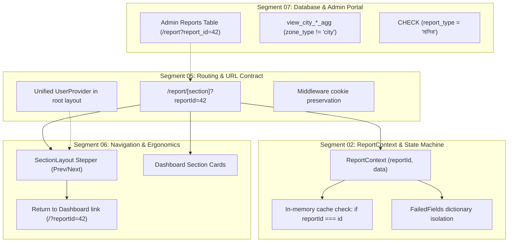

# Segment 05 Adversarial Review: Routing, Canonical Navigation & Fallback Demolition

**Repository**: `Jabir-A-H/report-submission` (`Talimul Quran Report Submission`)  
**Auditor**: Subagent B (Adversarial Reviewer)  
**Target Domain**: Segment 05 — Routing, Canonical Navigation & Fallback Demolition  
**Subject Under Review**: `docs/issues-critique/segment-05-investigation.md` (Subagent A's Investigation)  
**Evaluation Standard**: Pre-Production Agility (`AGENTS.md` Rule 7), Adversarial Doubt Gate (`AGENTS.md` Rule 2 & 6), 5-Layer Behavioral Trace (`WEB-001`–`WEB-014`), Zero Dead-Weight Policy  
**Date**: 2026-11-15  

---

## 1. Adversarial Scorecard & Sanity Check

| Issue ID | Proposed Refactor / Finding | Subagent A Conclusion | Adversarial Sanity Check | Verdict | Cross-Examination Summary |
|:---|:---|:---:|:---:|:---:|:---|
| **RS-10** | Single-Month Editing Boundary Enforcement | Flagged leaky RPC call in `UserDashboard` and missing DB check constraint | **VERIFIED & AMPLIFIED** | **ACCEPTED WITH HARDENING** | Confirmed. While [`src/app/report/[section]/page.tsx#L94-L97`](file:///d:/WebDev/report-submission/src/app/report/[section]/page.tsx#L94-L97) hardcodes `dbReportType = "মাসিক"`, [`src/components/dashboard/user-dashboard.tsx#L141-L161`](file:///d:/WebDev/report-submission/src/components/dashboard/user-dashboard.tsx#L141-L161) still forwards dynamic URL types (`p_report_type: dbReportType`) to `get_or_create_report`. Direct URL manipulation (`/?type=quarterly`) creates orphaned non-monthly rows. PostgreSQL `public.report` lacks a `CHECK` constraint (live DB contains row `id=37` with `report_type = 'Monthly'`). |
| **RS-60 & Tier 11** | Canonical `reportId` URL Navigation (`?reportId=42`) | Enforce `?reportId=42`; eliminate composite period params from section pages | **PARTIALLY SOUND / CONTAINS GAPS** | **ACCEPTED WITH CRITICAL MODIFICATIONS** | Subagent A's proposal drops redundant network calls, but contains **three critical operational blind spots**: (1) If `report/[section]/page.tsx` eliminates the `people` role check, admins can bypass the `/dashboard` guard and access field data entry; (2) Bare URL handling dumps users back to `/` even if `reportId` is already cached in `ReportContext`; (3) Returning from sections to `/` via stepper (`/?reportId=42`) breaks `UserDashboard`, which currently only recognizes `type/month/year`. |
| **Backlog Item 3** | DCS Zone 1 Entity & 2-Tier Hierarchy Governance | Replace magic `zone_id <> 1` with `zone_type != 'city'` across views and code | **VERIFIED & REFINED** | **ACCEPTED WITH NULL-SAFETY FIX** | All 6 SQL aggregation views (`view_city_*_agg`) currently execute `WHERE (r.zone_id <> 1)`. However, Subagent A's proposed SQL `WHERE z.zone_type != 'city'` suffers from SQL ternary NULL traps if any zone has `NULL` `zone_type`. Must use `WHERE (z.zone_type IS DISTINCT FROM 'city')`. `public.zone` rows 2..14 confirmed to have `parent_id = null`; setting `parent_id = 1` is safe. |
| **KI-023 Trap 1** | Phantom Schema Fallacy | Schema drift reversed; code maintains dead fallbacks | **VERIFIED** | **ACCEPTED** | Supabase DDL migration was completed on 2026-11-10 (`zone_type` and `parent_id` are live). Frontend defensive checks (e.g. `42703` catch in `management/page.tsx`) are verified dead-weight. |
| **RS-48** | Supabase cookie loss on middleware redirects | `NextResponse.redirect` drops refreshed session cookies | **VERIFIED** | **ACCEPTED** | Confirmed across [`middleware.ts#L59-L63, L79-L83, L87-L92`](file:///d:/WebDev/report-submission/middleware.ts#L59-L92). Refresh tokens written to `supabaseResponse` are never copied to `NextResponse.redirect()`, causing intermittent session drops during token rotation. |
| **RS-67** | Triplicate client auth/profile network storm | Move to unified `<UserProvider>` in root layout | **VERIFIED** | **ACCEPTED WITH GUEST-STATE GUARD** | Confirmed. [`navbar.tsx`](file:///d:/WebDev/report-submission/src/components/layout/navbar.tsx), [`bottom-nav.tsx`](file:///d:/WebDev/report-submission/src/components/layout/bottom-nav.tsx), and [`user-dropdown.tsx`](file:///d:/WebDev/report-submission/src/components/layout/user-dropdown.tsx) execute 6 redundant network round-trips on every page mount. `<UserProvider>` is mandatory, but must handle unauthenticated states (`/home`, `/help`) gracefully without throwing or blocking. |
| **RS-74** | SessionCleaner demolition | Permanently delete `.discard/session-cleaner.tsx` | **VERIFIED** | **ACCEPTED** | Zero occurrences of `sessionStorage` in `src/`. Ready for permanent removal upon user review under Rule 4. |
| **Middleware** | Legacy `/login` & `/register` rewrites | Stale documentation drift in `TECHNICAL_MANUAL.md` | **VERIFIED** | **ACCEPTED** | Code already cleaned up; documentation reconciliation required. |

---

## 2. False-Positive Discharge Table

The adversarial audit identifies the following theoretical findings, over-generalizations, and misclassifications that must be discharged or clarified:

| # | Candidate Issue / Flag | Subagent A Implication | Adversarial Reality Check & Domain Fact | Final Disposition |
|:---:|:---|:---|:---|:---:|
| **FP-01** | **Multi-Month Viewing on `/report` as a Routing Defect** | Risk of conflating multi-month URL parameters on `/report` with the single-month data entry guard | In [`src/app/report/page.tsx#L220-L240`](file:///d:/WebDev/report-submission/src/app/report/page.tsx#L220-L240), `/report` serves as the **read-only multi-month aggregation viewer and export engine** (PDF/Excel) for admins and authorized users. It deliberately accepts `?type=quarterly&quarter=1&year=2026` to aggregate monthly rows in memory (`id: -1`). Enforcing `?reportId=42` must apply strictly to the **interactive section editor** (`/report/[section]`), NOT to the read-only aggregate viewer (`/report`). | **DISCHARGED AS INTENTIONAL ARCHITECTURE** (Preserve multi-month query capability on `/report`) |
| **FP-02** | **Unconditional Bare URL Redirect to Dashboard** | Subagent A proposed redirecting any bare `/report/[section]` to `/?targetSection=${section}` | If a field worker is in an active session where `ReportContext` already holds `reportId = 42` and `data`, bouncing them to the dashboard when they type `/report/courses` is an abrasive UX failure. The bare URL handler must check in-memory `ReportContext.reportId` first before bailing out to `/`. | **DISCHARGED / REFINED** (Check context before redirecting) |
| **FP-03** | **Immediate Elimination of Role Checks from `report/[section]`** | Subagent A proposed completely eliminating role checks from `report/[section]/page.tsx` to optimize network calls | Eliminating the role check without hoisting it to layout creates an authorization leak: admins could navigate to `/report/header?reportId=42` and edit zone field forms, violating ADR-009 / WEB-006. The role check must be retained or consumed from `UserProvider`. | **DISCHARGED / REFINED** (Consume role from `UserProvider`) |
| **FP-04** | **`CHECK (report_type = 'মাসিক')` Breaking System Extensibility** | Fear that adding a PostgreSQL `CHECK` constraint prevents future non-monthly reports | In this system's domain model, upazila field submissions are strictly and exclusively monthly. Multi-month metrics are mathematical aggregations generated by SQL views or query loaders; they are never stored as independent rows in `public.report`. The constraint reflects the true domain invariant. | **DISCHARGED** (Database constraint is valid) |
| **FP-05** | **Undefined Column `42703` Catch Block in `management/page.tsx`** | Retained out of fear that unmigrated database instances exist | Pre-production agility (`AGENTS.md` Rule 7) establishes that the live Supabase database is authoritative. Columns `zone_type` and `parent_id` exist. Defensive catch blocks for non-existent columns are dead-weight. | **DISCHARGED AS BLOATWARE** (Safe to remove) |

---

## 3. ID Tampering & Cross-Zone Security Scenarios

### 3.1 Scenario Matrix: The "Doubt Gate" Cross-Examination

To evaluate Subagent A's canonical pointer proposal (`/report/[section]?reportId=42`), we subject the architecture to 5 real-world field conditions:

```
┌────────────────────────────────────────────────────────────────────────────────────────┐
│                        ADVERSARIAL STRESS-TEST SCENARIOS                               │
├──────────────────────────┬───────────────────────────────┬─────────────────────────────┤
│ Field Condition          │ Threat / Vulnerability        │ Systemic Defense Mechanism  │
├──────────────────────────┼───────────────────────────────┼─────────────────────────────┤
│ 1. ID Tampering          │ Worker in Zone A alters URL   │ RLS on public.report &      │
│    (?reportId=43)        │ to view Zone B's report data  │ child tables blocks read.   │
├──────────────────────────┼───────────────────────────────┼─────────────────────────────┤
│ 2. Direct Write Hack     │ Malicious client invokes      │ RLS UPDATE policy checks    │
│    (updateField on 43)   │ PostgREST UPDATE on report_id │ zone_id = get_user_zone_id()│
├──────────────────────────┼───────────────────────────────┼─────────────────────────────┤
│ 3. Cold Refresh          │ Field worker pulls down to    │ 1 PostgREST query loads     │
│    (F5 on ?reportId=42)  │ refresh on spotty 3G/4G       │ complete 7-table bundle.    │
├──────────────────────────┼───────────────────────────────┼─────────────────────────────┤
│ 4. Non-Existent ID       │ Worker visits bookmarked ID   │ PGRST116 detected; clean    │
│    (?reportId=999999)    │ that was purged or deleted    │ 404/redirect card rendered. │
├──────────────────────────┼───────────────────────────────┼─────────────────────────────┤
│ 5. Admin Intrusion       │ Admin pastes section URL      │ UserContext detects role;   │
│    (Admin hits [section])│ into browser address bar      │ immediately routes to /dash │
└──────────────────────────┴───────────────────────────────┴─────────────────────────────┘
```

### 3.2 Detailed Behavioral & Cryptographic Tracing

#### Scenario 1: ID Tampering across Zones (Zone 12 User visits `?reportId=43` belonging to Zone 13)
1. **Client Action**: Field worker in Demra Zone (id: 12) changes URL from `/report/header?reportId=42` to `/report/header?reportId=43` (belonging to Khilgaon Zone, id: 13).
2. **Database Query**: Cold page execution triggers `loadReport(43)`:
   ```typescript
   supabase.from('report').select('*, header:report_header(*), ...').eq('id', 43).single();
   ```
3. **PostgreSQL RLS Execution**:
   - PostgreSQL evaluates RLS policy `report_select_own_zone_or_admin`:
     ```sql
     ((zone_id = get_user_zone_id()) OR is_admin())
     ```
   - `get_user_zone_id()` for authenticated user returns `12`.
   - `is_admin()` returns `false`.
   - For row `43`, `zone_id` is `13`. `13 = 12` evaluates to `FALSE`.
   - Zero rows returned.
4. **PostgREST Response**:
   PostgREST returns HTTP 406 with error code `PGRST116` (`"JSON object requested, multiple (or no) rows returned"`).
5. **DOM & State Protection**:
   `report-context.tsx` receives `error`, sets `loadError`, and returns `{ success: false }`. In [`src/app/report/[section]/page.tsx#L179-L212`](file:///d:/WebDev/report-submission/src/app/report/[section]/page.tsx#L179-L212), `activeError` short-circuits component rendering. **Zero form inputs, zero field labels, and zero metrics from Zone 13 are ever mounted in the DOM.**
6. **UX Defect in Subagent A's Proposal**:
   The current error card tells the worker: *"আপনার পূর্বের ডেটা সুরক্ষিত আছে। ইন্টারনেট সংযোগ পরীক্ষা করে পুনরায় চেষ্টা করুন।"* ("Your previous data is secure. Check your internet connection and retry.")
   - This creates a **confusing dead-end retry loop** because the internet is fine—the user simply lacks authorization!
   - **Hardened Fix**: `loadReport` must inspect `error.code === 'PGRST116'` and render an explicit access error: *"রিপোর্টটি খুঁজে পাওয়া যায়নি অথবা এটি দেখার অনুমতি আপনার নেই।"* with a button directing back to the Dashboard (`/`).

#### Scenario 2: Direct PostgREST Write Tampering
1. **Attack Vector**: Attacker bypasses the UI and dispatches an authenticated PostgREST HTTP `PATCH /rest/v1/report_header?report_id=eq.43` with payload `{"total_muallima": 999}` using their valid JWT token.
2. **PostgreSQL RLS Evaluation**:
   PostgreSQL evaluates `report_header_update` policy:
   ```sql
   (is_admin() OR (report_id IN (
     SELECT report.id FROM report WHERE report.zone_id = get_user_zone_id()
   )))
   ```
3. **Execution**:
   The subquery `SELECT id FROM report WHERE zone_id = 12` yields `[42]`. Since `43 NOT IN [42]`, the policy evaluates to `FALSE`.
4. **Result**: 0 rows updated. PostgREST returns `[]` with status 200/204. No error is thrown, but zero data is written. Tampering is completely neutralized at the database engine level.

#### Scenario 3: Cold Browser Refresh on `/report/header?reportId=42`
1. **Action**: Worker on spotty mobile network pulls down to refresh or reopens the browser.
2. **State Trace**:
   - `ReportContext` in-memory state is empty (`data = {}`, `reportId = null`).
   - `searchParams.get("reportId")` resolves to `"42"`.
   - `SectionSwitcher` initiates `loadReport(42)`.
   - Exactly **1 network request** is dispatched to PostgREST fetching `report` with child table joins.
   - Contrast with current production: Currently executes 4 sequential round-trips (`getUser`, `people`, `get_or_create_report` RPC, and 7-table join), saving ~450ms on 3G/4G connections.

#### Scenario 4: Admin Access to Field Section Forms (`WEB-006` Regression)
1. **Vulnerability**: If Subagent A's recommendation to "completely eliminate people check from section pages" is implemented naively, an admin visiting `/report/header?reportId=42` would be granted access because `is_admin() = true` satisfies RLS.
2. **Threat**: Admins entering zone edit forms bypass the read-only audit flow and risk accidentally corrupting zone field entries.
3. **Hardened Guard**: `SectionSwitcher` must consume `useUser()` from the new unified `UserProvider`:
   ```typescript
   const { profile, isLoading: isUserLoading } = useUser();
   if (!isUserLoading && (profile?.role === "admin" || profile?.role === "superadmin")) {
     router.replace("/dashboard");
     return;
   }
   ```
   This maintains `WEB-006` protection with 0 redundant database queries.

---

## 4. Cross-Segment Blast Radius Analysis

Switching from composite period parameters (`type/month/year`) to canonical `reportId` pointers cascades across four interconnected architectural segments:



### 4.1 Impact on Segment 02: Save Reliability & State Machine
1. **`ReportContext` State Preservation**:
   - When a worker transitions from `/report/header?reportId=42` to `/report/courses?reportId=42`, `reportId` in `ReportContext` remains `42`.
   - `SectionSwitcher` verifies `reportIdRef.current === 42 && dataRef.current`, bypassing all fetches and rendering immediately.
2. **Cross-Report Field Failure Contamination**:
   - If auto-save fails on Report 42 (e.g. connectivity drop), `failedFields` holds unsaved edits.
   - If the worker subsequently navigates to a different report (Report 43) from the dashboard, `failedFields` **must be cleared**:
     ```typescript
     // Inside ReportContext loadReport(newId)
     if (reportId !== newId) {
       setFailedFields({});
     }
     ```
     Failing to clear `failedFields` across report IDs would allow "Retry All" to mistakenly replay Report 42's metrics into Report 43!

### 4.2 Impact on Segment 06: Stepper Navigation & Dashboard Interoperability
1. **Stepper Forward/Backward Links**:
   [`src/components/report/section-layout.tsx#L72, L82`](file:///d:/WebDev/report-submission/src/components/report/section-layout.tsx#L72-L82) forwards `searchParams.toString()`. When URLs adopt `?reportId=42`, `queryString` becomes `?reportId=42`. Stepper navigation between all 7 section tabs preserves the canonical pointer automatically.
2. **The Dashboard Return Trap (`/?reportId=42`)**:
   - In [`section-layout.tsx#L44, L90`](file:///d:/WebDev/report-submission/src/components/report/section-layout.tsx#L44-L90), the "Dashboard" and "Finish" buttons navigate to `/${queryString}` (`/?reportId=42`).
   - In current [`user-dashboard.tsx#L53-L69`](file:///d:/WebDev/report-submission/src/components/dashboard/user-dashboard.tsx#L53-L69), `hasParams` checks exclusively for `typeParam`, `monthParam`, and `yearParam`.
   - **The Failure**: When the user clicks "ড্যাশবোর্ড" from a section, they land on `/?reportId=42`. `hasParams` evaluates to `false`. The dashboard resets, displaying the unselected period picker and hiding all section cards!
   - **Required Coordination**: `UserDashboard` must recognize `reportId` as a valid entry parameter. If `reportId` is present in `searchParams`, it loads the report by ID and extracts the year/month from the loaded data object to populate the header pill!

### 4.3 Impact on Segment 07: Admin Portal & Database Schemas
1. **URL Parameter Casing Parity**:
   - Admin reports table ([`src/app/(admin)/reports/page.tsx#L504`](file:///d:/WebDev/report-submission/src/app/(admin)/reports/page.tsx#L504)) currently links to `/report?zone_id=X&report_id=Y` (snake_case `report_id`).
   - Section pages and viewer must accept both casings:
     ```typescript
     const reportIdParam = searchParams.get("reportId") || searchParams.get("report_id");
     ```
2. **SQL Aggregation Views Schema Upgrade**:
   - When updating all 6 `view_city_*_agg` views to filter on `zone_type != 'city'`, the views must be declared `WITH (security_invoker = true)` to prevent security privilege escalation.
   - The filter must use `z.zone_type IS DISTINCT FROM 'city'` to prevent NULL drops.

---

## 5. Final Hardened Pre-Production Action Plan

Under `AGENTS.md` Rule 7, execute this consolidated 6-step architectural implementation:

### Step 1: Database DDL & View Consolidation Migration
Execute in Supabase project `pxdkvewaglagnfcqeckn`:
```sql
-- 1. Standardize historical report row 37 and enforce strict single-month constraint
UPDATE public.report SET report_type = 'মাসিক' WHERE report_type = 'Monthly';
ALTER TABLE public.report DROP CONSTRAINT IF EXISTS report_type_check;
ALTER TABLE public.report ADD CONSTRAINT report_type_check CHECK (report_type = 'মাসিক');

-- 2. Populate 2-tier hierarchy foreign key (parent_id = 1 for all upazilas)
UPDATE public.zone SET parent_id = 1 WHERE id != 1 AND parent_id IS NULL;

-- 3. Upgrade all 6 SQL views to use zone_type hierarchy with null safety
CREATE OR REPLACE VIEW public.view_city_header_agg WITH (security_invoker = true) AS
  SELECT r.year, r.month, r.report_type,
    sum(rh.total_muallima) AS total_muallima,
    sum(rh.muallima_increase) AS muallima_increase,
    sum(rh.muallima_decrease) AS muallima_decrease,
    sum(rh.certified_muallima) AS certified_muallima,
    sum(rh.certified_muallima_taking_classes) AS certified_muallima_taking_classes,
    sum(rh.trained_muallima) AS trained_muallima,
    sum(rh.trained_muallima_taking_classes) AS trained_muallima_taking_classes,
    sum(rh.total_unit) AS total_unit,
    sum(rh.units_with_muallima) AS units_with_muallima
  FROM public.report r
  JOIN public.report_header rh ON r.id = rh.report_id
  JOIN public.zone z ON r.zone_id = z.id
  WHERE z.zone_type IS DISTINCT FROM 'city'
  GROUP BY r.year, r.month, r.report_type;

CREATE OR REPLACE VIEW public.view_city_course_agg WITH (security_invoker = true) AS
  SELECT r.year, r.month, r.report_type, rc.category,
    sum(rc.number) AS number, sum(rc.increase) AS increase, sum(rc.decrease) AS decrease,
    sum(rc.sessions) AS sessions, sum(rc.students) AS students, sum(rc.attendance) AS attendance,
    sum(rc.status_board) AS status_board, sum(rc.status_qayda) AS status_qayda,
    sum(rc.status_ampara) AS status_ampara, sum(rc.status_quran) AS status_quran,
    sum(rc.completed) AS completed, sum(rc.correctly_learned) AS correctly_learned
  FROM public.report r
  JOIN public.report_course rc ON r.id = rc.report_id
  JOIN public.zone z ON r.zone_id = z.id
  WHERE z.zone_type IS DISTINCT FROM 'city'
  GROUP BY r.year, r.month, r.report_type, rc.category;

CREATE OR REPLACE VIEW public.view_city_organizational_agg WITH (security_invoker = true) AS
  SELECT r.year, r.month, r.report_type, ro.category,
    sum(ro.number) AS number, sum(ro.increase) AS increase, sum(ro.amount) AS amount
  FROM public.report r
  JOIN public.report_organizational ro ON r.id = ro.report_id
  JOIN public.zone z ON r.zone_id = z.id
  WHERE z.zone_type IS DISTINCT FROM 'city'
  GROUP BY r.year, r.month, r.report_type, ro.category;

CREATE OR REPLACE VIEW public.view_city_personal_agg WITH (security_invoker = true) AS
  SELECT r.year, r.month, r.report_type, rp.category,
    sum(rp.teaching) AS teaching, sum(rp.learning) AS learning, sum(rp.olama_invited) AS olama_invited,
    sum(rp.became_shohojogi) AS became_shohojogi, sum(rp.became_sokrio_shohojogi) AS became_sokrio_shohojogi,
    sum(rp.became_kormi) AS became_kormi, sum(rp.became_rukon) AS became_rukon
  FROM public.report r
  JOIN public.report_personal rp ON r.id = rp.report_id
  JOIN public.zone z ON r.zone_id = z.id
  WHERE z.zone_type IS DISTINCT FROM 'city'
  GROUP BY r.year, r.month, r.report_type, rp.category;

CREATE OR REPLACE VIEW public.view_city_meeting_agg WITH (security_invoker = true) AS
  SELECT r.year, r.month, r.report_type, rm.category,
    sum(rm.city_count) AS city_count, sum(rm.city_avg_attendance) AS city_avg_attendance,
    sum(rm.thana_count) AS thana_count, sum(rm.thana_avg_attendance) AS thana_avg_attendance,
    sum(rm.ward_count) AS ward_count, sum(rm.ward_avg_attendance) AS ward_avg_attendance
  FROM public.report r
  JOIN public.report_meeting rm ON r.id = rm.report_id
  JOIN public.zone z ON r.zone_id = z.id
  WHERE z.zone_type IS DISTINCT FROM 'city'
  GROUP BY r.year, r.month, r.report_type, rm.category;

CREATE OR REPLACE VIEW public.view_city_extra_agg WITH (security_invoker = true) AS
  SELECT r.year, r.month, r.report_type, re.category,
    sum(re.number) AS number
  FROM public.report r
  JOIN public.report_extra re ON r.id = re.report_id
  JOIN public.zone z ON r.zone_id = z.id
  WHERE z.zone_type IS DISTINCT FROM 'city'
  GROUP BY r.year, r.month, r.report_type, re.category;
```

### Step 2: Unified `UserProvider` Context (`AGENTS.md` Rule 2)
1. Create `src/components/providers/user-provider.tsx`:
   - Single memoized `createClient()` instance.
   - Fetches `user` and `people` profile once on mount.
   - Listens to `supabase.auth.onAuthStateChange` to keep session in sync.
   - Exposes `{ user, profile, isLoading, isAdmin, isSuperAdmin, zoneId, zoneName }`.
2. Wrap inside `src/app/layout.tsx`.
3. Refactor `Navbar`, `BottomNav`, and `UserDropdown` to consume `useUser()`, cutting 6 redundant network calls per route transition to 0.

### Step 3: Middleware Cookie Forwarding Hardening
In [`middleware.ts`](file:///d:/WebDev/report-submission/middleware.ts):
Replace raw `NextResponse.redirect(url)` with a cookie-preserving helper:
```typescript
function createRedirectResponse(request: NextRequest, url: URL, supabaseResponse: NextResponse) {
  const redirectResponse = NextResponse.redirect(url);
  supabaseResponse.cookies.getAll().forEach((cookie) => {
    redirectResponse.cookies.set(cookie.name, cookie.value, cookie);
  });
  return redirectResponse;
}
```
Apply across lines 62, 82, and 91 to eliminate session dropping during token rotation.

### Step 4: Two-Way Canonical `reportId` in `UserDashboard`
In [`src/components/dashboard/user-dashboard.tsx`](file:///d:/WebDev/report-submission/src/components/dashboard/user-dashboard.tsx):
1. Demolish `REPORT_TYPE_MAP` allowing non-monthly report creation:
   ```typescript
   // Field workers strictly create/load monthly reports
   const dbReportType = "মাসিক";
   ```
2. Accept `reportId` from URL searchParams:
   If `searchParams.get("reportId")` exists:
   - Check if already loaded in `ReportContext`. If not, call `loadReport(id)`.
   - Set active period state from the loaded report's `month` and `year`.
3. Section card links adopt canonical database pointer:
   ```tsx
   <Link href={`/report/${section.id}?reportId=${repId}`}>
   ```

### Step 5: Hardened `SectionSwitcher`
In [`src/app/report/[section]/page.tsx`](file:///d:/WebDev/report-submission/src/app/report/[section]/page.tsx):
1. **Bare URL Resolution with In-Memory Cache Check**:
   ```typescript
   const reportIdParam = searchParams.get("reportId") || searchParams.get("report_id");
   if (!reportIdParam) {
     if (reportIdRef.current) {
       router.replace(`/report/${section}?reportId=${reportIdRef.current}`);
       return;
     }
     router.replace(`/?targetSection=${section}`);
     return;
   }
   ```
2. **WEB-006 Role Protection via `UserProvider`**:
   ```typescript
   const { profile, isLoading: isUserLoading } = useUser();
   if (!isUserLoading && (profile?.role === "admin" || profile?.role === "superadmin")) {
     router.replace("/dashboard");
     return;
   }
   ```
3. **Instant Render via Cache Check**:
   ```typescript
   const targetId = Number(reportIdParam);
   if (reportIdRef.current === targetId && dataRef.current && Object.keys(dataRef.current).length > 0 && !loadError) {
     setIsLoading(false);
     return;
   }
   ```
4. **PGRST116 Error Discrimination**:
   When `loadReport` fails with `PGRST116`, render an informative authorization/not-found card rather than suggesting an internet connection failure.

### Step 6: Post-Session Documentation Reconcile
1. Update `docs/TECHNICAL_MANUAL.md` §1.3 and §4.1 (remove stale `/login` and `/register` rewrites, record canonical `reportId` contract).
2. Update `docs/ROADMAP.md` (advance Tier 11 to verified implementation).
3. Record architectural decision: `docs/ADR/027-canonical-report-id-navigation-and-hierarchy-views.md`.
