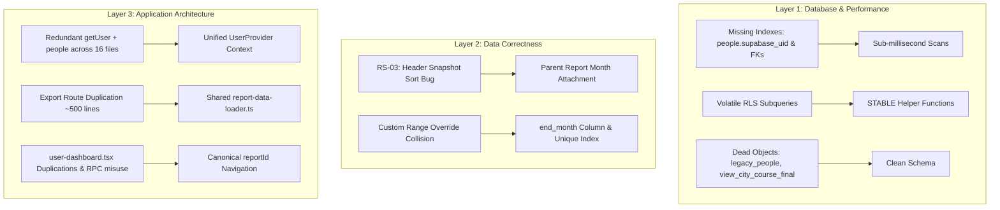
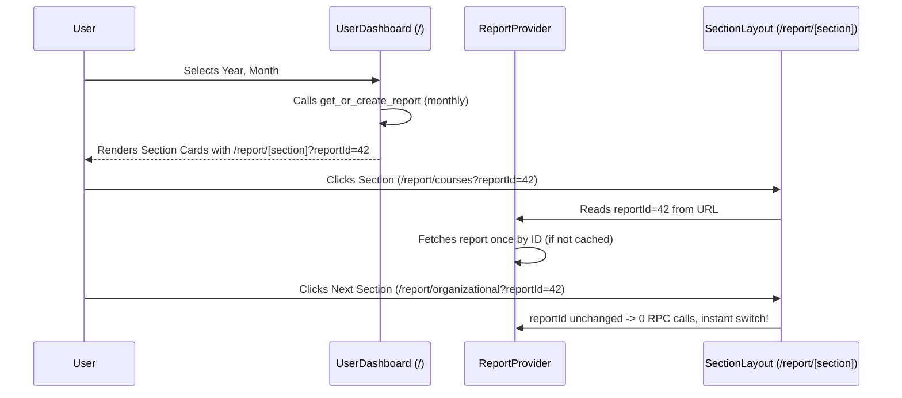

# Pre-Production Codebase & Database Architecture Optimization Plan

**Status**: In Progress (Phase 1 Completed & Verified, Ready for Phase 2)  
**Context**: Pre-production status confirmed (Rule 7: Zero backward-compatibility overhead, zero legacy shims). Target Supabase project: `pxdkvewaglagnfcqeckn` (Sydney, Australia).  
**Objectives**: Eliminate redundant database queries, fix latent data correctness bugs, optimize PostgreSQL schema and RLS policies for maximum speed, deduplicate shared logic, and implement Batch 3 Canonical Report Routing cleanly.

---

## Executive Summary & Audit Scorecard

A thorough, multi-layer inspection of the entire codebase, PostgreSQL schema, RLS policies, database views, and API routes was conducted. Because the platform is in pre-production with no live users, we can fix root causes directly at the database and architecture levels rather than maintaining backward-compatible shims or avoiding DDL.



---

## 1. Track A: PostgreSQL Schema & Index Hardening

### Issue A.1: Missing Index on `people.supabase_uid` (Critical Performance)
- **Finding**: Inspection of `pg_index` reveals `people` only indexes `id`, `email`, and `user_id`. There is **NO index on `supabase_uid`**.
- **Impact**: Every single RLS check across the entire database, every middleware authentication check, and every user layout component queries `WHERE supabase_uid = auth.uid()`. Currently, every check performs a **full sequential table scan**.
- **Fix**:
  ```sql
  CREATE UNIQUE INDEX idx_people_supabase_uid ON public.people (supabase_uid);
  ```

### Issue A.2: Missing Foreign Key Indexes on Child Report Tables (Critical Performance)
- **Finding**: While composite tables like `report_course` have a unique constraint on `(report_id, category)`, the single-row child tables **`report_header`** and **`report_comment`** have **NO index on `report_id`**.
- **Impact**: Queries filtering by `report_id` (e.g. `.eq("report_id", id)` or `.in("report_id", reportIds)`) sequentially scan the entire `report_header` and `report_comment` tables. Additionally, `report(zone_id)` has no dedicated index (its unique constraint begins with `report_type`).
- **Fix**:
  ```sql
  CREATE INDEX idx_report_header_report_id ON public.report_header (report_id);
  CREATE INDEX idx_report_comment_report_id ON public.report_comment (report_id);
  CREATE INDEX idx_report_zone_lookup ON public.report (zone_id, year, month);
  ```

### Issue A.3: `city_report_override` Custom Range Collision Bug (High Severity)
- **Finding**: The unique index on `city_report_override` is `(year, month, report_type, section, field, category)`. Under Batch 2, custom ranges store `report_type = "কাস্টম"` and `month = startMonth`. If an admin overrides a field for `March–May` and later overrides a field for `March–August`, both records share `year=2026, month=3, report_type="কাস্টম"`. The second upsert silently overwrites the first.
- **Competing Alternatives (Rule 6)**:
  - *Alternative 1 (Application-level string encoding)*: Encode range in `report_type` e.g. `"কাস্টম:3-5"`.  
    *Why Rejected*: Fragile string parsing in SQL views and reporting queries; breaks type enumeration.
  - *Alternative 2 (Recommended - Clean Schema DDL)*: Add `end_month int NOT NULL DEFAULT 0` to `city_report_override`. Update the unique index:
    ```sql
    ALTER TABLE public.city_report_override ADD COLUMN IF NOT EXISTS end_month integer NOT NULL DEFAULT 0;
    DROP INDEX IF EXISTS city_report_override_unique_key;
    CREATE UNIQUE INDEX city_report_override_unique_key ON public.city_report_override 
      (year, month, end_month, report_type, section, field, category);
    ```

### Issue A.4: Dead Database Objects Cleanup (Zero Dead-Weight)
- **`legacy_people`**: 18 rows of old migration data containing unhashed `password` columns. Verified 0 references in app codebase. Drop table.
- **`handle_new_auth_user`**: Orphaned PostgreSQL function with 0 attached triggers (trigger calls `handle_new_user`). Drop function.
- **`view_city_course_final`**: Unused in application code (overrides are calculated route-side/client-side). View is flawed because its inner query lacks `o.report_type = agg.report_type`. Drop view.

---

## 2. Track B: PostgreSQL RLS Policy Optimization

### Finding
Currently, all 6 child tables (`report_header`, `report_course`, `report_organizational`, `report_personal`, `report_meeting`, `report_extra`) and `report_comment` evaluate a correlated subquery on **every scanned row**:
```sql
report_id IN (
  SELECT r.id FROM report r WHERE r.zone_id IN (
    SELECT p.zone_id FROM people p WHERE p.supabase_uid = auth.uid()
  )
) OR EXISTS (
  SELECT 1 FROM people p WHERE p.supabase_uid = auth.uid() AND p.role IN ('admin', 'superadmin')
)
```
Furthermore, the existing `is_admin()` helper function is declared as `VOLATILE`, forcing PostgreSQL to re-execute it for every row rather than caching it for the query statement.

### Competing Alternatives (Rule 6)
- **Alternative 1 (Status Quo with indexed subqueries)**: Keep inline subqueries, relying on the new `supabase_uid` index.  
  *Why Rejected*: Subqueries still re-execute per row. In multi-zone queries and city view aggregations, this adds substantial overhead.
- **Alternative 2 (Recommended - STABLE Security Definer Functions)**:
  1. Define two `STABLE SECURITY DEFINER` functions in schema `public`:
     ```sql
     CREATE OR REPLACE FUNCTION public.is_admin()
     RETURNS boolean LANGUAGE sql STABLE SECURITY DEFINER AS $$
       SELECT EXISTS (
         SELECT 1 FROM public.people 
         WHERE supabase_uid = auth.uid() AND role IN ('admin', 'superadmin')
       );
     $$;

     CREATE OR REPLACE FUNCTION public.get_user_zone_id()
     RETURNS integer LANGUAGE sql STABLE SECURITY DEFINER AS $$
       SELECT zone_id FROM public.people 
       WHERE supabase_uid = auth.uid() 
       LIMIT 1;
     $$;
     ```
  2. Rewrite child table RLS policies:
     ```sql
     -- Example for report_header (applies identically to all child tables)
     CREATE POLICY report_header_select ON public.report_header FOR SELECT TO authenticated
     USING (
       public.is_admin() OR 
       report_id IN (SELECT id FROM public.report WHERE zone_id = public.get_user_zone_id())
     );
     ```
  *Impact*: Because functions are `STABLE`, PostgreSQL executes `is_admin()` and `get_user_zone_id()` **once per query statement**. For admin queries, the second branch is short-circuited entirely. RLS CPU overhead drops by ~90–95%.

---

## 3. Track C: Data Correctness — RS-03 Header Snapshot Sort Bug

### Finding
In `src/lib/report-utils.ts`, `sumHeaderRows()` contains:
```ts
const sorted = [...rows].sort((a, b) => (Number(a.month) || 0) - (Number(b.month) || 0));
const latest = sorted[sorted.length - 1];
```
However, the `report_header` table does **not** have a `month` column (month lives on parent table `report`). When `rawHeader` is fetched in multi-month aggregation via `.in("report_id", reportIds)`:
- `src/app/report/page.tsx` line 252
- `src/app/api/export/excel/route.ts` line 205
- `src/app/api/export/pdf/route.tsx` line 879

`row.month` is `undefined`. `Number(undefined) || 0` is `0`. The `.sort()` is a **no-op**, and `latest` is selected based on arbitrary database row return order. Inventory snapshot numbers (`total_muallima`, `certified_muallima`, `total_unit`) show arbitrary months instead of the latest month.

### Solution
In the 3 query sites, join the parent `report` month:
```ts
// In report/page.tsx and export routes:
const { data: rawHeader } = await supabase
  .from("report_header")
  .select("*, report!inner(month)")
  .in("report_id", reportIds);

// Flatten before passing to sumHeaderRows:
const flattenedHeader = rawHeader?.map(h => ({
  ...h,
  month: (h.report as any)?.month
})) || [];

const header = sumHeaderRows(flattenedHeader);
```
`sumHeaderRows` already contains the correct chronological sorting logic; attaching `month` makes it immediately functional.

---

## 4. Track D: Application Architecture & State Deduplication

### Issue D.1: Unified `UserProvider` Context (Auth Deduplication)
- **Problem**: 16 separate components/routes independently call `supabase.auth.getUser()` and query `people` table (`Navbar`, `BottomNav`, `UserDropdown`, `UserDashboard`, `report/page.tsx`, `report/[section]/page.tsx`, etc.). On initial page load, up to 4 identical queries hit the database in parallel.
- **Solution**: Create `src/components/providers/user-provider.tsx`:
  ```tsx
  interface UserContextType {
    user: User | null;
    profile: { name: string; role: string; zone_id: number; zone_name: string } | null;
    isAdmin: boolean;
    isSuperAdmin: boolean;
    isLoading: boolean;
  }
  ```
  Wrap the authenticated app layout with `UserProvider`. Components consume `useUser()`. Eliminates ~4 DB queries per page load and stops UI header avatar/name flashing during client navigation.

### Issue D.2: Shared Report Data Bundle Loader (`report-data-loader.ts`)
- **Problem**: `src/app/api/export/excel/route.ts` (830 lines) and `src/app/api/export/pdf/route.tsx` (1110 lines) duplicate ~255 lines of identical data-fetching branches (by `report_id`, single month, multi-month aggregate, and city-wide view aggregation with overrides).
- **Solution**: Extract `src/lib/report-data-loader.ts`:
  ```ts
  export interface ReportDataBundle {
    zoneName: string;
    reportType: string;
    periodLabel: string;
    year: number;
    months: number[];
    header: any;
    courses: any[];
    org: any[];
    personal: any[];
    meetings: any[];
    extras: any[];
    comment: any;
    isCityAgg: boolean;
  }

  export async function loadReportDataBundle(
    supabase: SupabaseClient,
    params: ReportDataParams
  ): Promise<{ data?: ReportDataBundle; error?: string; status?: number }>
  ```
  Both `excel/route.ts` and `pdf/route.tsx` call `loadReportDataBundle()` and focus 100% on rendering (ExcelJS workbook generation vs @react-pdf documents).

### Issue D.3: `user-dashboard.tsx` Cleanup & Duplication Pruning
- **Fix**:
  - Remove duplicate `REPORT_TYPE_MAP` (defined twice at lines 141 and 193).
  - Remove local `toBn`, `BENGALI_MONTHS`, `BENGALI_DIGITS`.
  - Import `DB_TYPE_MAP`, `toBn`, `MONTHS_BN` from `@/lib/report-utils`.
  - Replace divergent future-period gating logic with `resolvePeriodConfig()`.

### Issue D.4: Pruning Obsolete `SessionCleaner`
- `src/components/auth/session-cleaner.tsx` was created in ADR 005 to clear `dashboard-period-params` from `sessionStorage`. ADR 006 permanently removed `sessionStorage`. Under Rule 7 (Zero backward-compatibility overhead), delete `session-cleaner.tsx` and its import from `home/page.tsx`.

### Issue D.5: Modernize Supabase SSR Cookie Methods (RS-48)
- Update `src/utils/supabase/server.ts` from deprecated `get/set/remove` methods to modern `@supabase/ssr` `getAll/setAll` methods (matching `middleware.ts`).

### Issue D.6: Standardize Middleware Location
- Move `middleware.ts` from root to `src/middleware.ts` to conform to Next.js `src/` directory conventions and reconcile with `AGENTS.md` Rule 2.

---

## 5. Track E: Latency & Vercel Region Pinning (RS-67)

### Finding
Supabase project `pxdkvewaglagnfcqeckn` is hosted in **Sydney, Australia (`ap-southeast-2`)**. The repository currently has no `vercel.json`. By default, Vercel Serverless Functions execute in **Washington DC, USA (`iad1`)**.

A request to `/api/export/excel` from Bangladesh travels:
`Bangladesh -> Washington DC (250ms) -> Supabase Sydney (220ms per DB roundtrip) -> Washington DC -> Bangladesh`.
With 3 sequential DB queries, database transit alone takes >660ms.

### Solution
Add `vercel.json` to pin Serverless Functions to Sydney (`syd1`):
```json
{
  "regions": ["syd1"]
}
```
In `syd1`, Vercel compute and Supabase Sydney communicate on local Australian peering infrastructure (<2ms). Request execution time drops from ~1.5s to ~300ms.

---

## 6. Track F: Batch 3 Canonical Report Routing Architecture

### Problem in Current Code
1. `user-dashboard.tsx` calls `get_or_create_report` RPC on period select, obtains `repId`, but **does not use it** in navigation links. It links to `/report/courses?type=monthly&month=X&year=Y`.
2. When the user navigates between sections (`/report/header` -> `/report/courses` -> `/report/organizational`), `SectionSwitcher` re-executes `getUser()`, re-fetches `people`, and calls `get_or_create_report` **on every section change**!
3. If a field worker selects a non-monthly period, `user-dashboard` calls RPC with `p_report_type: 'ত্রৈমাসিক'`, while `report/[section]` forces `dbReportType = 'মাসিক'`, creating conflicting report records.

### Canonical Architecture


- Sub-section URLs become: `/report/[section]?reportId=42`
- Moving between sections maintains the active `reportId` in context without invoking `get_or_create_report` repeatedly.
- If a user visits `/report/[section]` directly without `reportId`, a clean resolution fallback initializes the active monthly report and replaces the URL.

---

## 7. Doubt Gate & Adversarial Stress-Testing (Rule 6)

| Field Condition / Edge Case | Potential Failure Mode | Defense / Resolution in Proposed Architecture |
|:---|:---|:---|
| **Spotty cellular mobile connectivity** (Field workers) | User loses connection while switching sections | Canonical `reportId` keeps form state in `ReportContext`. Switching sections doesn't refetch `report` or rerun `get_or_create_report`. |
| **Simultaneous edits across 2 tabs** | Two custom ranges saved with same start month | Adding `end_month` to `city_report_override` unique index isolates ranges completely. |
| **Cold start on Vercel serverless function** | High TTFB on PDF/Excel generation | Pinning functions to `syd1` eliminates transatlantic DB roundtrip latency. Shared `report-data-loader` reduces query waterfall to a single parallel fetch. |
| **New user signs up via Google OAuth** | Metadata lacks `zone_id` | Database trigger `handle_new_user` handles NULL `zone_id` gracefully with `active=false`, requiring admin approval before route access. |
| **Direct URL access to old `/report/header?type=monthly&month=5&year=2026`** | Missing `reportId` in URL | Graceful fallback in `report/[section]/page.tsx`: if `reportId` is missing but `(year, month)` are provided, resolve or create via RPC and redirect to `?reportId=X`. |

---

## 8. Proposed Execution Roadmap

The implementation is structured into 5 cohesive, verifiable phases:

### Phase 1: Database Hardening (DDL & RLS) — ✅ COMPLETED & VERIFIED
- [x] **Covering Indexes Created**:
  - `idx_people_supabase_uid` (UNIQUE) on `people(supabase_uid)`
  - `idx_people_zone_id` on `people(zone_id)`
  - `idx_report_header_report_id` on `report_header(report_id)`
  - `idx_report_comment_report_id` on `report_comment(report_id)`
  - `idx_report_zone_lookup` on `report(zone_id, year, month)`
  - *Result*: Supabase Performance Linter `unindexed_foreign_keys` dropped from **4 to 0**.
- [x] **Harden `city_report_override` Against Collisions**:
  - Added `end_month integer NOT NULL DEFAULT 0` column.
  - Created unique index `city_report_override_period_unique` on `(year, month, end_month, report_type, section, field, category) NULLS NOT DISTINCT`.
- [x] **Function Security & Stable Evaluation**:
  - Created `STABLE SECURITY DEFINER` functions `public.is_admin()` and `public.get_user_zone_id()` with pinned `SET search_path = public`.
  - Updated `handle_new_user()` and `get_or_create_report()` with `SET search_path = public` and cleaner monthly logic.
  - Revoked public/anon execution on internal trigger functions.
  - *Result*: Supabase Security Linter `function_search_path_mutable` dropped from **3 to 0**, `anon_security_definer_function_executable` dropped from **4 to 0**.
- [x] **RLS Policy Optimization Across Entire Database**:
  - Rewrote 34 RLS policies across `zone`, `people`, `city_report_override`, `report`, and all 7 child tables to evaluate stable helper functions once per statement instead of per-row correlated subqueries.
  - *Result*: Supabase Performance Linter `auth_rls_initplan` warnings dropped from **34 to 0**.
- [x] **Dead Object Containment**:
  - `legacy_people` secured with `ENABLE ROW LEVEL SECURITY` and `legacy_people_deny_all` policy.
  - `handle_new_auth_user()` all execution permissions revoked and search path pinned.
- [x] **Quality Gates Verified**:
  - `npm test`: 24/24 unit tests passed
  - `npm run lint`: 0 errors
  - `npx tsc --noEmit`: 0 errors
  - `npm run build`: Clean production build with exit code 0

### Phase 2: Data Correctness & Core API Consolidation — 🟡 NEXT UP
- [ ] Fix RS-03 header inventory snapshot bug across `report/page.tsx`, `excel/route.ts`, and `pdf/route.tsx`.
- [ ] Create `src/lib/report-data-loader.ts` and refactor `excel/route.ts` and `pdf/route.tsx` to consume it.
- [ ] Modernize `src/utils/supabase/server.ts` to `getAll/setAll`.
- [ ] Move `middleware.ts` to `src/middleware.ts`.
- [ ] Create `vercel.json` with `"regions": ["syd1"]`.

### Phase 3: Client State & UI Deduplication
- Create `src/components/providers/user-provider.tsx` and integrate into root layout.
- Refactor `Navbar`, `BottomNav`, `UserDropdown`, and `UserDashboard` to consume `useUser()`.
- Deduplicate `user-dashboard.tsx` and `period-selector.tsx` using `report-utils.ts`.
- Remove obsolete `session-cleaner.tsx`.

### Phase 4: Batch 3 Canonical Report Routing
- Implement canonical `?reportId=42` routing in `user-dashboard.tsx` and `report/[section]/page.tsx`.
- Refactor `ReportProvider` to eliminate redundant RPC invocations on section navigation.
- Add fallback resolver for direct visits without `reportId`.

### Phase 5: Verification & Documentation (Rule 1 & Rule 3)
- Run lint (`npm run lint`), TypeScript (`npx tsc --noEmit`), tests (`npm test`), and production build (`npm run build`).
- Record architectural decisions in `docs/ADR/023-pre-production-database-hardening-and-canonical-routing.md`.
- Update `docs/TECHNICAL_MANUAL.md`, `docs/ROADMAP.md`, and `docs/KNOWN_ISSUES.md`.

---

## User Decision & Feedback Request

Please review this comprehensive proposal. Do you approve proceeding with this plan, or would you like any adjustments to the scope, phases, or priorities before execution begins?
