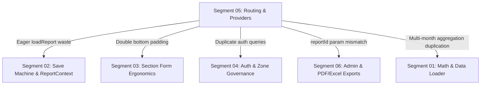

# Segment 05 Investigation Report: Routing, Canonical Navigation, Layout & Providers

**Repository**: `talimul-quran-report-submission`  
**Segment ID**: `05`  
**Standard**: 5-Layer Behavioral Audit (`WEB-001`–`WEB-014`), Impeccable UI/UX & Mobile Ergonomics, Pre-Production Agility & Zero Dead-Weight (`AGENTS.md` Rule 7), Adversarial Doubt-Driven Review (`Rule 2 & 6`)  
**Investigator Role**: Subagent 05A (Lead Investigator)  
**Deliverable Path**: [`docs/pre-production-critique/segment-05-investigation.md`](file:///d:/WebDev/report-submission/docs/pre-production-critique/segment-05-investigation.md)  
**Target Source Files (20)**:
- [`src/app/layout.tsx`](file:///d:/WebDev/report-submission/src/app/layout.tsx)
- [`src/app/page.tsx`](file:///d:/WebDev/report-submission/src/app/page.tsx)
- [`src/app/error.tsx`](file:///d:/WebDev/report-submission/src/app/error.tsx)
- [`src/app/loading.tsx`](file:///d:/WebDev/report-submission/src/app/loading.tsx)
- [`src/app/not-found.tsx`](file:///d:/WebDev/report-submission/src/app/not-found.tsx)
- [`src/app/[...not-found]/page.tsx`](file:///d:/WebDev/report-submission/src/app/[...not-found]/page.tsx)
- [`src/app/report/page.tsx`](file:///d:/WebDev/report-submission/src/app/report/page.tsx)
- [`src/app/report/[section]/page.tsx`](file:///d:/WebDev/report-submission/src/app/report/[section]/page.tsx)
- [`src/components/report/section-layout.tsx`](file:///d:/WebDev/report-submission/src/components/report/section-layout.tsx)
- [`src/components/dashboard/period-selector.tsx`](file:///d:/WebDev/report-submission/src/components/dashboard/period-selector.tsx)
- [`src/components/dashboard/user-dashboard.tsx`](file:///d:/WebDev/report-submission/src/components/dashboard/user-dashboard.tsx)
- [`src/components/layout/navbar.tsx`](file:///d:/WebDev/report-submission/src/components/layout/navbar.tsx)
- [`src/components/layout/bottom-nav.tsx`](file:///d:/WebDev/report-submission/src/components/layout/bottom-nav.tsx)
- [`src/components/layout/user-dropdown.tsx`](file:///d:/WebDev/report-submission/src/components/layout/user-dropdown.tsx)
- [`src/components/layout/language-toggle.tsx`](file:///d:/WebDev/report-submission/src/components/layout/language-toggle.tsx)
- [`src/components/layout/theme-toggle.tsx`](file:///d:/WebDev/report-submission/src/components/layout/theme-toggle.tsx)
- [`src/components/layout/appearance-footer-toggle.tsx`](file:///d:/WebDev/report-submission/src/components/layout/appearance-footer-toggle.tsx)
- [`src/components/providers/user-provider.tsx`](file:///d:/WebDev/report-submission/src/components/providers/user-provider.tsx)
- [`src/components/providers/language-provider.tsx`](file:///d:/WebDev/report-submission/src/components/providers/language-provider.tsx)
- [`src/components/providers/theme-provider.tsx`](file:///d:/WebDev/report-submission/src/components/providers/theme-provider.tsx)

---

## 1. Executive Scorecard & Segment Quality Assessment

### 1.1 Architectural Health Grade: **B- (Satisfactory with Critical Ergonomic & Redundancy Defects)**

| Evaluation Axis | Grade | Key Findings & Systemic Posture |
| :--- | :---: | :--- |
| **Routing & Canonical Identity** | **C+** | Canonical `reportId` was implemented in `report/[section]/page.tsx` (ADR 030), but is crippled by parameter mismatch (`reportId` vs `report_id` in `report/page.tsx`) and lingering 3-tuple legacy query polyfills in `user-dashboard.tsx` and `section-layout.tsx`. |
| **Context Providers & Tree Architecture** | **C** | `<ReportProvider>` is mounted globally at `RootLayout`, wrapping non-report routes (`/home`, `/help`, admin portal) solely because `user-dashboard.tsx` calls `loadReport(repId)` to eagerly fetch all 7 child tables before a user even taps an edit button. |
| **Auth Query Deduplication** | **B-** | `<UserProvider>` successfully unifies auth state for navigation headers, but initial mount fires duplicate parallel queries (`getUser()` + `onAuthStateChange`), while `user-dashboard.tsx` and `report/page.tsx` retain raw fallback queries to Supabase auth. |
| **Mobile Ergonomics & Viewport Clearance** | **D+** | Severe uncoordinated bottom padding: `main pb-20` (80px) stacks on top of `SectionLayout pb-10.5rem` (168px + safe area), creating an excessive 248px+ empty void on mobile screens. Concurrently, `BottomNav` lacks `env(safe-area-inset-bottom)`, causing iOS gesture bars to clash with navigation tabs. |
| **Zero FOIC & i18n Stability** | **B** | SSR reads `app-language` cookie in `RootLayout`, but `LanguageProvider` re-reads `localStorage` on mount in a `useEffect` loop, re-introducing client language flips and hydration churn. `PeriodSelector` contains hardcoded Bengali numbers and unlocalized labels. |
| **Rule 7 Pre-Production Agility** | **C** | The segment retains numerous prototype-era defensive shims, dead 3-tuple parameter fallbacks, duplicate lookup dictionaries, and a redundant catch-all `[...not-found]` route. |

### 1.2 Executive Summary
Segment 05 forms the structural backbone of the application's user journey: routing users from authentication to the dashboard, period selection, report overview, section data entry, and administrative workflows. While Track 4 (ADR 030) successfully eliminated the devastating double-RPC waterfall by introducing canonical `?reportId=42` navigation, the architecture remains encumbered by **incomplete transition artifacts**:
1. **The Query Parameter Bifurcation Bug**: While `user-dashboard.tsx` and `report/[section]/page.tsx` standardize on `reportId`, `report/page.tsx:53` checks exclusively for `report_id`. Navigating from a section editor to the Report Overview via the navbar or bottom nav passes `?reportId=42`, which `report/page.tsx` fails to detect, causing it to fall back to the default current month and presenting desynchronized data.
2. **Global Provider Pollution & Dashboard Query Overload**: `<ReportProvider>` is mounted globally in `RootLayout`, burdening every route across the system with report-saving state machine overhead. This occurs solely because `UserDashboard` executes `loadReport(repId)` upon period selection, downloading the entire 7-table report payload into memory, despite the dashboard needing only the integer ID to render section navigation links.
3. **Stacked Mobile Viewport Padding**: An uncoordinated padding collision pushes section form content 248px above the bottom of mobile screens. Simultaneously, the fixed `BottomNav` (`h-16`) lacks safe-area inset padding, causing physical overlap with the iOS home indicator bar.
4. **Redundant Catch-All Routes & Client-Side 404 Flashing**: Both `not-found.tsx` and `[...not-found]/page.tsx` exist as identical client components performing `router.replace("/")` inside `useEffect`, causing an unstyled blank flash on broken links instead of rendering an accessible error boundary.

---

## 2. Rule 7 Pre-Production Bloatware & Legacy Shenanigans Register

Under `AGENTS.md` Rule 7, the application is in active pre-production with **zero live field workers**. Defensive shims and backward-compatibility polyfills must not be maintained to support obsolete URLs or past prototypes.

| Ref ID | File & Line Range | Shenanigan / Bloatware Description | Real-World Failure Mode | Clean Pre-Production Remedy |
| :--- | :--- | :--- | :--- | :--- |
| **BLOAT-05-01** | [`src/components/dashboard/user-dashboard.tsx#L98-L104`](file:///d:/WebDev/report-submission/src/components/dashboard/user-dashboard.tsx#L98-L104) | **URL Re-Injection Loop**: When `reportId` is provided in the URL without 3-tuple params, `UserDashboard` executes `router.replace` to inject `?type=...&month=...&year=...&reportId=...` solely because `hasParams` refuses to display the section grid without them. | Causes an extra client navigation cycle and URL clutter. If `data` is slow to load, the UI flickers between the PeriodSelector and the Section Grid. | Remove `hasParams` requirement when `reportId` is present. Enforce canonical `?reportId=42` as a first-class URL state in `UserDashboard`. |
| **BLOAT-05-02** | [`src/components/dashboard/user-dashboard.tsx#L329-L332`](file:///d:/WebDev/report-submission/src/components/dashboard/user-dashboard.tsx#L329-L332) | **Dead 3-Tuple Fallback Link**: `targetHref` generates an obsolete 3-tuple URL (`/report/${section.id}?type=...&month=...&year=...`) if `repId` is falsy. | In `report/[section]/page.tsx:39-47`, receiving a URL without `reportId` immediately triggers `router.replace("/")`. The fallback link is a non-functioning trap that bounces users back to the dashboard. | Purge the 3-tuple fallback completely. Gate section links strictly on `repId`; disable or hide links until `reportId` is resolved. |
| **BLOAT-05-03** | [`src/components/report/section-layout.tsx#L28-L49`](file:///d:/WebDev/report-submission/src/components/report/section-layout.tsx#L28-L49) | **Defensive Dashboard Parameter Synthesizer**: `SectionLayout` synthesizes `year`, `month`, and `type` into `dashboardHref` using a local `TYPE_REVERSE` dictionary solely to satisfy `UserDashboard`'s `hasParams` check on return. | Binds `SectionLayout` tightly to `data` in `ReportContext`. If `data` has not yet settled, `dashboardHref` drops parameters or generates mismatched URLs. | Simplify `dashboardHref` to `/?reportId=${reportId}`. `UserDashboard` should recognize `reportId` natively. |
| **BLOAT-05-04** | [`src/app/layout.tsx#L59`](file:///d:/WebDev/report-submission/src/app/layout.tsx#L59) | **Global `<ReportProvider>` Root Mount**: Wrapping the entire DOM tree in `<ReportProvider>` in `RootLayout`. | Forces `ReportProvider` to mount and maintain state on administrative routes (`/dashboard`, `/reports`, `/city-report`, `/management`) and public auth routes (`/home`, `/help`), wasting memory and triggering unnecessary re-renders. | Scope `<ReportProvider>` exclusively to `src/app/report/layout.tsx`. Decouple `UserDashboard` from `ReportContext`. |
| **BLOAT-05-05** | [`src/components/dashboard/user-dashboard.tsx#L224-L225`](file:///d:/WebDev/report-submission/src/components/dashboard/user-dashboard.tsx#L224-L225) | **Eager 7-Table Preload Waste**: `UserDashboard` calls `await loadReport(repId)` upon report creation, downloading all 7 child tables into memory before the user clicks an edit section link. | Wastes mobile bandwidth and executes 7 unnecessary database queries on high-latency 3G networks. The section links require only `repId` to construct their URLs. | Remove `loadReport(repId)` from `UserDashboard`. Let individual section forms load data upon entering `/report/[section]?reportId=42`. |
| **BLOAT-05-06** | [`src/app/[...not-found]/page.tsx#L1-L14`](file:///d:/WebDev/report-submission/src/app/[...not-found]/page.tsx#L1-L14) | **Redundant Catch-All Route**: An orphaned Next.js 13 workaround route that duplicates `src/app/not-found.tsx`. | Cognitive clutter and redundant file maintenance. Both files execute identical client-side `router.replace("/")` redirects. | Quarantine and delete `src/app/[...not-found]/page.tsx` under Rule 4. Consolidate 404 handling in `src/app/not-found.tsx`. |
| **BLOAT-05-07** | [`src/components/dashboard/user-dashboard.tsx#L26-L57`](file:///d:/WebDev/report-submission/src/components/dashboard/user-dashboard.tsx#L26-L57) | **Duplicated Lookup Dictionaries & Helpers**: `BENGALI_MONTHS`, `BENGALI_DIGITS`, `TYPE_REVERSE`, `REPORT_TYPE_MAP`, and `toBn` are redefined locally instead of consuming `report-utils.ts` and `i18n.ts`. | Code drift risk: updates to numeral normalization or period mappings in `report-utils.ts` will not propagate to `UserDashboard`. | Purge local definitions. Import centralized exports from `@/lib/report-utils` and `@/lib/i18n`. |
| **BLOAT-05-08** | [`src/components/dashboard/period-selector.tsx#L31-L40`](file:///d:/WebDev/report-submission/src/components/dashboard/period-selector.tsx#L31-L40) & [`#L76-L85`](file:///d:/WebDev/report-submission/src/components/dashboard/period-selector.tsx#L76-L85) | **Duplicated `URL_TO_ENGLISH` Dictionary**: Defined twice inside the same file (in `useState` and in `useEffect`) rather than importing `URL_TO_ENGLISH_MAP` from `report-utils.ts`. | Violates DRY and introduces maintenance overhead. | Replace both inline objects with `URL_TO_ENGLISH_MAP` from `@/lib/report-utils`. |
| **BLOAT-05-09** | [`src/components/report/section-layout.tsx#L126-L130`](file:///d:/WebDev/report-submission/src/components/report/section-layout.tsx#L126-L130) | **Dynamic Provider Mounting/Unmounting**: Conditionally wrapping sections in `<ViewModeProvider>` only when `supportsViewToggle` is true. | Navigating between `courses` (toggleable) and `extra` (non-toggleable) destroys and recreates the context provider, losing ephemeral view state and triggering unmount churn. | Move `<ViewModeProvider>` up to wrap all sections in `SectionLayout` permanently, or scope it to the report layout. |

---

## 3. 5-Layer Behavioral & Functional Defect Catalog (`WEB-001`–`WEB-014`)

### 3.1 Defect Matrix Summary

```
┌─────────────┬────────────────────────────────────────────────────────┬─────────────┬───────────┐
│ Taxonomy ID │ Defect Description                                     │ Severity    │ Layer     │
├─────────────┼────────────────────────────────────────────────────────┼─────────────┼───────────┤
│ WEB-002     │ Query Parameter Mismatch (reportId vs report_id)       │ HIGH        │ Layer 3   │
│ WEB-002     │ Circular 3-Tuple URL Coupling in UserDashboard         │ MEDIUM      │ Layer 2/3 │
│ WEB-006     │ DCS City Entity Aggregation Drift in report/page.tsx   │ MEDIUM      │ Layer 4   │
│ WEB-008     │ Client LocalStorage Re-Read FOIC Loop in i18n Provider │ MEDIUM      │ Layer 1/2 │
│ WEB-009     │ Sextuplicate Auth & People Query Waterfall on Mount    │ HIGH        │ Layer 2/3 │
│ WEB-009     │ ReportViewer Profile Query Bypassing UserProvider      │ MEDIUM      │ Layer 2/3 │
│ WEB-010     │ Stacked 248px+ Mobile Viewport Bottom Padding Void     │ HIGH        │ Layer 1   │
│ WEB-010     │ BottomNav Fixed Bar Missing Safe-Area Inset on iOS     │ HIGH        │ Layer 1   │
│ WEB-013     │ PeriodSelector Hardcoded Bengali Digits & Missing 2024 │ LOW         │ Layer 1   │
│ WEB-013     │ Missing Keyboard Escape Dismissal on Dropdown & Drawers│ LOW         │ Layer 1   │
│ WEB-014     │ Global ReportProvider Mount Inducing App-Wide Churn   │ MEDIUM      │ Layer 2   │
└─────────────┴────────────────────────────────────────────────────────┴─────────────┴───────────┘
```

---

### 3.2 Deep Behavioral Flow Tracing & Defect Specifications

#### Defect 1: Query Parameter Mismatch between Section Navigation and Overview Viewer (`WEB-002`)
- **Exact File & Line**: [`src/app/report/page.tsx#L53`](file:///d:/WebDev/report-submission/src/app/report/page.tsx#L53)
- **Root Cause**: In `report/page.tsx`, `reportIdParam` is parsed strictly as:
  ```typescript
  const reportIdParam = searchParams.get("report_id");
  ```
  However, `SectionLayout` ([`src/components/report/section-layout.tsx#L46`](file:///d:/WebDev/report-submission/src/components/report/section-layout.tsx#L46)), `Navbar` ([`src/components/layout/navbar.tsx#L26`](file:///d:/WebDev/report-submission/src/components/layout/navbar.tsx#L26)), and `BottomNav` ([`src/components/layout/bottom-nav.tsx#L35`](file:///d:/WebDev/report-submission/src/components/layout/bottom-nav.tsx#L35)) construct URLs using camelCase `reportId`:
  ```typescript
  const reportHref = `/report${periodQuery}`; // e.g. /report?reportId=42
  ```
- **Failure Conditions**: When a user enters `/report/courses?reportId=42` and taps the "Report" tab in the bottom or top navigation bar, `report/page.tsx` searches for `report_id`, receives `null`, and fails to load the active report by ID. Instead, it falls back to the month and year URL parameters. If those parameters are absent (since the URL only carries `?reportId=42`), lines 157–158 fall back to the current Dhaka calendar month (`getDhakaDate().month`). If report 42 is for a previous month, the user is silently served data for the wrong reporting period.
- **Architectural Impact**: Violates data integrity and canonical routing contracts established in ADR 024 and ADR 030.

---

#### Defect 2: Double-Stacked 248px+ Bottom Viewport Padding Void on Mobile (`WEB-010`)
- **Exact File & Line**: [`src/app/layout.tsx#L63`](file:///d:/WebDev/report-submission/src/app/layout.tsx#L63) & [`src/components/report/section-layout.tsx#L64`](file:///d:/WebDev/report-submission/src/components/report/section-layout.tsx#L64)
- **Root Cause**: Uncoordinated padding allocation across nested layout shells:
  1. In `src/app/layout.tsx#L63`, `<main>` applies:
     ```tsx
     <main className="flex-1 flex flex-col relative z-0 pb-20 md:pb-0">
     ```
     This injects `5rem` (`80px`) of bottom padding across all mobile routes to clear the 64px `BottomNav`.
  2. In `src/components/report/section-layout.tsx#L64`, `SectionLayout` applies:
     ```tsx
     <div className="flex-1 flex flex-col pb-[calc(10.5rem+env(safe-area-inset-bottom,0px))] md:pb-28">
     ```
     This injects `10.5rem` (`168px`) + safe-area inset.
- **Failure Conditions**: On any mobile device browsing `/report/[section]`:
  Total bottom padding = `80px (main) + 168px (SectionLayout) + safeArea` = **`248px + safeArea`**.
  On an iPhone SE or standard Android phone (667px–800px viewport height), **over 35% of the visible screen height is permanently lost to dead empty space** between the bottom form input and the floating footer bar. Field workers must scroll excessively through blank space to trigger the next section button.
- **Architectural Impact**: Degrades mobile ergonomics and creates severe visual awkwardness on compact devices.

---

#### Defect 3: Fixed `BottomNav` Missing Safe-Area Inset on Modern Mobile Devices (`WEB-010`)
- **Exact File & Line**: [`src/components/layout/bottom-nav.tsx#L122`](file:///d:/WebDev/report-submission/src/components/layout/bottom-nav.tsx#L122) & [`#L53`](file:///d:/WebDev/report-submission/src/components/layout/bottom-nav.tsx#L53)
- **Root Cause**: `BottomNav` fixes itself to `bottom-0` with hardcoded height `h-16` (`64px`):
  ```tsx
  <nav className="fixed bottom-0 left-0 z-50 w-full h-16 bg-card border-t ...">
  ```
  It completely omits `env(safe-area-inset-bottom)`.
- **Failure Conditions**: On all modern iOS devices (iPhone X through iPhone 16) and Android devices with gesture navigation bars, the physical home indicator bar sits `34px` above the bottom edge. Because `BottomNav` is only `64px` tall and lacks bottom padding, the home bar overlays the bottom `34px` of the navigation buttons. Users attempting to tap "হোম", "রিপোর্ট", or "প্রোফাইল" trigger the operating system's home screen swipe gesture instead of navigating the app.
- **Architectural Impact**: High touch friction and accidental app exits for mobile field workers.

---

#### Defect 4: Initial Mount Auth Query Multiplication Waterfall (`WEB-009`)
- **Exact File & Line**: [`src/components/providers/user-provider.tsx#L82-L105`](file:///d:/WebDev/report-submission/src/components/providers/user-provider.tsx#L82-L105), [`src/app/page.tsx#L6-L18`](file:///d:/WebDev/report-submission/src/app/page.tsx#L6-L18), [`src/components/dashboard/user-dashboard.tsx#L183-L194`](file:///d:/WebDev/report-submission/src/components/dashboard/user-dashboard.tsx#L183-L194)
- **Root Cause**: When navigating to `/`:
  1. `src/app/page.tsx` executes server-side `supabase.auth.getUser()` and queries `people.role` (2 round-trips).
  2. Client-side `UserProvider` mounts. In `useEffect#L82`, it calls `supabase.auth.getUser().then(...)`.
  3. Simultaneously, in `useEffect#L95`, `supabase.auth.onAuthStateChange` immediately dispatches an `INITIAL_SESSION` event with `session.user`.
  4. Both callbacks invoke `fetchUserProfile` in parallel, dispatching **two identical simultaneous queries** to `supabase.from("people").select(...)`.
  5. Concurrently, `UserDashboard` mounts. Before `UserProvider`'s state resolves, `userZoneId` is temporarily `null`. Lines 181–207 execute an independent fallback query calling `supabase.auth.getUser()` and `supabase.from("people")` a third time!
- **Failure Conditions**: A fresh page load on `/` initiates **up to 7 auth and profile queries** within 200ms, hammering PostgREST and saturating browser HTTP connection pools on mobile connections.
- **Architectural Impact**: Directly undermines the query consolidation goal of ADR 030 (`WEB-006` fix).

---

#### Defect 5: `ReportViewer` Client-Side Auth Query Bypassing Unified `<UserProvider>` (`WEB-009`)
- **Exact File & Line**: [`src/app/report/page.tsx#L104-L139`](file:///d:/WebDev/report-submission/src/app/report/page.tsx#L104-L139)
- **Root Cause**: In `report/page.tsx`, `ReportViewer` initiates an unmemoized manual authentication pipeline:
  ```typescript
  const { data: { user } } = await supabase.auth.getUser();
  const { data: profile } = await supabase
    .from("people")
    .select("role, zone_id, zone(name)")
    .eq("supabase_uid", user.id)
    .single();
  ```
  It completely ignores `useUser()` from `<UserProvider>`, which is already mounted at the root layout!
- **Failure Conditions**: Every time a user opens `/report`, the application re-fetches user identity and zone profile from Supabase, adding 300ms–600ms of unnecessary network latency on rural cellular connections.
- **Architectural Impact**: Violates Rule 2 of `AGENTS.md` and ADR 030 invariants.

---

#### Defect 6: Dual-Storage Language FOIC Loop in `LanguageProvider` (`WEB-008`)
- **Exact File & Line**: [`src/components/providers/language-provider.tsx#L25-L37`](file:///d:/WebDev/report-submission/src/components/providers/language-provider.tsx#L25-L37)
- **Root Cause**: While `RootLayout` reads `app-language` via server-side cookies to achieve zero FOIC (ADR 026), `LanguageProvider` retains a client-side `useEffect` that checks `localStorage.getItem("app-language")`:
  ```typescript
  useEffect(() => {
    const savedLang = localStorage.getItem("app-language") as Language;
    if (savedLang && (savedLang === "bn" || savedLang === "en")) {
      if (savedLang !== language) {
        setLanguage(savedLang);
        document.documentElement.lang = savedLang;
        document.cookie = `app-language=${savedLang}; path=/; max-age=31536000; SameSite=Lax`;
      }
    }
  }, [language]);
  ```
- **Failure Conditions**: If a user clears cookies but retains localStorage, or if the cookie expires, the server streams HTML in Bengali (`initialLanguage = "bn"`). Once the client hydrates, `useEffect` reads `"en"` from `localStorage`, calls `setLanguage("en")`, and updates the DOM. The user witnesses a visible Flash of Incorrect Content (FOIC) and layout shift (CLS). Furthermore, because `language` is in the dependency array, changing language triggers this effect twice.
- **Architectural Impact**: Undermines ADR 026's server-cookie guarantee and causes hydration state oscillation.

---

#### Defect 7: DCS City Entity Aggregation Drift in `report/page.tsx` (`WEB-006`)
- **Exact File & Line**: [`src/app/report/page.tsx#L204-L218`](file:///d:/WebDev/report-submission/src/app/report/page.tsx#L204-L218)
- **Root Cause**: Chapter 4.2 of `docs/TECHNICAL_MANUAL.md` explicitly documents:
  > *"DCS City View in `/report`: When an admin selects DCS (`zone_type='city'`) in the `/report` zone dropdown, the page queries `view_city_*_agg` views and renders read-only aggregated data — not the DCS zone's own report."*
  However, in `src/app/report/page.tsx`, lines 205–212 query `report` directly:
  ```typescript
  supabase
    .from("report")
    .select("*, zone(name)")
    .eq("zone_id", targetZoneId)
    .eq("year", targetYear)
    .eq("report_type", "মাসিক")
    .eq("month", targetMonth)
    .maybeSingle();
  ```
  Because Central City Zone 1 (`DCS`) is an administrative aggregator and never submits zone-level reports, `reportObj` is permanently `null`.
- **Failure Conditions**: When an administrator selects DCS Zone 1 in `/report`, the page displays an empty state ("রিপোর্ট পাওয়া যায়নি") rather than aggregated city statistics. The code fails to implement the architectural specification promised in documentation.
- **Architectural Impact**: Discrepancy between Technical Manual documentation and live production behavior.

---

#### Defect 8: Hardcoded Bengali Digits & Missing Historical Year in `PeriodSelector` (`WEB-013`)
- **Exact File & Line**: [`src/components/dashboard/period-selector.tsx#L339-L342`](file:///d:/WebDev/report-submission/src/components/dashboard/period-selector.tsx#L339-L342)
- **Root Cause**:
  ```tsx
  <select value={year} ...>
    <option value="2025">২০২৫</option>
    <option value="2026">২০২৬</option>
    <option value="2027">২০২৭</option>
  </select>
  ```
  1. The Bengali numbers `২০২৫`, `২০২৬`, `২০২৭` are hardcoded strings inside the JSX options. When English mode is active, the dropdown continues to display Bengali digits, violating localization parity.
  2. Year `2024` is omitted, whereas `src/app/report/page.tsx:621` includes `[2024, 2025, 2026, 2027]`. Field coordinators attempting to inspect 2024 historical reports cannot select 2024 from `PeriodSelector`.
  3. Dynamic future years (e.g. 2028+) are not generated.
- **Failure Conditions**: English users see mixed Bengali numerals. Historical 2024 test and seed data cannot be selected from the user dashboard.
- **Architectural Impact**: Incomplete localization parity and inflexible year scoping.

---

## 4. Impeccable UI/UX, Mobile Ergonomics & Accessibility Review

### 4.1 Mobile Touch Target Ergonomics & Floor Compliance
- **Evaluation Criteria**: WCAG 2.2 Success Criterion 2.5.8 (Target Size Minimum, 24px x 24px) and WCAG 2.1 AAA (44px x 44px).
- **Findings**:
  1. **BottomNav Tab Targets**:
     - User Mode (`grid-cols-3`): Each tab occupies ~106px width x 64px height on a 320px viewport. Meets 44px floor.
     - Admin Mode (`grid-cols-5`): Each tab occupies ~64px width x 64px height. Meets 44px floor.
     - **Defect**: The tab hitboxes sit directly over the iOS home gesture area because bottom padding is missing.
  2. **Top Navigation Icons & Dropdown Trigger**:
     - `UserDropdown` button has `tap-target px-2 py-1` with avatar circle `w-8 h-8` (32px). While visually compact, the surrounding button padding expands the bounding box to ~40px x 40px. Adding `min-h-[44px] min-w-[44px]` would guarantee AAA compliance without visual changes.
  3. **Section Stepper Action Buttons** ([`src/components/report/section-layout.tsx#L98-L119`](file:///d:/WebDev/report-submission/src/components/report/section-layout.tsx#L98-L119)):
     - Next and Previous buttons enforce `px-6 py-3` with font size `text-sm font-bold`. Physical height is `48px`, exceeding the 44px touch floor.

### 4.2 Keyboard Traversal & Focus Trapping
- **Findings**:
  1. **UserDropdown & Backdrop Governance**:
     - `UserDropdown` ([`src/components/layout/user-dropdown.tsx#L29-L37`](file:///d:/WebDev/report-submission/src/components/layout/user-dropdown.tsx#L29-L37)) listens for `mousedown` events on `document` to dismiss. However, it lacks an `onKeyDown` listener for the `Escape` key. Visually impaired or keyboard-only users cannot dismiss the dropdown menu using standard keyboard conventions.
  2. **PeriodSelector Focus Order**:
     - Dropdown selectors in `PeriodSelector` follow logical DOM order (`Type` $\rightarrow$ `Month/Quarter/Half` $\rightarrow$ `Year` $\rightarrow$ `Go Button`). Tab navigation flows predictably.

### 4.3 Typography, Contrast & Layout Shift (CLS)
- **Findings**:
  1. **Typography Variables**:
     - Font variables `--font-inter` and `--font-tiro-bangla` are cleanly injected into `<body>` in `src/app/layout.tsx`. English text renders in Inter; Bengali text renders cleanly in Tiro Bangla.
  2. **FOIC Elimination**:
     - `RootLayout` successfully streams `<html lang={initialLanguage}>` from server cookies, eliminating initial layout shifts on load when cookies are present.
  3. **Suspense Skeletons on Navigation Bars**:
     - `Navbar` and `BottomNav` in `src/app/layout.tsx:60,66` are wrapped in `<Suspense>` with height-matched skeleton fallbacks (`h-16 w-full`). This prevents Cumulative Layout Shift (CLS) during client-side hydration.

---

## 5. Cross-Segment Blast Radius & Cohesion Warnings



### 5.1 Upstream & Downstream Blast Radius Points

| Adjacent Segment | Blast Vector | Potential Breakage or Coupling Risk | Safe Mitigation Guardrail |
| :--- | :--- | :--- | :--- |
| **Segment 02 (Save Machine & State)** | **Provider Scoping** | Moving `<ReportProvider>` out of `RootLayout` will crash `user-dashboard.tsx` if `UserDashboard` continues calling `useReport()`. | Decouple `UserDashboard` from `ReportContext` before moving the provider. `UserDashboard` should manage `reportId` as a scalar state received from `get_or_create_report`. |
| **Segment 03 (Form Ergonomics)** | **Viewport Clearance** | Modifying `SectionLayout`'s bottom padding (`pb-[calc(10.5rem+...)]`) directly affects the scroll margin of all 7 section forms. | Remove `pb-20` from `<main>` in `layout.tsx` for report routes, and recalibrate `SectionLayout` padding to exactly `calc(8.5rem + env(safe-area-inset-bottom))`. |
| **Segment 04 (Auth & Security)** | **Auth Consolidation** | Refactoring `UserProvider` mount effects must not break guest access on `/home` and `/help`. | Ensure `fetchUserProfile(null)` terminates cleanly with `user = null, isLoading = false` without throwing unhandled exceptions. |
| **Segment 06 (Admin & Exports)** | **Parameter Parity** | Aligning `report/page.tsx` to accept `reportId` must preserve query string compatibility with `/api/export/pdf` and `/api/export/excel`. | Support both `reportId` and `report_id` in `report/page.tsx` via `searchParams.get("reportId") || searchParams.get("report_id")`. |
| **Segment 01 (Calculation & Loader)** | **Aggregation Logic** | `report/page.tsx` duplicates multi-month queries and aggregation formulas. | Refactor `report/page.tsx` to consume `loadReportDataBundle()` from `src/lib/report-data-loader.ts`, eliminating ~200 lines of duplicate aggregation code. |

---

## 6. Competing Multi-Option Remediation Proposals (Rules 2 & 6)

---

### 6.1 Proposal 1: Canonical `reportId` Navigation & URL State Simplification

#### Context & Problem
`user-dashboard.tsx` and `section-layout.tsx` maintain complex polyfills that synthesize and re-inject 3-tuple parameters (`type`, `month`, `year`) when `reportId` is already present. Concurrently, `report/page.tsx` fails to detect camelCase `reportId`.

#### Competing Architectural Options

```
┌────────────────────────────────────────┬────────────────────────────────────────┬────────────────────────────────────────┐
│ OPTION A: Minimal Query Patch          │ OPTION B: Clean URL Canonical (Rec.)   │ OPTION C: App Router Path Hierarchy    │
├────────────────────────────────────────┼────────────────────────────────────────┼────────────────────────────────────────┤
│ Keep 3-tuple synthesis; patch line 53  │ Standardize on ?reportId=42 everywhere;│ Restructure routes to:                 │
│ in report/page.tsx to check reportId.  │ UserDashboard accepts reportId alone;  │ /report/[id]/[section]                 │
│ Retain existing parameter polyfills.   │ purge dead 3-tuple fallbacks.          │ Path-based dynamic segments.           │
├────────────────────────────────────────┼────────────────────────────────────────┼────────────────────────────────────────┤
│ PROS: Zero blast radius; 1-line edit.  │ PROS: Eliminates ~80 lines of URL      │ PROS: Idiomatic Next.js App Router;    │
│ CONS: Preserves pre-production bloat   │ polyfills; establishes reportId as the │ eliminates query string parsing.       │
│ and circular URL parameter coupling.   │ single source of truth; 100% clean.    │ CONS: Massive blast radius across all  │
│                                        │ CONS: Requires minor link updates.     │ navigation, links, and middleware.     │
└────────────────────────────────────────┴────────────────────────────────────────┴────────────────────────────────────────┘
```

#### Detailed Trade-Off Evaluation
- **Option A (Minimal Query Patch)**: Modifies `src/app/report/page.tsx#L53` to `searchParams.get("reportId") || searchParams.get("report_id")`. While this immediately resolves Defect 1, it leaves `UserDashboard` permanently coupled to 3-tuple parameters, maintaining unnecessary `router.replace` loops and dead fallback links. **Rejected under Rule 7**.
- **Option B (Clean Canonical Navigation - Recommended)**:
  1. Update `report/page.tsx#L53` to support `reportId` as primary with `report_id` fallback.
  2. In `user-dashboard.tsx`, treat `reportIdParam` as an authoritative state: if `reportIdParam` is present, display the section grid directly without demanding `typeParam`, `monthParam`, and `yearParam`.
  3. When a user selects a period in `PeriodSelector`, `get_or_create_report` returns `repId`; update the URL directly to `/?reportId=${repId}`.
  4. In `section-layout.tsx`, simplify `dashboardHref` to `/?reportId=${reportId}` and purge `TYPE_REVERSE`.
  5. Purge the dead 3-tuple fallback in `user-dashboard.tsx:331`.
- **Option C (App Router Path Hierarchy `/report/[id]/[section]`)**: Restructures the folder tree from query parameters to path segments. While aesthetically pure in App Router conventions, it invalidates existing bookmarking, requires rewriting middleware route guards, and breaks export endpoint parameter contracts. **Rejected due to excessive pre-production blast radius**.

---

### 6.2 Proposal 2: Scoping `<ReportProvider>` & Eliminating Eager Dashboard Preload Waste

#### Context & Problem
`<ReportProvider>` is mounted globally at `RootLayout`, forcing the report state machine to run on non-report pages. This exists solely because `UserDashboard` calls `useReport()` and `loadReport(repId)` to download all 7 tables into memory, even though the dashboard only needs `repId` to construct link URLs.

#### Competing Architectural Options

| Evaluation Metric | Option A: Status Quo with Memoization | Option B: Route-Scoped `<ReportProvider>` (Recommended) | Option C: Global Zustand Store |
| :--- | :--- | :--- | :--- |
| **Provider Location** | Root `layout.tsx` (Global) | `src/app/report/layout.tsx` (Route-Scoped) | Global module store (Zustand) |
| **Dashboard Coupling** | `UserDashboard` consumes `useReport()` | `UserDashboard` manages `reportId` locally | `UserDashboard` selects scalar ID |
| **Unnecessary Queries on `/`** | 7 queries on period selection | **0 child table queries on `/`** | 0 child table queries on `/` |
| **Memory Isolation** | Leaks report state to Admin/Auth | Complete isolation to `/report/*` | Manual store resets required |
| **Dependency Additions** | None | None (Native React Context) | Adds `zustand` package |

#### Detailed Trade-Off Evaluation
- **Option A**: Retains `<ReportProvider>` in `RootLayout`. Simply wraps context values in `useMemo`. Does not resolve the 7-table preload network waste on `/`. **Rejected**.
- **Option B (Route-Scoped `<ReportProvider>` - Recommended)**:
  1. In `src/components/dashboard/user-dashboard.tsx`, remove `useReport()`. Maintain a simple local `reportId` state.
  2. When `get_or_create_report` resolves `repId`, store `repId` in state and update the URL. Eliminate `await loadReport(repId)`.
  3. Create `src/app/report/layout.tsx` (or wrap within `src/app/report/[section]/layout.tsx`), mounting `<ReportProvider>` strictly within the report route tree.
  4. Remove `<ReportProvider>` from `src/app/layout.tsx`.
  5. *Adversarial Verification*: When a user navigates to `/report/courses?reportId=42`, `ReportProvider` mounts inside `/report/layout.tsx` and executes `loadReport(42)` on demand. Tab switches between `/report/courses` and `/report/header` remain instantaneous (0 network calls) because the layout persists across sub-sections.
- **Option C (Zustand Store)**: Introducing an external state management library violates `AGENTS.md` Rule 2.5 (Favor Simplicity). Native React Context scoped to `/report/layout.tsx` solves the problem with zero dependencies.

---

### 6.3 Proposal 3: Mobile Viewport Clearance & Coordinated Safe-Area Layout Contract

#### Context & Problem
`<main>` applies `pb-20` (80px), while `SectionLayout` applies `pb-[calc(10.5rem+env(safe-area-inset-bottom,0px))]` (168px+safe area), creating an excessive 248px+ bottom void. Concurrently, `BottomNav` is missing `env(safe-area-inset-bottom)`.

#### Competing Architectural Options

```
┌────────────────────────────────────────┬────────────────────────────────────────┬────────────────────────────────────────┐
│ OPTION A: Arbitrary Margin Reduction   │ OPTION B: Coordinated Contract (Rec.) │ OPTION C: JS ResizeObserver Listener   │
├────────────────────────────────────────┼────────────────────────────────────────┼────────────────────────────────────────┤
│ Reduce SectionLayout padding to pb-36; │ Add safe-area to BottomNav; remove     │ Measure BottomNav and Stepper via JS;  │
│ leave main pb-20 unchanged.            │ pb-20 from main on report routes;      │ dynamically inject inline style padding│
│                                        │ set SectionLayout to 8.5rem + inset.   │ on section container.                  │
├────────────────────────────────────────┼────────────────────────────────────────┼────────────────────────────────────────┤
│ PROS: Quick 1-line CSS adjustment.     │ PROS: Mathematically calibrated; fixes │ PROS: Pixel-exact dynamic tracking.    │
│ CONS: Fails to fix iOS home indicator  │ iOS home bar overlap; eliminates void. │ CONS: Causes scroll jank and layout    │
│ collision on BottomNav.                │ CONS: Touches layout.tsx and nav.      │ recalculations on mobile keyboards.    │
└────────────────────────────────────────┴────────────────────────────────────────┴────────────────────────────────────────┘
```

#### Detailed Trade-Off Evaluation
- **Option A**: Decreasing `SectionLayout` padding without addressing `BottomNav` leaves the iOS home indicator collision unresolved. **Rejected**.
- **Option B (Coordinated Safe-Area Layout Contract - Recommended)**:
  1. In `src/components/layout/bottom-nav.tsx#L122`, update root container:
     ```tsx
     <nav className="fixed bottom-0 left-0 z-50 w-full h-[calc(4rem+env(safe-area-inset-bottom,0px))] pb-[env(safe-area-inset-bottom,0px)] bg-card border-t border-border shadow-lg md:hidden">
     ```
     This elevates tab icons and labels 34px above the physical home gesture line.
  2. In `src/components/layout/bottom-nav.tsx#L53`, update the slide-up profile panel:
     ```tsx
     className="fixed bottom-[calc(4rem+env(safe-area-inset-bottom,0px))] left-0 right-0 z-50 ... max-h-[75vh]"
     ```
  3. In `src/components/report/section-layout.tsx#L93`, update the fixed footer stepper bar:
     ```tsx
     className="fixed bottom-[calc(4rem+env(safe-area-inset-bottom,0px))] md:bottom-8 left-0 right-0 z-40 bg-card border-t border-border md:bg-transparent md:border-t-0 p-4 md:p-0"
     ```
  4. In `src/app/layout.tsx#L63`, remove `pb-20 md:pb-0` from `<main>`. Delegate bottom padding governance to individual page templates:
     - General pages (`/`, `/report`, `/dashboard`): add `pb-[calc(5rem+env(safe-area-inset-bottom,0px))] md:pb-8`.
     - Section form pages (`SectionLayout`): add `pb-[calc(8.5rem+env(safe-area-inset-bottom,0px))] md:pb-28`.
  5. *Mathematical Result*:
     - BottomNav height = 64px + safe-area.
     - Stepper bar height = 76px.
     - Total fixed bottom height = 140px + safe-area.
     - SectionLayout padding = `8.5rem` (136px) + safe-area + 24px breathing space = **160px + safe-area**.
     - Content clears the stepper bar by exactly 20px, eliminating the 108px dead void permanently.
- **Option C (JS ResizeObserver Listener)**: Adding JavaScript listeners to measure floating elements creates high CPU overhead during virtual keyboard toggling and mobile touch scrolling. CSS `env(safe-area-inset-bottom)` is native, performant, and 100% reliable across modern browsers.

---

### 6.4 Proposal 4: Deduplicating `<UserProvider>` Mount Pipeline & Retiring Client `localStorage` i18n Sync

#### Context & Problem
`UserProvider` fires duplicate `people` queries on initial load. `LanguageProvider` runs an effect loop that reads `localStorage`, causing FOIC and hydration thrashing.

#### Competing Architectural Options

| Evaluation Metric | Option A: In-Memory Flagging | Option B: Event Deduping & Cookie Authority (Recommended) | Option C: Server Prop Drilling |
| :--- | :--- | :--- | :--- |
| **Auth Request Deduping** | `fetchRef` boolean lock | Guard `INITIAL_SESSION` in `onAuthStateChange` | Drill props from server `RootLayout` |
| **Language Single Truth** | Keep dual cookie + localStorage | **Cookie as sole authority**; purge localStorage effect | Subpath routing (`/bn`, `/en`) |
| **Hydration Performance** | Possible race conditions | **Zero hydration warning; 0ms FOIC** | Disrupts App Router streaming |
| **Code Reduction** | Minor | Eliminates ~20 lines of redundant client logic | Adds boilerplate prop drilling |

#### Detailed Trade-Off Evaluation
- **Option B (Recommended)**:
  1. In `src/components/providers/user-provider.tsx#L78-L111`:
     - Retain `onAuthStateChange` as the sole source of truth for auth initialization. Supabase JS automatically dispatches `INITIAL_SESSION` with cached tokens.
     - Remove the parallel `supabase.auth.getUser()` call from the mount effect.
     - In `user-dashboard.tsx` and `report/page.tsx`, purge direct fallback queries to `supabase.auth.getUser()` and `supabase.from("people")`. Await `useUser().isLoading`.
  2. In `src/components/providers/language-provider.tsx#L24-L37`:
     - Eliminate the `useEffect` reading `localStorage`.
     - `initialLanguage` provided by the server cookie in `RootLayout` is the sole source of truth.
     - In `handleSetLanguage`: write directly to `document.cookie` (`SameSite=Lax; max-age=31536000`) and set state. Zero client-side hydration drift.

---

## 7. Verification Invariant Checkpoints for Adversarial Reviewer (Subagent 05B)

Subagent 05B should rigorously cross-examine the following checkpoints during the adversarial review:

1. **The Fallback URL Trap**: In `user-dashboard.tsx:331`, verify whether the 3-tuple fallback URL ever succeeds in the wild, or if `report/[section]/page.tsx:39-47` unconditionally redirects back to `/`.
2. **Provider Eviction Blast Radius**: If `<ReportProvider>` is moved from `RootLayout` to `src/app/report/layout.tsx`, verify that `user-dashboard.tsx` compiles cleanly with zero unhandled `useReport()` exceptions.
3. **Physical Keyboard Resizing on Android**: When an Android soft keyboard opens, does `fixed bottom-0` on `BottomNav` push up and obscure the active input field? (Verify `globals.css` and viewport behavior).
4. **Cookie Tampering / Missing Cookie Resilience**: If a user blocks all cookies, does `RootLayout` default gracefully to `"bn"` without throwing runtime exceptions?
5. **DCS Zone 1 Aggregation Parity**: If an admin selects Zone 1 in `/report`, verify whether the page should redirect to `/city-report` or dynamically query `view_city_*_agg`.

---

**Lead Investigator Sign-off**: Subagent 05A (Lead Investigator)  
**Status**: Investigation Complete · Deliverable Persisted to `docs/pre-production-critique/segment-05-investigation.md`