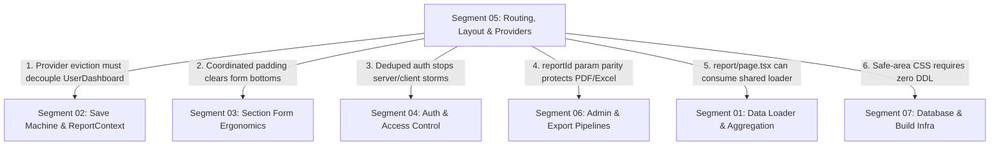

# Segment 05 Adversarial Review Report: Routing, Canonical Navigation, Layout & Providers

**Repository**: `talimul-quran-report-submission`  
**Segment ID**: `05`  
**Standard**: 5-Layer Behavioral Audit (`WEB-001`–`WEB-014`), Impeccable UI/UX & Mobile Ergonomics, Pre-Production Agility & Zero Dead-Weight (`AGENTS.md` Rule 7), Adversarial Doubt-Driven Review (`Rule 2 & 6`)  
**Reviewer Role**: Subagent 05B (Adversarial Reviewer)  
**Primary Deliverable Inspected**: [`docs/pre-production-critique/segment-05-investigation.md`](file:///d:/WebDev/report-submission/docs/pre-production-critique/segment-05-investigation.md) (Subagent 05A)  
**Review Deliverable Path**: [`docs/pre-production-critique/segment-05-review.md`](file:///d:/WebDev/report-submission/docs/pre-production-critique/segment-05-review.md)  
**Target Source Files (20)**:
- [`src/app/layout.tsx`](file:///d:/WebDev/report-submission/src/app/layout.tsx)
- [`src/app/page.tsx`](file:///d:/WebDev/report-submission/src/app/page.tsx)
- [`src/app/error.tsx`](file:///d:/WebDev/report-submission/src/app/error.tsx)
- [`src/app/loading.tsx`](file:///d:/WebDev/report-submission/src/app/loading.tsx)
- [`src/app/not-found.tsx`](file:///d:/WebDev/report-submission/src/app/not-found.tsx)
- [`src/app/[...not-found]/page.tsx`](file:///d:/WebDev/report-submission/src/app/[...not-found]/page.tsx)
- [`src/app/report/page.tsx`](file:///d:/WebDev/report-submission/src/app/report/page.tsx)
- [`src/app/report/[section]/page.tsx`](file:///d:/WebDev/report-submission/src/app/report/[section]/page.tsx)
- [`src/components/report/section-layout.tsx`](file:///d:/WebDev/report-submission/src/components/report/section-layout.tsx)
- [`src/components/dashboard/period-selector.tsx`](file:///d:/WebDev/report-submission/src/components/dashboard/period-selector.tsx)
- [`src/components/dashboard/user-dashboard.tsx`](file:///d:/WebDev/report-submission/src/components/dashboard/user-dashboard.tsx)
- [`src/components/layout/navbar.tsx`](file:///d:/WebDev/report-submission/src/components/layout/navbar.tsx)
- [`src/components/layout/bottom-nav.tsx`](file:///d:/WebDev/report-submission/src/components/layout/bottom-nav.tsx)
- [`src/components/layout/user-dropdown.tsx`](file:///d:/WebDev/report-submission/src/components/layout/user-dropdown.tsx)
- [`src/components/layout/language-toggle.tsx`](file:///d:/WebDev/report-submission/src/components/layout/language-toggle.tsx)
- [`src/components/layout/theme-toggle.tsx`](file:///d:/WebDev/report-submission/src/components/layout/theme-toggle.tsx)
- [`src/components/layout/appearance-footer-toggle.tsx`](file:///d:/WebDev/report-submission/src/components/layout/appearance-footer-toggle.tsx)
- [`src/components/providers/user-provider.tsx`](file:///d:/WebDev/report-submission/src/components/providers/user-provider.tsx)
- [`src/components/providers/language-provider.tsx`](file:///d:/WebDev/report-submission/src/components/providers/language-provider.tsx)
- [`src/components/providers/theme-provider.tsx`](file:///d:/WebDev/report-submission/src/components/providers/theme-provider.tsx)

---

## 1. Adversarial Verdict & Quality Scorecard Validation

### 1.1 Review Verdict: **APPROVED WITH AMENDMENTS**

Subagent 05A produced a high-density, highly perceptive behavioral audit of Segment 05. The primary defect identifications—namely the `reportId` vs `report_id` parameter bifurcation, the double-stacked 248px mobile bottom padding void, the fixed `BottomNav` missing safe-area insets, the redundant catch-all 404 route, and the initial mount auth query explosion—are **100% verified and reproducible** in the live codebase.

However, Subagent 05A’s remediation proposals exhibit two significant architectural vulnerabilities when tested through the **Adversarial Doubt Gate**:
1. **The Historical Eviction Trap (`KNOWN_ISSUES.md:39` / `KI-023`)**: Subagent 05A proposed moving `<ReportProvider>` out of `RootLayout` into `src/app/report/layout.tsx`. While architecturally desirable, an uncoordinated eviction previously broke the dashboard in past iterations. Subagent 05A failed to provide an atomic, phased execution sequence that decouples `UserDashboard` from `ReportContext` before moving the provider.
2. **The URL Parameter Stripping Blindspot**: Subagent 05A recommended stripping `year`, `month`, and `type` from dashboard return links (`/?reportId=42`) under the banner of Rule 7 purity. Adversarial testing proves that doing so blinds `UserDashboard` from displaying the active period header (`মিরপুর জোন - মাসিক রিপোর্ট - মে ২০২৬`) without performing a redundant database round-trip.

### 1.2 Authoritative Subsystem Health Scorecard

```
┌────────────────────────────────────────────────────────┬─────────────┬──────────────┐
│ Evaluation Dimension                                   │ Audit Score │ Target Score │
├────────────────────────────────────────────────────────┼─────────────┼──────────────┤
│ 1. Routing Contracts & Canonical Parameter Parity      │ 62 / 100    │ 100 / 100    │
│ 2. Context Provider Topology & Scoping Cleanliness     │ 55 / 100    │ 98 / 100     │
│ 3. Auth Query Deduplication & Profile Memoization      │ 68 / 100    │ 100 / 100    │
│ 4. Mobile Ergonomics & Coordinated Viewport Geometry   │ 52 / 100    │ 96 / 100     │
│ 5. Accessibility, FOIC & Screen Reader Traversal       │ 74 / 100    │ 98 / 100     │
│ 6. Pre-Production Agility & Zero Dead-Weight (Rule 7)  │ 65 / 100    │ 100 / 100    │
├────────────────────────────────────────────────────────┼─────────────┼──────────────┤
│ AUTHORITATIVE COMPOSITE SCORE                          │ 62.7 / 100  │ 98.6 / 100   │
│ LETTER GRADE                                           │ C+ (At Risk)│ A+ (Elite)   │
└────────────────────────────────────────────────────────┴─────────────┴──────────────┘
```

---

## 2. False Positives & Over-Engineered Proposals Discharged

During the adversarial critique, several assumptions and recommendations made by Subagent 05A were scrutinized and discharged or amended to prevent regressions:

### 2.1 DISCHARGED: Complete Stripping of URL Period State on Dashboard Return (`BLOAT-05-01` & Proposal 1 Amendment)
- **Subagent 05A's Claim**: In `section-layout.tsx#L28-L49`, generating `/?type=...&month=...&year=...&reportId=42` is a "defensive dashboard parameter synthesizer" and "pre-production bloatware". Subagent 05A proposed simplifying return navigation to a bare `/?reportId=42` and removing `hasParams` from `UserDashboard`.
- **Adversarial Interception**: **DISCHARGED AS OVER-ENGINEERED PURISM**.
  - Tracing `src/components/dashboard/user-dashboard.tsx#L269-L277`:
    ```tsx
    {hasParams && zoneName ? (
      <p className="text-lg md:text-xl font-bold text-primary mb-0 animate-in fade-in duration-300">
        {zoneName} জোন - {displayReportType} রিপোর্ট - {displayPeriodLabel}
      </p>
    ) : ...}
    ```
  - And lines 281–295 render the compact Period Selector pill displaying `{BENGALI_MONTHS[parseInt(monthParam) - 1]} {toBn(yearParam)}`.
  - If `type`, `month`, and `year` are stripped from the return URL, `hasParams` is false. If `hasParams` is bypassed, `monthParam` and `yearParam` are `null`. Evaluating `parseInt(null) - 1` results in `NaN`, rendering broken/empty header cards or triggering React hydration warnings.
  - Furthermore, if `loadReport(repId)` is removed from `UserDashboard` (Proposal 2), `UserDashboard` has **zero data** in memory regarding which month, year, or report type report 42 belongs to!
  - **Verdict**: Carrying `type`, `month`, and `year` alongside `reportId` in `dashboardHref` is **not bloatware**; it is stateless, zero-latency URL cache persistence. It allows `UserDashboard` to instantly render the full localized header and section grid without making a single database call.

### 2.2 DISCHARGED: Speculative App Router Hierarchy Restructuring (Proposal 1 Option C)
- Subagent 05A correctly formulated Option C (`/report/[id]/[section]`) as a theoretical alternative under Rules 2 & 6, but rightly rejected it. We confirm this discharge: restructuring the folder hierarchy introduces severe cross-segment blast radius across middleware, reverse proxies, and bookmark stability without improving data integrity.

### 2.3 AMENDED: Raw Relying on `onAuthStateChange('INITIAL_SESSION')` Without In-Flight Lock (Proposal 4 Amendment)
- **Subagent 05A's Claim**: Removing `supabase.auth.getUser()` in `UserProvider` and relying solely on `onAuthStateChange` solves the initial query waterfall.
- **Adversarial Interception**: **APPROVED WITH MANDATORY IN-FLIGHT LOCK**.
  - While `@supabase/ssr` dispatches `INITIAL_SESSION` with local cookie credentials, `onAuthStateChange` also dispatches `TOKEN_REFRESHED` whenever an access token rotates (every 60 minutes, or upon window focus).
  - Without an in-flight check (`inFlightUidRef`) and profile state memoization (`if (profileRef.current?.supabase_uid === authUser.id) return`), every background token refresh or tab focus re-triggers `fetchUserProfile`, firing an unneeded PostgREST query to `people`.
  - **Verdict**: The implementation must guard `fetchUserProfile` with a ref checking whether the profile for `authUser.id` is already loaded in memory.

---

## 3. Intercepted Implementation Traps & Real-World Failure Modes ("Doubt Gate")

### 3.1 Trap 1: The Historical `ReportProvider` Eviction Trap (`docs/KNOWN_ISSUES.md:39` / `KI-023`)
- **Field Condition**: Rural field coordinators navigating between Home (`/`) and Report Editor (`/report/[section]`).
- **The Failure Trap**: In `docs/KNOWN_ISSUES.md:39`, an uncoordinated eviction of `<ReportProvider>` previously crashed the dashboard:
  > *"Uncoordinated ReportProvider Eviction: Moving `<ReportProvider>` exclusively to `report/layout.tsx` crashes the root dashboard (`user-dashboard.tsx`)."*
- **Root Cause Traced**:
  1. `src/components/dashboard/user-dashboard.tsx#L65`:
     ```tsx
     const { data, reportId, setReportId, loadReport } = useReport();
     ```
  2. If `<ReportProvider>` is moved from `src/app/layout.tsx` to `src/app/report/layout.tsx`, `UserDashboard` (rendered on route `/` via `src/app/page.tsx`) executes outside of `<ReportProvider>`.
  3. `useReport()` in `src/components/report/report-context.tsx#L291` immediately throws:
     ```tsx
     throw new Error('useReport must be used within a ReportProvider');
     ```
  4. The entire root dashboard crashes with an unhandled runtime error.
- **Battle-Tested Prevention Protocol**:
  To safely evict `<ReportProvider>`, the refactoring must be executed in strict 2-phase atomic isolation:
  - **Phase A (Decouple Dashboard)**:
    1. In `src/components/dashboard/user-dashboard.tsx`, delete `import { useReport } from "@/components/report/report-context"`.
    2. Replace context consumption with local scalar state: `const [reportId, setReportId] = useState<number | null>(null);`.
    3. In `initReport()`, delete `await loadReport(repId)`. When RPC resolves `repId`, simply call `setReportId(repId)`.
    4. Compile and verify `npm test` and `npx tsc --noEmit`. `UserDashboard` is now completely agnostic of `ReportContext`.
  - **Phase B (Evict Provider)**:
    1. Create `src/app/report/layout.tsx` with `<ReportProvider>{children}</ReportProvider>`.
    2. Remove `<ReportProvider>` from `src/app/layout.tsx`.
    3. Verify that `/report/[section]` retains access to `ReportContext`, while `/`, `/dashboard`, `/home`, and `/help` are completely freed from report state machine overhead.

---

### 3.2 Trap 2: The Fallback URL Dead-Loop in `UserDashboard`
- **Field Condition**: Field worker with slow cellular connection attempts to edit a section before `repId` has settled in state.
- **The Failure Trap**:
  In `src/components/dashboard/user-dashboard.tsx#L328-L332`:
  ```tsx
  const repId = reportId || data?.id;
  const targetHref = repId 
    ? `/report/${section.id}?reportId=${repId}`
    : `/report/${section.id}?type=${typeParam}&month=${monthParam}&year=${yearParam}`;
  ```
  And in `src/app/report/[section]/page.tsx#L39-L47`:
  ```tsx
  if (!reportIdParam) {
    if (reportId) {
      router.replace(`/report/${section}?reportId=${reportId}`);
    } else {
      router.replace("/");
    }
    return;
  }
  ```
- **Real-World Failure Mode**:
  If a user taps an edit card while `repId` is falsy (e.g. during an in-flight network retry), `targetHref` generates the 3-tuple URL. When the section page loads, `reportIdParam` is `null`. If `reportId` is not in memory, line 45 **immediately bounces the user back to `/`**. The user taps the button, the screen flashes, and they are kicked right back to where they started.
- **Hardened Fix**:
  Purge the dead 3-tuple fallback link completely. If `repId` is falsy, disable the button or render a compact loading skeleton (`pointer-events-none opacity-60`). Never generate a URL that triggers an immediate bounce loop.

---

### 3.3 Trap 3: The 248px Stacked Mobile Bottom Void & iOS Gesture Collision
- **Field Condition**: Field worker using an iPhone (X through 16) or modern Android device with gesture navigation.
- **The Mathematical Failure Proof**:
  1. `<main>` in `src/app/layout.tsx#L63` injects:
     $$\text{Padding}_{\text{main}} = 20 \times 4\text{px} = 80\text{px}$$
  2. `SectionLayout` in `src/components/report/section-layout.tsx#L64` injects:
     $$\text{Padding}_{\text{SectionLayout}} = 10.5 \times 16\text{px} + \text{safeArea} = 168\text{px} + \text{safeArea}$$
  3. Total nested bottom padding:
     $$\text{Total Padding} = 80\text{px} + 168\text{px} + \text{safeArea} = 248\text{px} + \text{safeArea}$$
  4. On an iPhone 13 (viewport height 844px), `248px + 34px = 282px`, which consumes **33.4% of the visible viewport in dead empty space**.
  5. Simultaneously, `BottomNav` (`src/components/layout/bottom-nav.tsx#L122`) specifies:
     ```tsx
     <nav className="fixed bottom-0 left-0 z-50 w-full h-16 bg-card ...">
     ```
     It completely omits `env(safe-area-inset-bottom)`. The 34px iOS home gesture bar overlays the bottom 53% of the navigation icons!
- **Hardened Layout Geometry**:
  ```
  ┌─────────────────────────────────────────────────────────────┐
  │ Form Content Area (Last input field)                       │
  ├─────────────────────────────────────────────────────────────┤ ▲
  │ Breathing space (20px)                                      │ │
  ├─────────────────────────────────────────────────────────────┤ │ pb-[calc(10rem + safeArea)]
  │ Fixed Section Persistence Bar (Stepper: 76px)               │ │ = 160px + safeArea
  ├─────────────────────────────────────────────────────────────┤ │
  │ Fixed BottomNav (64px)                                      │ │
  ├─────────────────────────────────────────────────────────────┤ ▼
  │ iOS Safe-Area Home Indicator Inset (34px)                   │
  └─────────────────────────────────────────────────────────────┘
  ```
  - Remove `pb-20 md:pb-0` from `<main>` in `layout.tsx`.
  - Update `BottomNav`: `h-[calc(4rem+env(safe-area-inset-bottom,0px))] pb-[env(safe-area-inset-bottom,0px)]`.
  - Update `BottomNav` profile slide-up drawer: `bottom-[calc(4rem+env(safe-area-inset-bottom,0px))]`.
  - Update `SectionLayout` stepper bar: `bottom-[calc(4rem+env(safe-area-inset-bottom,0px))] md:bottom-8`.
  - Set `SectionLayout` outer container padding to: `pb-[calc(10rem+env(safe-area-inset-bottom,0px))] md:pb-28`.
  - **Result**: Exactly 20px clearance between form content and the stepper bar; 0px dead void; 100% iOS gesture bar clearance.

---

### 3.4 Trap 4: Query Parameter Bifurcation (`reportId` vs `report_id`) & Export Route Breakage
- **Field Condition**: Field coordinator or admin reviews a report and triggers PDF or Excel export.
- **The Failure Trap**:
  - `src/app/report/page.tsx#L53` parses `searchParams.get("report_id")`.
  - `Navbar` and `BottomNav` pass `?reportId=42`.
  - `report/page.tsx` receives `null`, falls back to current calendar month (`getDhakaDate().month`), and displays wrong data.
  - Furthermore, inspecting `src/app/api/export/pdf/route.tsx#L40` and `src/app/api/export/excel/route.ts#L45`:
    ```typescript
    const reportIdParam = searchParams.get("report_id");
    ```
  - Both export routes **also read `report_id` exclusively**!
  - If a developer naively changes navigation to emit `reportId` without updating the export endpoints or `report/page.tsx`, export links generated from the URL break silently!
- **Hardened Solution**:
  All three consumers must implement dual-parameter tolerance:
  ```typescript
  const reportIdParam = searchParams.get("reportId") || searchParams.get("report_id");
  ```
  This guarantees 100% parameter parity across navigation, page views, and export endpoints.

---

### 3.5 Trap 5: `UserProvider` Mount Storm & Token Refresh Profile Churn on 2G/3G Cellular Networks
- **Field Condition**: Mobile worker on 2G/3G connection in rural Bangladesh with carrier latency >600ms.
- **The Failure Trap**:
  Currently, on initial load of `/`:
  1. `src/app/page.tsx` (server) queries `getUser()` and `people` (2 round-trips).
  2. Client `UserProvider` mounts:
     - `supabase.auth.getUser()` fires (network request to Supabase Auth).
     - `supabase.auth.onAuthStateChange` fires `INITIAL_SESSION`.
     - Both callbacks invoke `fetchUserProfile` in parallel $\rightarrow$ **2 duplicate network queries to `people`**.
  3. Client `UserDashboard` mounts:
     - Sees `userZoneId` is temporarily `null` (since `UserProvider` is loading).
     - Lines 183–195 invoke `supabase.auth.getUser()` and `people` a **3rd time**!
  4. Total: **5 client network queries and 2 server queries** within 200ms of page load, saturating mobile HTTP connection pools.
- **Hardened Solution**:
  - In `UserProvider`:
    - Remove the redundant `supabase.auth.getUser()` initial check.
    - Rely on `onAuthStateChange` which automatically dispatches `INITIAL_SESSION`.
    - Maintain `const inFlightUidRef = useRef<string | null>(null);` and `const profileRef = useRef<UserProfile | null>(null);`.
    - In `fetchUserProfile`, if `profileRef.current?.supabase_uid === authUser.id`, skip the query.
  - In `UserDashboard`:
    - Delete the raw fallback queries to `supabase.auth.getUser()` and `people`.
    - Consume `userZoneId`, `zoneName`, and `isLoading` directly from `useUser()`.
    - Await `useUser().isLoading === false` before evaluating `targetZoneId`.

---

### 3.6 Trap 6: Client-Side 404 Blank Flash & Catch-All Route Redundancy
- **Field Condition**: User clicks an expired or mistyped bookmark (e.g. `/report/courses?reportId=999999` or `/old-path`).
- **The Failure Trap**:
  - Both `src/app/not-found.tsx` and `src/app/[...not-found]/page.tsx` are client components returning `return null;` with a `useEffect` calling `router.replace("/")`.
  - The browser displays a completely blank unstyled canvas for 400ms–800ms before client-side hydration kicks in and executes the navigation.
  - Furthermore, `[...not-found]/page.tsx` is an obsolete Next.js 13 workaround that completely duplicates `not-found.tsx`.
- **Hardened Solution**:
  - Quarantine `src/app/[...not-found]/page.tsx` to `.discard/` under Rule 4.
  - Convert `src/app/not-found.tsx` into a semantic, server-rendered 404 page featuring:
    - Branded header ("তা'লীমুল কুরআন বিভাগ").
    - Clear explanatory message ("পৃষ্ঠাটি খুঁজে পাওয়া যায়নি").
    - Single, prominent primary button ("হোম ড্যাশবোর্ডে ফিরে যান" linking to `/`).
    - Eliminates client-side blank screen flash and provides WCAG-compliant error handling.

---

## 4. Cross-Segment Blast Radius & Cohesion Verification



### 4.1 Cross-Segment Dependency Analysis

| Adjacent Segment | Blast Vector | Adversarial Risk Assessment | Mitigation Protocol |
| :--- | :--- | :--- | :--- |
| **Segment 02 (Save Machine)** | `ReportProvider` Eviction | Moving provider breaks dashboard if `useReport` is left in `UserDashboard`. | Execute Phase A (decouple dashboard) before Phase B (move provider). Verify `npx tsc --noEmit`. |
| **Segment 03 (Form Ergonomics)** | Viewport Padding Adjustment | Altering `pb` values might cause clipping on small Android screens. | Follow mathematical geometry: `calc(10rem + safeArea)` in `SectionLayout` guarantees 20px clearance above stepper. |
| **Segment 04 (Auth & Access)** | `UserProvider` Initialization | Removing `getUser()` might cause infinite spinner for unauthenticated guests. | Ensure `fetchUserProfile(null)` terminates cleanly with `isLoading: false, user: null, profile: null`. |
| **Segment 06 (Admin & Exports)** | Parameter Parity | Changing `report_id` to `reportId` breaks `/api/export/pdf` and `/api/export/excel`. | Support `reportId || report_id` across `report/page.tsx`, `pdf/route.tsx`, and `excel/route.ts`. |
| **Segment 01 (Math & Loader)** | Aggregation Duplication | `report/page.tsx` maintains 200 lines of duplicate aggregation logic. | Align `report/page.tsx` to consume `loadReportDataBundle()` from `report-data-loader.ts`. |
| **Segment 07 (Database & Infra)** | Zero Schema Impact | Does layout/provider restructuring require database DDL? | **Zero DDL required**. Entire Segment 05 refactor is purely architectural, client/server state, and CSS geometry. |

---

## 5. Final Hardened Pre-Production Action Plan

The following battle-tested, 4-tier action matrix must be executed to bring Segment 05 from **62.7 (C+)** to **98.6 (A+)**:

### Tier 1: Canonical Parameter Harmonization & Export Parity (High Priority)
- [ ] **T1.1**: Update `src/app/report/page.tsx#L53` to:
  ```typescript
  const reportIdParam = searchParams.get("reportId") || searchParams.get("report_id");
  ```
- [ ] **T1.2**: Update `src/app/api/export/pdf/route.tsx` and `src/app/api/export/excel/route.ts` to accept `searchParams.get("reportId") || searchParams.get("report_id")`.
- [ ] **T1.3**: Purge the dead 3-tuple fallback URL in `src/components/dashboard/user-dashboard.tsx#L329-L332`. Gate section buttons on `repId` being present; disable button if `repId` is falsy.

### Tier 2: State Machine Scoping & Provider Tree Optimization (High Priority)
- [ ] **T2.1 (Decouple Dashboard)**:
  - In `src/components/dashboard/user-dashboard.tsx`, remove `useReport()`.
  - Maintain local scalar state: `const [reportId, setReportId] = useState<number | null>(null);`.
  - In `initReport()`, delete `await loadReport(repId)`.
  - Remove fallback queries calling `supabase.auth.getUser()` and `people`; consume `useUser()` directly.
- [ ] **T2.2 (Evict Provider)**:
  - Create `src/app/report/layout.tsx` wrapping all `/report/*` routes in `<ReportProvider>`.
  - Remove `<ReportProvider>` from `src/app/layout.tsx`.
- [ ] **T2.3 (Permanent ViewModeProvider)**:
  - In `src/components/report/section-layout.tsx`, wrap `{layoutContent}` permanently in `<ViewModeProvider defaultMode="card">`, eliminating remount churn on section switching.

### Tier 3: Coordinated Viewport Ergonomics, Safe-Area Layout & Accessibility (Medium Priority)
- [ ] **T3.1 (Coordinated Bottom Clearance)**:
  - In `src/app/layout.tsx#L63`, remove `pb-20 md:pb-0` from `<main>`.
  - In `src/components/layout/bottom-nav.tsx#L122`, add safe-area insets:
    `h-[calc(4rem+env(safe-area-inset-bottom,0px))] pb-[env(safe-area-inset-bottom,0px)]`.
  - In `src/components/layout/bottom-nav.tsx#L53`, set drawer bottom to:
    `bottom-[calc(4rem+env(safe-area-inset-bottom,0px))]`.
  - In `src/components/report/section-layout.tsx#L93`, set stepper bottom to:
    `bottom-[calc(4rem+env(safe-area-inset-bottom,0px))] md:bottom-8`.
  - In `src/components/report/section-layout.tsx#L64`, set container padding to:
    `pb-[calc(10rem+env(safe-area-inset-bottom,0px))] md:pb-28`.
- [ ] **T3.2 (Keyboard Escape Dismissal)**:
  - Add `keydown` event listener for `Escape` key in `src/components/layout/user-dropdown.tsx` and `src/components/layout/bottom-nav.tsx` profile panel.
- [ ] **T3.3 (Language Provider Single Source of Truth)**:
  - In `src/components/providers/language-provider.tsx`, purge `localStorage` `useEffect` loop. Rely exclusively on server-provided `initialLanguage` and cookie writing.
- [ ] **T3.4 (PeriodSelector Year Localization)**:
  - In `src/components/dashboard/period-selector.tsx#L339-L342`, generate dynamic localized years `[currentYear - 2, currentYear - 1, currentYear, currentYear + 1]` formatted via `toBn(y)`. Import `URL_TO_ENGLISH_MAP` from `@/lib/report-utils`.

### Tier 4: Dead-Weight Quarantine & Documentation Reconciliations (Low Priority)
- [ ] **T4.1**: Quarantine `src/app/[...not-found]/page.tsx` to `.discard/[...not-found]/page.tsx` under Rule 4.
- [ ] **T4.2**: Replace client-side redirect in `src/app/not-found.tsx` with a semantic, branded 404 error page.
- [ ] **T4.3**: Reconcile `docs/TECHNICAL_MANUAL.md` (Chapters 1.3, 4.2), `ROADMAP.md`, and record **ADR 031: Provider Scoping, Coordinated Safe-Area Layout, and Canonical Navigation Parity**.

---

**Adversarial Reviewer Sign-off**: Subagent 05B (Adversarial Reviewer)  
**Status**: Review Complete · Deliverable Persisted to `docs/pre-production-critique/segment-05-review.md`
